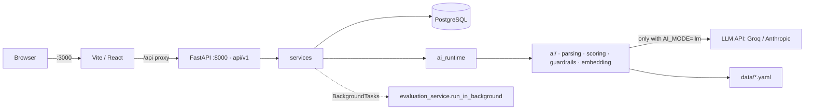
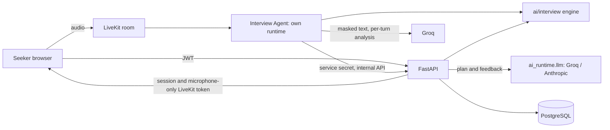
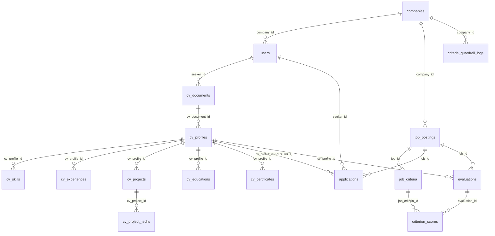
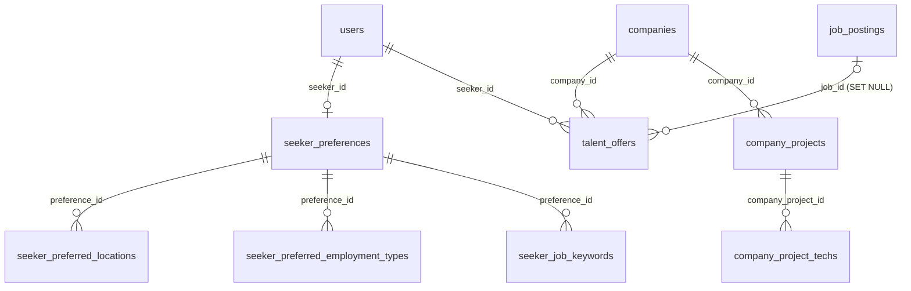

# CareerSync — Project Documentation

> Decisions and scope: see docs/DECISIONS.md. If the two conflict, DECISIONS.md is right.
>
> Rules for AI coding assistants: [§10](#10-development-rules) (assistant-specific instructions are in a local, untracked CLAUDE.md).
> Written against `main` at commit `5615851` (2026-10-25). The code is the reference (D87): if the code differs from this document, update the document; a behaviour that looks like a bug is reported to Long, not documented as correct.
> [Planned] items come from the design document 「AI 소프트웨어 기본설계서 및 상세설계서」 (AI software basic and detailed design document) v1.0 (2026-10-11), which is not a source of decisions.
>
> Labels: **[Current]** in the code and working · **[DB only]** tables exist, no API/logic yet · **[Planned]** intended direction, no working feature yet; a decision only where docs/DECISIONS.md says so (the practice interview is: D51–D62) · **[Recommended]** a suggestion, not agreed · `TBD` not decided.

## Contents

1. [Overview](#1-overview)
2. [Architecture](#2-architecture)
3. [Database](#3-database)
4. [API](#4-api)
5. [Frontend](#5-frontend)
6. [AI / ML](#6-ai--ml)
7. [Coding conventions](#7-coding-conventions)
8. [Files and folders](#8-files-and-folders)
9. [Environment and configuration](#9-environment-and-configuration)
10. [Development rules](#10-development-rules)
11. [Known issues and risks](#11-known-issues-and-risks)
12. [Glossary](#12-glossary)

---

## 1. Overview

**CareerSync** — 기업 맞춤형 AI 채용 매칭 플랫폼 (criteria-based hiring and job matching).

**Idea.** Each company defines **evaluation criteria + weights** per job. The same criteria are used to (1) score applicants and (2) recommend the company's jobs to people who have not applied. AI provides scores and evidence only; **the recruiter makes every decision**.

**Users.** `company` (recruiter; 1 account = 1 company) and `seeker` (job seeker).

| Feature                                                                                    | Status    | Note                                                                                                                                                                                                                                                                                                                 |
| ------------------------------------------------------------------------------------------ | --------- | -------------------------------------------------------------------------------------------------------------------------------------------------------------------------------------------------------------------------------------------------------------------------------------------------------------------- |
| Register / log in with privacy + AI-analysis consent; re-consent and AI-consent withdrawal | [Current] | D17                                                                                                                                                                                                                                                                                                                  |
| Company profile (name, intro, 인재상 (talent profile))                                     | [Current] |                                                                                                                                                                                                                                                                                                                      |
| Company running projects                                                                   | [Current] | `/api/companies/me/projects`, shown on the public company profile; context for AI JD drafts; never used in scoring (D23)                                                                                                                                                                                             |
| Jobs: draft → published → closed                                                           | [Current] |                                                                                                                                                                                                                                                                                                                      |
| Private job text or project specification, or poster OCR, to editable criteria and weights | [Current] | Company reviews OCR and suggestions; input is not published |
| AI suggests criteria from the JD (`/analyze`)                                              | [Current] | Used by the job editor. Suggestions that saving would reject are left out (D24, issue 7)                                                                                                                                                                                                                             |
| AI drafts a JD for a draft job (`/jd-draft`)                                               | [Current] | Used by the job editor; not saved (D24)                                                                                                                                                                                                                                                                              |
| Criteria + weights with a legal guardrail                                                  | [Current] |                                                                                                                                                                                                                                                                                                                      |
| CV PDF upload → PII masking → structuring → seeker edits and confirms                      | [Current] |                                                                                                                                                                                                                                                                                                                      |
| Apply → background scoring → applicants ranked by Fit with evidence                        | [Current] |                                                                                                                                                                                                                                                                                                                      |
| Recruiter CV-verification questions (maximum 3) | [Current] | Employer-only, quoted evidence + criterion + interview check; separate from seeker practice interview |
| Recruiter changes application status                                                       | [Current] |                                                                                                                                                                                                                                                                                                                      |
| Job list / detail without login                                                            | [Current] | `GET /api/jobs`, `GET /api/jobs/{job_id}` are public; the token is optional (D4)                                                                                                                                                                                                                                     |
| Seeker preferences (input for Pref)                                                        | [Current] | `GET`/`PUT /api/preferences/me`; Pref in `ai/scoring/pref.py`, used by job recommendation and talent recommendation                                                                                                                                                                                                  |
| AI self-check of a CV version (strengths / improvements, no score)                         | [Current] | `POST /api/cv/{profile_id}/review` (D25)                                                                                                                                                                                                                                                                             |
| Skill roadmap and interview practice questions for a job                                   | [Current] | `POST /api/jobs/{job_id}/roadmap`, `POST /api/jobs/{job_id}/interview-questions` (D21)                                                                                                                                                                                                                               |
| AI practice interview: real-time voice, feedback report, no scores | [Planned] | Decided in D51–D64. The engine `ai/interview/` exists ([§6.2](#62-practice-interview-engine)), and so do the backend services up to the feedback service (M4 S1–S3c) and the seeker API (the seven endpoints of D67, S4.1 to S4.5, [§2.1](#21-practice-interview-architecture-planned)); the Interview Agent (M5) and the frontend (M6) are planned |
| Job recommendation (Fit + Pref)                                                            | [Current] | `GET /api/recommendations/jobs` ([§6.1](#61-recommendation)); seeker page 추천 공고 (Recommended jobs) shows the match score with its band (매우 적합 / 적합 / 참고: very good / good / reference), category scores and the preference score (D42); the job list and job detail show existing scores read-only (D43) |
| Talent recommendation (opt-in, anonymous, offers)                                          | [Current] | `GET /api/jobs/{job_id}/talent` (D19), `/api/talent-offers*` (D20) ([§6.1](#61-recommendation))                                                                                                                                                                                                                      |
| Bias audit, AI cache                                                                       | [Planned] | No code yet                                                                                                                                                                                                                                                                                                          |
| Delete CV / account                                                                        | Deferred  | Later phase, not rejected (docs/DECISIONS.md D34)                                                                                                                                                                                                                                                                    |

**End-to-end flow**

```
Company: register → profile → create job (draft) → (optional) AI suggests criteria → save criteria (guardrail) → publish
Seeker:  register → upload CV PDF → AI structures it → edit + confirm → browse jobs → apply
System:  create evaluation (pending) → background task scores each criterion → store scores + evidence
Company: applicants ranked by Fit → per-criterion score + evidence → change status
```

---

## 2. Architecture

| Part        | Technology                                                                                                                                | Location                                  |
| ----------- | ----------------------------------------------------------------------------------------------------------------------------------------- | ----------------------------------------- |
| Frontend    | React 19, TypeScript, Vite, React Router. Korean UI, desktop-first                                                                        | `frontend/`                               |
| Backend     | Python 3.11+, FastAPI, SQLAlchemy 2, Alembic, Pydantic 2                                                                                  | `backend/app/`                            |
| Database    | PostgreSQL 16 (tests: in-memory SQLite, or a disposable local PostgreSQL via `TEST_DATABASE_URL`)                                                            | `backend/migrations/`                     |
| AI          | Groq (`openai/gpt-oss-120b`, demo default) or Anthropic Claude via `LLMClient` (`LLM_PROVIDER`, D91), sentence-transformers `intfloat/multilingual-e5-base` (fallback `hashing-ngram-v1`), PyMuPDF, Tesseract (local poster OCR) | `ai/`                                     |
| Auth        | JWT HS256 (PyJWT), Argon2id passwords, Bearer token                                                                                       | `backend/app/core/security.py`, `deps.py` |
| Static data | Legal blocklist, skill dictionary (YAML)                                                                                                  | `data/`                                   |
| Infra       | Docker Compose: `db`, `init` (migrate + seed), `backend`, `frontend`, and the optional `agent` (profile `voice`)                          | `docker-compose.yml`                      |



**Layers.** `api/v1` checks permissions (dependencies `CurrentUser`, `CompanyUser`) and maps schemas → `services` hold business logic and DB access, and call `ai/` through `services/ai_runtime.py` → `models` are the ORM. `ai/` never imports `app.*`.

**Errors.** Services raise `AppError(status, CODE, "Korean message", **extra)` → JSON `{"code", "message", ...}`. Validation errors: 422 `{"detail": [...]}`. Missing/invalid token: 401; non-company on a company route: 403. Another company's job returns 404 `JOB_NOT_FOUND` on purpose.

**Main data flows**

- **CV upload:** PDF (≤ 5 MB, ≤ 5 pages, text only) → `ai.parsing.pdf` → `ai.parsing.pii` masks PII → `cv_documents.masked_text` (the PDF itself is not stored) → `structure_cv` (LLM or rules) → `CvProfile` → `cv_service._fill_relational_profile` writes it into the `cv_*` tables as profile version 1.
- **CV read:** `cv_service.to_profile_data(row)` rebuilds the `CvProfile` model from the `cv_*` tables. The API response and the AI input both use this `CvProfile` shape (`cv_profile.v1`).
- **CV edit:** every save creates a new `cv_profiles` version (new child rows); `confirm=true` sets `confirmed_at`.
- **Apply:** seeker + published, unexpired job + AI consent + newest CV confirmed + not applied → `applications` + `evaluations` (pending, keyed by job × CV version) → background scoring → `criterion_scores`.
- **Ranking:** Fit is computed at read time from stored scores and the **current** weights (`criteria_service.load_for_scoring`), so a weight change re-ranks without any AI call.

### 2.1 Practice interview architecture [Planned]

The seeker practice interview is decided (D51–D62). The pure engine `ai/interview/` exists, with its model-independent LLM layer and the final feedback generator ([§6.2](#62-practice-interview-engine)). Of M4 (backend and database), the tables, the daily quota ledger, the backend services (stages S1 to S3c: lifecycle, ingestion of turns and of the end, the feedback service) and the seeker API (the seven endpoints of D67, stages S4.1 to S4.5) exist (§3.7); of M5 (D80, D81), the internal agent API (stage S1), the agent core with a text driver for developers (`interview_agent/`, stage S2), the consent-withdrawal rule (S3), and the voice worker with optional Anam Avatar integration (`D90`, falling back gracefully to audio-only), the seeker's join token, and a developer test page (`interview_agent/devclient/`) exist. On 22/11/2026 and 23/11/2026, live voice runs (`AI_MODE=llm`, sessions 3 and 6) verified room dispatch, Korean turn detection, end-to-end latency, the Groq timeout fallback, live PII masking, and a join into an existing room; on 25/11/2026, the Compose `agent` image switched to the frozen Linux lock (`interview_agent/requirements.linux.lock.txt` with `--no-deps` and `pip check`), and sessions 8 to 11 on the Compose stack (driven by a headless `livekit.rtc` participant interrupting active agent TTS audio) closed the remaining live checklist items (`C6a` timing, `C6b`–`C6d`, `C8`, Compose `rules` mode, live backend `GroqClient` plan generation, and PostgreSQL feedback). Anam Avatar with audio-only fallback (`D90`) is wired and live-verified on Compose across sessions 12 to 14 (`interview_agent/` `voice.py`, `config.py`, `timing.py` and `interview_agent/devclient/`: audio-only mode, error fallback, and live Anam video/audio streaming); still planned: M6 (full frontend rebuild including interview UI, D88).



| Step                            | Where                                | Model (D52)                                                                                                       |
| ------------------------------- | ------------------------------------ | ----------------------------------------------------------------------------------------------------------------- |
| Plan (questions, rubric points) | Backend, when a session is created   | `ai_runtime.llm()` in `AI_MODE=llm`, else the template; the D21 question bank is reused and cached                |
| Per-turn answer analysis        | Interview Agent                      | Groq `openai/gpt-oss-120b` through LiveKit's Groq plugin, or the engine's rules (D54); `AI_MODE=rules` uses rules |
| Final feedback                  | Backend, when the seeker asks for it | `ai_runtime.llm()` in `AI_MODE=llm`, else the rules version                                                       |

- **The engine decides, everything else carries.** The agent is a separate runtime (`interview_agent/`, D56). It hands each transcribed answer to the engine and speaks the engine's next line; it never decides what to ask and never touches the database. The backend builds the plan, checks the D51 gates, stores the masked turns and writes the feedback.
- **Tokens and internal calls (D58).** The browser gets a microphone-only LiveKit token for one new room (no camera or screen track). The agent is dispatched with only the session id as metadata, because a participant can read the metadata inside its own token. The internal endpoints accept a service secret that the browser never sees and the room name of the session, and only while the session is created or live. That check lives in its own module; `backend/app/core/security.py` and `backend/app/core/deps.py` stay unchanged.
- **Privacy (D53).** Masked text only, never audio or video. Spoken text is masked before any model sees it, then masked again and its quotes re-verified by the backend before storing. Only the owning seeker reads a transcript or its feedback; companies never do. Sessions can be deleted and expire after 30 days. Consent and expiry are decided in D65 (a consent per session, a 30-day expiry that hides the session, and a deletion that a lazy purge and a script carry out, the script needing an external scheduler); the processors involved are Q35, still open.
- **Modes (D54, D55).** `AI_MODE=rules` needs no key: the engine's rules, template questions, rules feedback. A failing model call degrades that one turn to the rules and records the method. Interviews work audio-only; the avatar is optional.
- **Unchanged by this feature:** `ai/llm/client.py`, scoring and the company side. The interview reads no evaluation and no weight.

---

## 3. Database

PostgreSQL 16, Alembic migrations `0001` → `0012`. List the current tables with:
`python -c "import app.models; from app.db.session import Base; print(sorted(Base.metadata.tables))"` (from `backend/`).
JSON columns are `JSONB` on PostgreSQL and `JSON` on SQLite. All `created_at`/`updated_at` columns are `timestamptz` with `now()` defaults.

### 3.1 Accounts and companies

**`companies`** — `id` PK · `name` varchar(100) · `intro` text (≤1000) · `talent_profile` text (인재상, ≤1000; added to scoring of `other` criteria) · `created_at`, `updated_at`

**`users`** — `id` PK · `email` varchar(255), unique on `lower(email)` · `password_hash` (Argon2id) · `display_name` varchar(50) (shown to recruiters, masked out of CV text) · `role` `seeker`|`company` · `company_id` FK → companies (CASCADE; required when role is company) · `consent_privacy_at`, `consent_ai_at` (AI consent required to apply), `consent_version` · `created_at`

### 3.2 Jobs and criteria

**`job_postings`** — `id` PK · `company_id` FK → companies (CASCADE) · `title` varchar(200) · `description` text (JD, ≤10000, required to publish) · `employment_type` `full_time`|`contract`|`intern` · `min_experience_years` smallint 0–30, NULL = 신입 가능 (entry level allowed) · `location`, `salary_note` varchar(100) free text · `deadline` date · `status` `draft`|`published`|`closed` · `criteria_updated_at` · `published_at`, `closed_at` · `created_at`, `updated_at`.
After publishing only `deadline`, `location`, `salary_note` change; `closed` is final; only drafts can be deleted.

**`job_criteria`** — `id` PK · `job_id` FK → job_postings (CASCADE) · `name` varchar(50), unique per job on `lower(trim(name))` · `description` text (rubric, ≤500) · `category` `skill`|`experience`|`project`|`certificate`|`education`|`other` · `weight` 1–100 · `position` · `guardrail_version` · `created_at`, `updated_at`.
Service rules: 1–`CRITERIA_MAX_ITEMS` criteria, unique names, weights sum to `CRITERIA_WEIGHT_TOTAL`; an `education` criterion names at least one major or 이공계/STEM (checked on draft save, copy and publish); after publishing only weights and order change.

**`criteria_guardrail_logs`** — one row per blocked input: `company_id` FK (CASCADE), `job_id` FK (SET NULL), `input_name`, `input_description`, `rule_id`, `category`, `law_ref`, `blocklist_version`, `created_at`.

### 3.3 CVs

**`cv_documents`** — `id` PK · `seeker_id` FK → users (CASCADE) · `file_name` · `sha256` (unused so far) · `pages` · `masked_text` (the only text the LLM and evidence checks see) · `masked_kinds` JSON · `created_at`

**`cv_profiles`** — one row per CV version: `id` PK · `cv_document_id` FK (CASCADE) · `seeker_id` FK → users (CASCADE) · `version` (unique per document) · `schema_version` (`cv_profile.v1`) · `method` (`rules`, `llm:<model>`, `seeker`) · `summary` text · `confirmed_at` (only confirmed versions can be used to apply) · `created_at`.

Child tables of `cv_profiles` (all `cv_profile_id` FK → cv_profiles, CASCADE, indexed; read back in `id` order):

| Table              | Columns                                                                                                                 |
| ------------------ | ----------------------------------------------------------------------------------------------------------------------- |
| `cv_skills`        | `skill_name` varchar(100)                                                                                               |
| `cv_experiences`   | `org`, `role` varchar(100) · `start`, `end` varchar(7) `YYYY-MM`, nullable · `description` text · `source` varchar(500) |
| `cv_projects`      | `name` varchar(200) · `role` varchar(100) · `description` text · `source` varchar(500)                                  |
| `cv_project_techs` | `cv_project_id` FK → cv_projects (CASCADE) · `tech_name` varchar(100)                                                   |
| `cv_educations`    | `school`, `major` varchar(100) · `degree` varchar(20) · `source` varchar(500)                                           |
| `cv_certificates`  | `name` varchar(100) · `date` varchar(7) nullable · `source` varchar(500)                                                |

`source` = the CV line an item was read from. Seekers can edit it (see [issue 3](#11-known-issues-and-risks)).

### 3.4 Applications and evaluation

**`applications`** — `id` PK · `job_id` FK (CASCADE) · `seeker_id` FK → users (CASCADE) · `cv_profile_id` FK → cv_profiles (**RESTRICT**) · `status` `submitted`|`reviewing`|`interview`|`on_hold`|`passed`|`rejected` (recruiter only) · `status_updated_at` · `created_at`. Unique (`job_id`, `seeker_id`).

**`evaluations`** — `id` PK · `job_id` FK (CASCADE) · `cv_profile_id` FK (CASCADE) · `status` `pending`|`done`|`failed` · `error` · `llm_model`, `embedding_model`, `prompt_version`, `skills_version` · `created_at`, `finished_at` · `queued_at` timestamptz, nullable · `attempts` smallint ≥ 0, default 0. Unique (`job_id`, `cv_profile_id`) — keyed by job × CV version, **not** by application, so recommendation can reuse it.

`queued_at`/`attempts`: migration `0008` (backfill `queued_at = created_at`, `attempts = 1`). Set by `evaluation_service.claim()` on every queue (apply, retry); the run writes its result only while `queued_at` still equals the value it was queued with (fencing). Rules: [§6.1](#61-recommendation).

**`criterion_scores`** — `evaluation_id` FK (CASCADE) · `job_criteria_id` FK (CASCADE) · `score` 0–100 · `level` · `reason` · `evidence` JSON (quotes) · `method` (`rule:skill`, `llm:<model>`, `retrieval`, …). Unique (`evaluation_id`, `job_criteria_id`). Weights are **not** stored.

### 3.5 Matching groundwork

Created in `0007`. The four `seeker_*` tables are used by `/api/preferences/me`; `talent_offers` is used by talent offers (D20); `company_projects*` are used by `/api/companies/me/projects` (D23).

| Table                               | Columns                                                                                                                                                                                                                                                        | Purpose                                                                                                                                                                                                  |
| ----------------------------------- | -------------------------------------------------------------------------------------------------------------------------------------------------------------------------------------------------------------------------------------------------------------- | -------------------------------------------------------------------------------------------------------------------------------------------------------------------------------------------------------- |
| `seeker_preferences`                | `seeker_id` FK → users (CASCADE), unique · `profile_public` bool default false · `profile_public_at` · `created_at`, `updated_at`                                                                                                                              | One row per seeker. `profile_public` = opt-in to appear anonymously in talent recommendation                                                                                                             |
| `seeker_preferred_locations`        | `preference_id` FK (CASCADE) · `location` varchar(100); unique per preference                                                                                                                                                                                  | Desired work locations (free text)                                                                                                                                                                       |
| `seeker_preferred_employment_types` | `preference_id` FK (CASCADE) · `employment_type` `full_time`\|`contract`\|`intern`; unique per preference                                                                                                                                                      | Desired employment types                                                                                                                                                                                 |
| `seeker_job_keywords`               | `preference_id` FK (CASCADE) · `keyword` varchar(100); unique per preference                                                                                                                                                                                   | Desired role keywords (free text)                                                                                                                                                                        |
| `talent_offers`                     | `company_id` FK (CASCADE) · `seeker_id` FK → users (CASCADE) · `job_id` FK (SET NULL, optional) · `status` `pending`\|`accepted`\|`rejected`\|`cancelled` · `message` varchar(1000), nullable (`0009`) · `created_at`, `responded_at`                          | Offers from a company to a seeker. `expired` is not stored: a `pending` offer older than `OFFER_EXPIRY_DAYS` is shown as expired. Contact details stay in `users` and are returned only after `accepted` |
| `company_projects`                  | `company_id` FK (CASCADE) · `name` varchar(200) · `description` text · `created_at`, `updated_at`                                                                                                                                                              | Company's running projects                                                                                                                                                                               |
| `company_project_techs`             | `company_project_id` FK (CASCADE) · `tech_name` varchar(100); unique per project                                                                                                                                                                               | Technologies of a project                                                                                                                                                                                |
| `career_contents` (`0010`)          | `seeker_id` FK → users, `job_id` FK, `cv_profile_id` FK (all CASCADE) · `kind` `roadmap`\|`interview` · `prompt_version` · `method` (`rules` or `llm:<model>`) · `content` JSON · `created_at`; unique (seeker, job, CV version, kind, prompt version, method) | Cached career content (D21): roadmaps and interview questions. Template fallbacks after an LLM failure or over the daily limit are not stored                                                            |
| `cv_reviews` (`0011`)               | `cv_document_id` FK → cv_documents, `seeker_id` FK → users (both CASCADE, indexed) · `prompt_version` · `method` (`llm:<model>`) · `content` JSON (`strengths`, `improvements`) · `created_at`; unique (document, prompt version, method)                      | The LLM part of a CV self-check (D25), per CV document: every version shares the masked text. Rule findings are computed per request; rules results and fallbacks are not stored                         |

### 3.6 ERD





### 3.7 Planned: practice interview tables [Planned]

The tables and the daily quota ledger `interview_quota` exist since migration `0012`. Stage S2 added the backend services that create, read, end and delete sessions and purge expired ones; until S4 no endpoint exposed them, and since S4.1 one router, `backend/app/api/v1/interview_sessions.py`, serves the seeker API (S4.1 to S4.5: the consent text, the creation, the history, the detail, the end, the delete and the feedback of a session). Stage S3a added the services that store the turns and the end of an interview (`record_turn`, `record_end`); nothing calls them yet, since the agent that would is M5. Stage S3b added the feedback service (`stored`, `ensure`); the feedback route (S4.5) calls `ensure`, and `stored` has no caller. The tables below are the schema of migration `0012`, as the models in `backend/app/models/interview.py` define it. They replace the earlier working design: there is no `expired` status (expiry is derived from `expires_at`), and no room-name or avatar column. Where a column holds JSON it is `JSONB` on PostgreSQL, and a null is stored as SQL NULL.

| Table | Columns | Constraints and indexes |
| ----- | ------- | ----------------------- |
| `interview_sessions` | `id` · `seeker_id`, `job_id`, `cv_profile_id` (FKs to `users`, `job_postings`, `cv_profiles`, all CASCADE) · `status` (`planning`, `created`, `live`, `completed`, `aborted`) · `end_reason` (a code, at most 40 characters, never text) · `plan` (JSON: the canonical plan; null until planned; no CV quote, no raw CV, no weight), `plan_method` (`rules` or `llm:<model>`), `plan_sha256` · `prompt_version` · `limits` (JSON: the limits the session runs with) · `coverage` (JSON: the engine's coverage snapshot, codes only) · `consent_version`, `consent_at` · `created_at`, `started_at`, `ended_at` · `active_until` (the deadline of the current status: planning lease, join deadline, end of the time budget; null once final) · `expires_at` (created + 30 days) · `feedback` (JSON), `feedback_method`, `feedback_prompt_version`, `feedback_at` · `feedback_attempts` (model attempts only), `feedback_lease_until`, `feedback_lease_token` (at most 32 characters) | CHECK on `status`; CHECK `feedback_attempts >= 0`; CHECK `feedback IS NULL OR feedback_method IS NOT NULL`; indexes on `job_id`, `cv_profile_id`, `expires_at` and `(seeker_id, created_at)`; **partial unique index** `uq_interview_sessions_active` on `seeker_id` where `status` is `planning`, `created` or `live` (at most one active session per seeker) |
| `interview_turns` | `id` · `session_id` (FK to `interview_sessions`, CASCADE) · `seq` · `role` (`agent` or `candidate`) · `kind` (`question`, `follow_up`, `clarify`, `repeat`, `redirect`, `nudge`, `closing`, `answer`) · `item_index` (the plan item, or null) · `text` (**masked**, never audio or video) · `method` (`rules` or `llm:<model>`, D54) · `analysis` (JSON) · `masked_kinds` (JSON: counts only) · `created_at` | `UNIQUE (session_id, seq)`; CHECK `seq >= 1`; CHECK on `role`; CHECK `item_index IS NULL OR item_index >= 0`; CHECK `length(text) <= 4000` |
| `interview_quota` | `seeker_id` (FK to `users`, CASCADE) · `kst_day` (a date in KST) · `kind` (`session`, `plan_model`, `feedback_model`) · `used` · `quota_limit` (the limit in force when the row was created) | primary key `(seeker_id, kst_day, kind)`; CHECK on `kind`; CHECK `quota_limit >= 0`; CHECK `used >= 0 AND used <= quota_limit`; index on `kst_day`; **no foreign key to a session**, so deleting a session never gives a reservation back |

**Implemented in M4 S1–S3c (services) and S4.1–S4.5 (the seven seeker endpoints, the no-store mechanism, the validation-error sanitizer and the route class that completes the `Allow` header).**

- **Quota ledger** (`interview_quota_service`). Three independent daily limits per seeker and KST day: session reservations, planning-model attempts and feedback-model attempts (3 each). One conditional `UPDATE` takes a reservation, and a database CHECK keeps `used` within the limit the row was created with. A reservation is committed before the work it pays for, and it is never refunded: not when the model fails, not after a crash or a refused plan, not when the session is deleted (the table has no link to a session). The claim has not yet been run against PostgreSQL concurrency tests (they are written and skipped without a PostgreSQL URL).
- **Consent** (`interview_consent_service`, D65). A per-session transcript consent: an explicit `true` and the exact `INTERVIEW_CONSENT_VERSION`, checked after the global AI consent, the confirmed CV and an open job, and before the criteria, the CV text or a model are touched. The wording is an implementation draft, not a legal approval, and it does not name the processors (Q35).
- **Plan** (`interview_plan_service`). The stored masked CV goes only to `clean_cv` and to `build_plan` (which needs it to keep the lines `clean_cv` removed, D62); the planning model gets the cleaned text only, through `make_bank`, `GatedClient`, `compose` and `ask`. Bank questions that repeat a CV line word for word (12 characters or more) or a removed line are dropped, every CV quote is cleared, and there is no CV-grounded warm-up. The plan is validated again without the CV, must be a fixed point with no issue, and passes a last scan before its canonical JSON and SHA-256 are stored. Never stored: the raw or cleaned CV, an excerpt, a CV quote, the question bank, a weight. **Limit:** the plan can still hold professional questions that the model or a template wrote from the cleaned CV, in other words. The word-for-word check does not see a paraphrase, and `clean_cv` is a vocabulary cut (Q24 is unresolved), so the plan is not guaranteed to be free of CV-derived information. Everything stored is readable by its owner only and expires with the session.
- **Lifecycle** (`interview_service`). Create takes its session and quota reservations in one short transaction (T1) with a 120-second planning lease, reads the CV and calls the model with no transaction open, and stores the plan with one compare-and-set (T3) that does not bring back a deleted, expired or superseded reservation. A seeker has at most one planning, created or live session. A session can be joined for 300 seconds after its plan is ready and runs for 600 seconds; after that only the final end event and the closing agent line are to be accepted, for 30 more seconds, and never a candidate answer (`record_turn` and `record_end` below enforce this by the backend clock at receipt). A session past its deadline is `aborted` for every reader (`not_joined`, `planning_lost` or `stale_live`): detail and history show this status without changing the row, while create, end and `scripts/purge_interviews.py` settle the row to the same status without touching the quota. End is idempotent; Delete is final, and a repeated Delete returns 404. Both are owner-only; another seeker's session or an expired one is a 404, and a company user gets a 403. History also returns `active` (`HistoryPage.active`, D67): the seeker's one planning, created or live session as `interview_time.derive` reads it at the same clock value as the items, or none. It is looked up on its own, so it does not depend on `job_id`, `limit` or `before_id`, and it is a read like the rest of the history: a session past its deadline reads `aborted` and is not active, and no row is settled.
- **Retention (D65).** `expires_at` is created_at + 30 days and never extended, and an expired session is hidden from every read. The app deletes the seeker's own expired sessions on create, history and delete, and at most 50 of anyone's on create. `scripts/purge_interviews.py [--dry-run] [--batch N]` settles stale sessions, deletes all expired ones with their turns and the quota rows of days before today, and prints counts only. **Nothing in the app or Compose runs it on a schedule**: a deployment must configure one (cron, a task scheduler, or `docker compose run --rm backend python scripts/purge_interviews.py`). Until it does, expired data is hidden, but not all of it is deleted.
- **Ingestion** (`interview_ingest_service`, S3a). `record_turn(db, session_id, event)` and `record_end(db, session_id, event)` take a session id and no user: the endpoint that will call them (M5) must authenticate the agent and bind it to the session. They validate and store what the Interview Agent says and hears, and they trust the agent for the coverage (the status of each topic and the rubric levels) and for the words. They check the shape, the relation to the stored canonical plan (its digest, and the topic echoed for each item index), the engine's rules and the clock; they never work out, improve or infer a status or a skill from a text or from an analysis. A buggy or compromised agent can still forge statuses and lines. **Turn:** strict types; role and kind pairs (`closing` only inside the end event); an item index into the plan; the text masked again, agent lines too, at most 4000 masked characters and 8000 raw, refused and never cut (an empty candidate answer is valid); a candidate's quotes verified again against the masked answer (an unverifiable one is dropped); the analysis checked and stored, never used for the coverage. **Sequence:** `seq == last + 1`, otherwise 409 `INTERVIEW_SEQ_GAP` with `expected_seq`; regular turns take 1 to 119 and the closing line may take 120. The same sequence number with the same identity (role, kind, item index, masked text) is a duplicate: nothing is written and the coverage is untouched; with another identity it is 409 `INTERVIEW_SEQ_CONFLICT` and the first write stays. The plan and the topic echo are checked before a duplicate is acknowledged. **Time:** by the backend clock at receipt. The first turn of a `created` session (seq 1, the engine's first question) starts it, and `active_until` becomes the start plus 600 seconds. A turn on the deadline is accepted and a turn after it is refused, candidate or agent. For the next 30 seconds only an end event is accepted. A turn that finishes after the 600 seconds is therefore dropped, and the stored transcript can lack the last answer the engine heard. **Coverage:** the snapshot of `coverage_snapshot(state)` after the turn, with exactly its four keys, phase `listening` and no end reason on a turn event (the agent must set both, even when its call ended the interview: the end event carries the final phase and reason), the topics of the stored plan, the engine's status and level vocabularies, the points of each topic's rubric, at most 4096 bytes. Against the stored coverage: a status may only make the transitions the real engine makes (a test drives the real engine and fails if it produces another one, or if an allowed one is never produced), a rubric level never goes down or disappears, and a status or levels that only an answer can give need a stored candidate answer for that topic. **End:** one final snapshot (phase `ended` or `aborted`) and, only for `ended`, the closing line. Accepted until the deadline plus the 30-second grace, for a live session. The status (`completed` or `aborted`), the final coverage and the closing line are one transaction. The end reason is one of `plan_exhausted`, `empty_plan`, `time`, `candidate_left`, `session_closed`, `agent_error`, `agent_ended`; the part of a value before a colon counts, and anything else is stored as `agent_ended` (a free-form reason is never stored). An end retried with the same payload (status, reason, final snapshot and closing line) is a duplicate; any other payload for a session that is over is 409 `INTERVIEW_ALREADY_ENDED`, including a different closing line. **Concurrency:** each write starts with one guard `UPDATE` that checks the status and the deadline and takes the row lock (PostgreSQL), and the checks that need the stored state are read under it, so a turn, an end, the seeker's End and the settlement cannot all win; `UNIQUE (session_id, seq)` is the backstop. No model is called, so the lock lasts a few statements. The behaviour under real parallel requests is covered by PostgreSQL-only tests that have not been run; SQLite tests of the same races step through them on one connection and prove nothing about PostgreSQL. **What the agent (M5) must do:** post events one at a time in order and resend a refused gap; stop and abort the session after a permanent refusal (a 422, or a conflict), because a refused event leaves a sequence gap that would break every later one; set phase `listening` on turn events; post a candidate's answer before the 600-second deadline.
- **Feedback** (`interview_feedback_service`, S3b, D64). `stored(db, user, session_id)` returns the stored report or `None` and never generates; `ensure(db, user, session_id)` returns it or makes it once, as a `FeedbackResult` (`data`, `final`, `limited`, `reason`, `method`, `prompt_version`, `generated_at`, `attempts_used`). The service adds no `AI_NOTICE`: the response schema `FeedbackOut` (S4.5) does. **Who and when:** seekers only, and only the owner (another seeker's, an expired and a deleted session are one 404, a company user gets 403). A stored report is returned first and stays readable after the AI consent is withdrawn; every new generation, rules and provisional reports included, needs the current AI consent (409 `AI_CONSENT_REQUIRED`) but not a confirmed newest CV. The interview must be over, `completed` or derived `aborted` (a stale `live` session counts; otherwise 409 `INTERVIEW_NOT_ENDED`); an aborted session whose last coverage still says `listening` gets the engine's interruption note, with no topic status changed. **Input:** the two safe views only (`plan_view_from`, `transcript_view_from`, then `make_feedback`); no CV text, raw state, raw turn or raw serialization. A turn's topic comes from the original order of the digest-checked stored plan, not from the validated plan, which can drop items; a plan with no faithful mapping is 409 `INTERVIEW_PLAN_INVALID`, and a plan whose digest does not match, or that validation still changes, gets a provisional rules report (`plan_invalid`) with no model, no quota and no attempt. **Fallbacks:** rules mode or no candidate answers: the rules report is stored as final (no quota). Quota used up: provisional rules report, `limited=true`, nothing kept. A model failure on attempt 1 or 2: provisional rules report (`model_failed`), not stored, lease freed; on attempt 3: the rules report is stored as final. A usable report: stored with `llm:<model>` and the prompt version. A valid lease held by another request: 409 `INTERVIEW_FEEDBACK_BUSY` with `retry_after_seconds`. **Lease, attempts, quota:** 120 seconds, 3 attempts per session and 3 reservations per seeker per KST day (the constants table in §9); a 120-second lease outlasts a normal call (about 90 s at most, `ai/llm/client.py`). T1 (one transaction) takes the lease, the attempt and the reservation together, and a refused reservation rolls all three back; the model is called with no transaction and no row lock; T3 stores only for the token that holds the lease and only while there is no report; a release is fenced by the same token. A stale worker therefore never clears or overwrites a newer worker's lease or result: it returns the stored report if there is one, else its own report provisionally (`lease_lost`), and 404 when the session is gone. The fence is the token, not the clock. Attempts and reservations are never refunded. A session whose third attempt never finished gets the rules report stored by the next request, with no model call. **Limits:** a stored report is not screened again when read; leases use the application clock; the SQLite tests of the races prove the logic only, and the PostgreSQL concurrency tests (`backend/tests/test_interview_feedback_concurrency.py`) are written and have not been run against PostgreSQL; Q24 and Q35 are unresolved.
- **Hardening** (S3c and S3c.1, D65, D66, D92). *Retention tests* no longer depend on the date: `scripts/purge_interviews.py` takes an injectable clock through its `main` function (a test seam and not an option: the command line is unchanged and uses the real clock), the tests derive their days from a clock they set and run it at four instants, among them the first and the last second of a KST day, and a tripwire fails any read of the wall clock by the time and quota services. *U+0000* is refused and never stripped, because PostgreSQL `TEXT` and `JSONB` cannot store it and SQLite can. A turn that has one, a closing line too, is 422 `INTERVIEW_BAD_TURN` with `field` `text`, before anything is written. A plan is refused (`PlanRefused`, so 422 `INTERVIEW_NOT_AVAILABLE`) when the cleaned CV has one (before any model sees it), when the questions the model made have one, or when the canonical plan has one anywhere, keys included. A feedback that a model wrote and that has one anywhere (a sentence, a quote, the model's name) is rejected as a whole before it is persisted, never cleaned, and handled through the existing failed-model-call path: the rules report, provisional on attempts 1 and 2 (`model_failed`) and stored as final as of the last attempt, with the attempt and the reservation spent as for any failed call; no part of the rejected report is stored, and there is no new error code (S3c.1, D66). *SQL parameters:* the engine is built with `hide_parameters=True` (`ENGINE_OPTIONS` in `backend/app/db/session.py`), so a database error or an SQL log line no longer carries bound values (masked transcripts, plans, feedback, CV text). It does not hide what PostgreSQL itself writes into the detail of an error (a check or not-null violation names the failing row), which is why values are validated before they are stored. *D21 & LLM failure logs:* `make_questions` and the other LLM callers (`ai/parsing/extract.py`, `ai/scoring/scorers.py`, `ai/career/cv_review.py`, `ai/career/roadmap.py`, `ai/career/verification.py`) log only the exception type (`type(e).__name__`) or a generic failure warning on `LLMError`, never raw exception text or model responses (D65, D92). A question that a blocklist drops, from the template or from the model, is logged at INFO by reason, source (`template` or `llm`) and criterion id (an id that is one of the job's criteria, otherwise none), and never by its text (S3c.1, D66). *PostgreSQL tests:* the `db` fixture drops every application table, so a PostgreSQL `TEST_DATABASE_URL` is accepted only for a disposable local database (PostgreSQL, one loopback host, a name ending in `_pgtest`, no query parameter that can name another server) and is refused before any connection, without printing the URL or the credentials (`backend/tests/db_safety.py`); SQLite is unchanged. `test_interview_create_concurrency.py` (simultaneous creates of one seeker: one winner, the quota taken once, the losers rolled back) and `test_interview_nul_postgres.py` are written and have been verified on PostgreSQL (D77). **Limits:** the `params` attribute of a SQLAlchemy error still holds the values in memory, though nothing logs it; Q24 and Q35 remain unresolved.
- **Processor caveat (Q35, open).** In model mode (`AI_MODE=llm` with a key) the model call of feedback sends PII-masked transcript text of the two safe views (never the CV, the PDF, the display name or an email) to the configured processor behind `ai/llm/client.py` (`GroqClient` when `LLM_PROVIDER=groq`, `AnthropicClient` when `anthropic`). The transcript consent text (D65) does not name any processor, and Q35 remains unresolved (widened in D91). This paragraph describes the caveat; it is not legal approval.
- **Other M5 constraints.** The agent must send only `ModelInput.system` and `ModelInput.user` to its model (D62), must treat a 409 `INTERVIEW_ALREADY_ENDED` after the seeker ended the session as final, and a 404 `INTERVIEW_NOT_FOUND` after the seeker deleted it as a reason to stop and disconnect (the delete route does not notify a live agent), and audio-only / Anam fallback behavior applies per D55 and D90. The agent's endpoints authenticate the agent and bind it to one session. LiveKit dependencies belong to `interview_agent/` and planned M6 frontend (D56).
- **Operational requirement.** Physical deletion of expired sessions needs a scheduler that a deployment configures and runs outside the app (D65); until then expired data is only hidden. The PostgreSQL tests of the interview (quota, ingestion, feedback, create, NUL) need a disposable local database as described for `TEST_DATABASE_URL` in §9.
- **API** (S4, D67 and D69; stages S4.1 to S4.5). The seeker API is built stage by stage. A route is registered only in the stage where its service integration is implemented: no placeholder and no 501 route exists, and a contract test fails when the registered interview routes differ from the stage's list. **S4.1** registers `GET /api/interview-consent` (any logged-in user, company included: the static text and version of `interview_consent_service.current()`, no personal data, no notice, no database write, no quota, no model call) and the mechanism that puts `Cache-Control: no-store` on every response under the interview paths (`/api/interview-consent`, `/api/interview-sessions…` and `/api/jobs/{id}/interview-sessions…`, not the D21 `/interview-questions` route): `backend/app/core/no_store.py`, a pure ASGI middleware and a handler for unexpected errors, installed last in `main.py`. The middleware covers every response made inside the application: success, 401 and 403, `AppError`, 422, 404, 405, the trailing-slash redirect and the 429. The handler is needed because Starlette makes the 500 response outside every user middleware. It delegates to the generic handler the framework would have used (none exists today, so Starlette's default text `Internal Server Error`), runs a synchronous handler in the thread pool and not on the event loop, and changes nothing outside the interview paths; the server still logs the error. Tests cover each kind of response on throwaway applications and on the real route, compare the response outside the interview paths with an application that has no `install`, and walk the real stack (in front of the middleware there are `ServerErrorMiddleware`, a telemetry layer that makes no response and, from FastAPI 0.164, `AppBodyLimitMiddleware`, which FastAPI adds on its own and which is a pass-through while no request body limit is set; the test accepts the stack with or without that last layer and fails on any other layer or order, so a library upgrade that adds a layer fails a test; it also fails if a body limit is set on the application, a router or a route, because a limit on the application would give a 413 outside the middleware without the header, D78). **S4.2** registers `POST /api/jobs/{job_id}/interview-sessions` and adds nothing to what `interview_service.create_session` does: seeker-only, the AI and the transcript consent, the confirmed CV, the open job, the quota and the one-active-session rule are the service's, and the route returns its result with status 201. The clock reaches the service through the overridable dependency `get_clock` (the real clock by default), so no API test depends on the real date. The two consent fields are untyped, so nothing is coerced (`"true"` is not `true`). A validation error on an interview path (422) is cut down to `type`, `loc` and `msg` (D68). FastAPI's default response also carries `input` (the submitted value, and the whole body when it is not an object) and `ctx` (the validation context), and for an unknown field its client-supplied name as the last element of `loc`. `backend/app/core/validation_errors.py` removes `input`, `ctx` and, for an `extra_forbidden` error, that last element of `loc`, and keeps the rest of `loc`. It applies to the interview API paths only, matched by the same `is_interview_path` test as the no-store middleware. Validation messages on those paths must be fixed sentences that never interpolate a submitted value, and a validator that builds its message dynamically must be reviewed before it is added. Every other path keeps the handler it had: the sanitizer captures the previously registered handler and delegates to it. The no-store header of D67 still covers the sanitized 422. The request body is not logged by anything of this stage. The request URL (an id) is still in the server's access log, as for every route. **S4.3** registers `GET /api/interview-sessions`, the seeker's history, and changes the service in one way: `interview_service.HistoryPage` gains `active`, the one added field of D67 (3); the items, the cursor, the page size, the retention purge and the lifecycle are as before. The route has the optional integer parameters `job_id`, `limit` and `before_id`. `job_id` and `before_id` accept the signed 32-bit range of the id columns (`Integer`), -2147483648 to 2147483647, and a value outside it is a 422 in the D68 shape, as is a value that is not an integer; the `msg` of a bound error holds the fixed bound and never the submitted value. `limit` has no bound: the service clamps it. It answers 200 for any seeker (inside that range an unknown job or a non-positive id is an empty page and not a 404; a company user gets 403 `SEEKER_ONLY`), and it has no quota, no model call and no consent gate, so it works after the AI consent is withdrawn (D67 (8)). `active` is always in the response and is `null` when there is none. It is the same summary as an item and is looked up on its own, so it does not depend on `job_id`, `limit` or `before_id`, and it is in `items` as well when it is on the page. It is read-only: a session past its deadline reads `aborted` and is not active, and a GET settles nothing. Its tests are `backend/tests/test_interview_api_history.py` (HTTP, OpenAPI and no-store), `backend/tests/test_interview_history_active.py` (service), and the stage lists of `backend/tests/test_interview_api_contract.py` and `backend/tests/test_interview_api.py`. **S4.4** registers the three routes of one session: `GET /api/interview-sessions/{session_id}` (the detail), `POST /api/interview-sessions/{session_id}/end` and `DELETE /api/interview-sessions/{session_id}`. The path id has the same signed 32-bit range as `job_id` and `before_id` (-2147483648 to 2147483647): a value outside it, or one that is not an integer, is a 422 in the D68 shape with `loc` `["path", "session_id"]`, before any service is called. The detail answers 200 with the `SessionOut` of the create response (D67 (7)). It is seeker-only, and a missing, expired, deleted or another seeker's session is the same 404 `INTERVIEW_NOT_FOUND`. It is a read: no status is settled, no expired session is purged, and there is no quota, no model call and no consent gate, so it works after the AI consent is withdrawn (D67 (8)). The status is derived from the deadlines, so a session past its deadline reads `aborted` with its reason, and nothing internal leaves the response: no plan, coverage, feedback body, CV text, rubric or weight. **The end** (`POST /api/interview-sessions/{session_id}/end`, with no body: a body that is sent is ignored) answers 200 with the same `SessionOut`, the session as it is after the call, and its rules are the service's, not the router's. The service first settles the seeker's own stale sessions, which can be another session than the one asked for and is done before a 404 too, and then looks the session up (404 `INTERVIEW_NOT_FOUND`, as for the detail). A session still being planned with a valid lease is a 409 `INTERVIEW_PLANNING` (`code` and `message` only, nothing changes), and one whose lease has run out reads, and is settled, as `aborted` with `planning_lost`. A `created` session up to its join deadline, and a `live` one up to its deadline plus the end grace (`INTERVIEW_END_GRACE_SECONDS`), becomes `aborted` with the reason `seeker_ended`, `ended_at` the time of the request and `active_until` null, by one compare-and-set update; a session past that keeps the reason it was settled with (`not_joined`, `stale_live`), and a completed or an already aborted one is returned as it is, so a repeated End gives the same 200 and the same `ended_at`. **The seeker's End inserts no closing line and no agent end event, and it does not call `interview_ingest_service.record_end`: the agent's final event and closing line are M5.** It changes no quota, makes no model call, does not purge, and works after the AI consent is withdrawn. **The delete** (`DELETE /api/interview-sessions/{session_id}`, with no body: a body that is sent is ignored) answers 204 with an empty body, and its rules are the service's. The service first deletes the seeker's own expired sessions (before a 404 too, and never another seeker's), then looks the session up (404 `INTERVIEW_NOT_FOUND`, as for the detail), and removes the session and its turns in one transaction, in any status: planning, created, live, completed or aborted. The stored feedback is a column of the session and goes with it. The quota is not refunded (D64), so a deleted session still counts for the day, and the seeker's active-session slot is free at once. A delete is final: a repeated delete is a 404 `INTERVIEW_NOT_FOUND`, like any other request for a deleted session, and it changes nothing. If the deletion fails the transaction is rolled back, the session and its turns are still there, and the answer is the sanitized 500. There is no audit record and no tombstone. **Deleting a live session only removes its rows: nothing in S4.4 notifies or disconnects a LiveKit agent or cleans a room, and the agent's next event for that session is refused by the ingestion as a 404 `INTERVIEW_NOT_FOUND`, which an M5 agent must treat as a reason to stop and disconnect.** It makes no model call and works after the AI consent is withdrawn. The tests of S4.4 are `backend/tests/test_interview_api_detail.py`, `backend/tests/test_interview_api_end.py`, `backend/tests/test_interview_api_delete.py`, the cases that every route of a session shares in `backend/tests/test_interview_api_session_common.py` (a table that each route of S4.4 joins), and the stage lists of `backend/tests/test_interview_api_contract.py` and `backend/tests/test_interview_api.py`. **The 405 of the interview paths** lists every method of the path in `Allow`: `DELETE, GET` for `/api/interview-sessions/{session_id}`, which has two routes, and the one method of every other interview path. FastAPI keeps one route per method and hands a request with a wrong method to the first route that matches the path, which advertises only its own method (and registering the other route first only swaps them), so the interview router is created with `route_class=all_methods_route_class()` from `backend/app/core/allowed_methods.py`: a route class that records the methods of its router's routes by path and widens the `Allow` of the 405 that the framework raises, in a fixed (sorted) order, and changes nothing else. Supported requests, the body and the other headers of the 405, the OpenAPI document and the no-store header are as they were, and an unrelated router keeps the framework's behavior. Its tests are `backend/tests/test_allowed_methods.py`, and the `Allow` tests of `backend/tests/test_interview_api_contract.py` (every interview path against its OpenAPI methods) and `backend/tests/test_interview_api_session_common.py`. **S4.5** registers the last of the seven seeker routes, `POST /api/interview-sessions/{session_id}/feedback` (get-or-create; there is no separate GET), which calls only `interview_feedback_service.ensure`. The answer is 200 for every result, as `FeedbackOut`: `report` (the stored or provisional report exactly as the service's `to_data()` made it, typed field for field by `FeedbackReportOut`; no field is added), `final`, `limited`, `reason`, `generated_at` and `notice` (`AI_NOTICE`). It has no `prompt_version`, no `attempts_used`, no second `method` and no lease data, and the report has no score, ranking, verdict or weight. The route adds one thing to the service: the `Retry-After` header of the busy 409 (D67 (6)), equal to `retry_after_seconds` and made with the application's own AppError handler, so the body is the handler's; every other error is the handler's, as everywhere. **What a request can give**, in the service's order (the HTTP tests drive each one with a mocked model): a stored report (final, no model, no quota, readable after the AI consent is withdrawn); 409 `AI_CONSENT_REQUIRED` for a new generation without the current AI consent, provisional and rules reports included; 409 `INTERVIEW_NOT_ENDED`; 409 `INTERVIEW_PLAN_INVALID` for a plan with no safe view; a provisional rules report (`reason` `plan_invalid`) when the digest does not match; the rules report stored as final in rules mode, for a session with no answers, or when the attempts are used up; 409 `INTERVIEW_FEEDBACK_BUSY` while another request holds the lease (`INTERVIEW_FEEDBACK_LEASE_SECONDS`); a provisional rules report with `limited` true and `reason` `quota` when the day's feedback-model quota is used up, with nothing kept. When the model is asked, it is called once, with no transaction open, after the lease, the attempt and the reservation were committed together: a usable report is stored as final (`llm:<model>`); a failure on an attempt below the cap gives a provisional rules report (`model_failed`), keeps the attempt and the reservation and frees the lease; a failure on the last attempt stores the rules report as final, and a further call is never made; a worker whose lease was taken over returns the winner's stored report or, if there is none, its own report as provisional (`lease_lost`), and never overwrites or releases the newer lease; a session deleted during the call is a 404 with the reservation still spent; an unexpected error is a sanitized 500 that frees the lease and keeps the attempt and the reservation. A model reply is validated by the existing pipeline: a quote must appear exactly in a masked candidate line of the same topic, a sentence that scores, ranks, judges or speaks for the company is dropped, and a reply with nothing usable counts as a failure. The tests are `backend/tests/test_interview_api_feedback.py` (the foundation and the outcomes that need no model) and `backend/tests/test_interview_api_feedback_model.py` (the model-backed outcomes, the transaction order and the privacy checks). The races run on one SQLite connection with a second database session as the other request, so they show the logic and not parallel requests, which only the PostgreSQL tests of the service cover (they are skipped without a database). **Processor caveat (Q35, open).** In model mode (`AI_MODE=llm` with a key) the model call of this route sends the PII-masked transcript text of the two safe views (never the CV, the PDF, the display name or an email) to the processor behind `ai/llm/client.py` (an Anthropic client in the code today). The transcript consent text (D65) does not name any processor, and Q35, which asks whether the processors of the practice interview need a legal check and a notice that names them, is unresolved; its text lists Groq and LiveKit, not the provider of this model call. This paragraph describes the caveat. It is not a legal approval and it does not resolve Q35, and the model-backed feedback is not to be treated as ready for production use until Q35 is decided; in rules mode nothing leaves the backend. With S4.5 all seven seeker routes of D67 exist. **M5 S1 (D80)** adds the two internal agent routes (context, events) and the agent's authentication (`core/agent_auth.py`: the shared secret and the room binding); see §4.1. Q24, Q35 and Q39 are open, and the PostgreSQL behaviour of the services is unverified (see the limits above).

---

## 4. API

Base URL `http://localhost:8000`. Swagger at `/docs` shows the request/response schemas as currently implemented; this section records the routes as implemented — if the implementation differs, update this section (an implementation that looks like a bug is reported to Long, D87). Except `register`, `login`, `/health`, `GET /api/jobs`, `GET /api/jobs/{job_id}`, `GET /api/jobs/{job_id}/criteria` and the two internal routes of the Interview Agent, `GET /api/internal/interview-sessions/{session_id}/context` and `POST /api/internal/interview-sessions/{session_id}/events` (which take the agent's shared secret and room instead of a token, D80), every endpoint needs `Authorization: Bearer <token>` (lifetime `JWT_EXPIRE_MINUTES`). On those three job routes the token is optional (`OptionalUser`), but a token that is sent must be valid (401 otherwise). "Company" = `CompanyUser` dependency; "Seeker" = checked in the service (`SEEKER_ONLY`, 403).

### 4.1 Existing endpoints [Current]

| Method       | Path                                                    | Purpose                                                                                                                                                                                                                                                                                                                                                                                                                                                                                                                                                                                                                                                 | Who                                                                                                                        | Main errors                                                                                                                                                                                                                         | Service                              | AI                            |
| ------------ | ------------------------------------------------------- | ------------------------------------------------------------------------------------------------------------------------------------------------------------------------------------------------------------------------------------------------------------------------------------------------------------------------------------------------------------------------------------------------------------------------------------------------------------------------------------------------------------------------------------------------------------------------------------------------------------------------------------------------------- | -------------------------------------------------------------------------------------------------------------------------- | ----------------------------------------------------------------------------------------------------------------------------------------------------------------------------------------------------------------------------------- | ------------------------------------ | ----------------------------- |
| POST         | `/api/auth/register`                                    | Register seeker or company (consents required)                                                                                                                                                                                                                                                                                                                                                                                                                                                                                                                                                                                                          | Anyone                                                                                                                     | 409 `EMAIL_TAKEN`                                                                                                                                                                                                                   | `auth_service.register`              | —                             |
| POST         | `/api/auth/login`                                       | Bearer token                                                                                                                                                                                                                                                                                                                                                                                                                                                                                                                                                                                                                                            | Anyone                                                                                                                     | 401 `INVALID_CREDENTIALS`                                                                                                                                                                                                           | `auth_service.authenticate`          | —                             |
| GET          | `/api/users/me`                                         | Current user, plus `current_consent_version` and `consent_required` (AI consent withdrawn or `consent_version` ≠ `CONSENT_VERSION` → show the consent screen)                                                                                                                                                                                                                                                                                                                                                                                                                                                                                           | Logged in                                                                                                                  | 401                                                                                                                                                                                                                                 | —                                    | —                             |
| POST         | `/api/users/me/consent`                                 | Consent (again) to the current text: body `version` (must equal `CONSENT_VERSION`), `consent_privacy`, `consent_ai` (both true). Sets `consent_privacy_at`, `consent_ai_at`, `consent_version`; no history                                                                                                                                                                                                                                                                                                                                                                                                                                              | Logged in                                                                                                                  | 409 `CONSENT_VERSION_OUTDATED` (+ `current_version`); 422                                                                                                                                                                           | `consent_service.consent`            | —                             |
| DELETE       | `/api/users/me/consent/ai`                              | Withdraw AI consent: `consent_ai_at = null` (keeps `consent_version`), `profile_public` off, and the seeker's planning, created and live practice-interview sessions end as `aborted` with the reason `consent_withdrawn`, all in one transaction (D81). Stored CVs, evaluations, applications and interview transcripts stay; a run already queued finishes                                                                                                                                                                                                                                                                                                                                                                                                                                                                               | Seeker                                                                                                                     | 403 `SEEKER_ONLY`                                                                                                                                                                                                                   | `consent_service.withdraw_ai`        | —                             |
| GET / PUT    | `/api/companies/me`                                     | Own company profile                                                                                                                                                                                                                                                                                                                                                                                                                                                                                                                                                                                                                                     | Company                                                                                                                    | 422                                                                                                                                                                                                                                 | route                                | —                             |
| GET          | `/api/companies/{company_id}`                           | Public company profile, with its running `projects` (oldest first)                                                                                                                                                                                                                                                                                                                                                                                                                                                                                                                                                                                      | Logged in                                                                                                                  | 404 `COMPANY_NOT_FOUND`                                                                                                                                                                                                             | route                                | —                             |
| GET          | `/api/companies/me/projects`                            | Own running projects (oldest first): `id`, `name`, `description`, `techs`, `created_at`, `updated_at`                                                                                                                                                                                                                                                                                                                                                                                                                                                                                                                                                   | Company                                                                                                                    | —                                                                                                                                                                                                                                   | `company_project_service`            | —                             |
| POST         | `/api/companies/me/projects`                            | Create (201) a running project: `name` 1–200 (whitespace collapsed), `description` ≤ 2000, `techs` ≤ 20 items of 1–100 characters (normalized with `data/skills.yaml`, duplicates merged ignoring case). Not used in scoring (D23)                                                                                                                                                                                                                                                                                                                                                                                                                      | Company                                                                                                                    | 409 `PROJECT_LIMIT` (over `MAX_PROJECTS`); 422                                                                                                                                                                                      | `company_project_service`            | normalize                     |
| PUT / DELETE | `/api/companies/me/projects/{project_id}`               | Replace (same fields as create) / delete (204) a running project                                                                                                                                                                                                                                                                                                                                                                                                                                                                                                                                                                                        | Company                                                                                                                    | 404 `PROJECT_NOT_FOUND` (another company's); 422                                                                                                                                                                                    | `company_project_service`            | normalize                     |
| POST         | `/api/jobs`                                             | Create draft                                                                                                                                                                                                                                                                                                                                                                                                                                                                                                                                                                                                                                            | Company                                                                                                                    | 422 `DEADLINE_IN_PAST`                                                                                                                                                                                                              | `job_service.create`                 | —                             |
| GET          | `/api/jobs`                                             | Published, unexpired jobs (`q`, `limit`, `offset`)                                                                                                                                                                                                                                                                                                                                                                                                                                                                                                                                                                                                      | Anyone (token optional)                                                                                                    | —                                                                                                                                                                                                                                   | `job_service.list_public`            | —                             |
| GET          | `/api/jobs/mine`                                        | Own jobs, all statuses                                                                                                                                                                                                                                                                                                                                                                                                                                                                                                                                                                                                                                  | Company                                                                                                                    | —                                                                                                                                                                                                                                   | `job_service.list_mine`              | —                             |
| GET          | `/api/jobs/{job_id}`                                    | Job detail. Guest: published, unexpired only. Logged in: also expired published. Owner: also draft/closed                                                                                                                                                                                                                                                                                                                                                                                                                                                                                                                                               | Anyone (token optional)                                                                                                    | 404 `JOB_NOT_FOUND`                                                                                                                                                                                                                 | `job_service.get_visible_job`        | —                             |
| PATCH        | `/api/jobs/{job_id}`                                    | Edit (after publish: deadline/location/salary_note)                                                                                                                                                                                                                                                                                                                                                                                                                                                                                                                                                                                                     | Company                                                                                                                    | 409 `JOB_CLOSED`, `JOB_FIELD_LOCKED`; 422 `FIELD_REQUIRED`                                                                                                                                                                          | `job_service.update`                 | —                             |
| DELETE       | `/api/jobs/{job_id}`                                    | Delete a draft                                                                                                                                                                                                                                                                                                                                                                                                                                                                                                                                                                                                                                          | Company                                                                                                                    | 409 `JOB_NOT_DRAFT`                                                                                                                                                                                                                 | `job_service.delete`                 | —                             |
| POST         | `/api/jobs/{job_id}/publish`                            | Publish (needs JD + valid criteria)                                                                                                                                                                                                                                                                                                                                                                                                                                                                                                                                                                                                                     | Company                                                                                                                    | 409 `JOB_NOT_DRAFT`; 422 `JOB_INCOMPLETE` + criteria errors                                                                                                                                                                         | `job_service.publish`                | guardrail                     |
| POST         | `/api/jobs/{job_id}/close`                              | Close (final)                                                                                                                                                                                                                                                                                                                                                                                                                                                                                                                                                                                                                                           | Company                                                                                                                    | 409 `JOB_NOT_PUBLISHED`                                                                                                                                                                                                             | `job_service.close`                  | —                             |
| POST         | `/api/jobs/criteria-preview` | Analyze unsaved job or internal project text; guardrail-filtered criteria and weights, no persistence; over `COMPANY_DAILY_LLM_PREVIEWS` in `AI_MODE=llm` → rules with `limited: true` (D89) | Company | 422 validation | `jd_service.preview` | **LLM** / rules |
| POST         | `/api/jobs/poster-text` | Extract editable Korean/English text from PNG or JPEG poster (5MB max) using local OCR via `run_in_threadpool` (UTF-8 decoded, bytes unlinked immediately; D89) | Company | 422 invalid image (`POSTER_SIZE`, `POSTER_FORMAT`, `POSTER_OCR_FAILED`, `POSTER_OCR_EMPTY`, `POSTER_OCR_TOO_LONG`), 503 `POSTER_OCR_UNAVAILABLE` | `poster_service.extract_text` | OCR |
| POST         | `/api/jobs/{job_id}/analyze`                            | Suggest criteria from the JD (not saved). Suggestions that saving would reject — a criteria guardrail hit, or `education` without a major (D13) — are left out and listed in `blocked` (`name`, `code` `CRITERIA_BLOCKED`\|`CRITERIA_MAJOR_REQUIRED`, `reason`); the rest are rescaled to 100. Nothing is written to `criteria_guardrail_logs`                                                                                                                                                                                                                                                                                                          | Company                                                                                                                    | 404                                                                                                                                                                                                                                 | `jd_service.analyze`                 | **LLM** / rules, guardrail    |
| POST         | `/api/jobs/{job_id}/jd-draft`                           | AI JD draft for an own **draft** job, not saved. Body: `keywords` (≤ 10, 1–50 characters), `notes` (≤ 1000), `project_ids` (own running projects as context). Response: `description` (assembled JD), `sections` (`intro`, `responsibilities`, `requirements`, `preferred`), `dropped` (`text`, `reason`: pay or money amounts, URL/email/phone, criteria blocklist hits, too long), `method`, `limited`, `notice`. Over `JD_DAILY_LLM_DRAFTS` in `AI_MODE=llm` → template with `limited: true` (D24)                                                                                                                                                   | Company                                                                                                                    | 404 `JOB_NOT_FOUND`, `PROJECT_NOT_FOUND`; 409 `JOB_NOT_DRAFT`; 422                                                                                                                                                                  | `jd_service.draft`                   | **LLM** / template, guardrail |
| GET          | `/api/jobs/{job_id}/criteria`                           | Owner company: full rows (`importance` included). Seeker: `name`, `category`, `importance` (`핵심`\|`중요`\|`일반`: core / important / general, D30), no weights or numbers. Guest: `name` only (D35). Guests and seekers see the same jobs as `GET /api/jobs/{job_id}` (guests: published, unexpired; seekers: published)                                                                                                                                                                                                                                                                                                                              | Anyone (company token → own jobs only)                                                                                     | 404; 401 for an invalid token                                                                                                                                                                                                       | `criteria_service`                   | —                             |
| PUT          | `/api/jobs/{job_id}/criteria`                           | Replace the criteria set                                                                                                                                                                                                                                                                                                                                                                                                                                                                                                                                                                                                                                | Company                                                                                                                    | 422 `CRITERIA_COUNT_INVALID`, `CRITERIA_DUPLICATE_NAME`, `WEIGHT_SUM_INVALID`, `CRITERIA_MAJOR_REQUIRED`, `CRITERIA_BLOCKED`; 409 `CRITERIA_LOCKED`                                                                                 | `criteria_service.replace_set`       | guardrail                     |
| POST         | `/api/jobs/{job_id}/criteria/copy-from/{source_job_id}` | Copy criteria into a draft                                                                                                                                                                                                                                                                                                                                                                                                                                                                                                                                                                                                                              | Company                                                                                                                    | 409 `CRITERIA_LOCKED`; 422 `CRITERIA_MAJOR_REQUIRED`, `CRITERIA_BLOCKED`                                                                                                                                                            | `criteria_service.copy_set`          | guardrail                     |
| POST         | `/api/criteria/check`                                   | Live guardrail check (saves nothing)                                                                                                                                                                                                                                                                                                                                                                                                                                                                                                                                                                                                                    | Company                                                                                                                    | —                                                                                                                                                                                                                                   | `criteria_service.check`             | guardrail                     |
| POST         | `/api/cv`                                               | Upload + analyze a PDF (multipart `file`)                                                                                                                                                                                                                                                                                                                                                                                                                                                                                                                                                                                                               | Seeker                                                                                                                     | 409 `AI_CONSENT_REQUIRED` (no AI consent; the version is not checked); 422 `CV_TOO_LARGE`, `CV_NOT_PDF`, `CV_UNREADABLE`, `CV_ENCRYPTED`, `CV_TOO_MANY_PAGES`, `CV_NO_TEXT`                                                         | `cv_service.upload`                  | PDF, PII, **LLM** / rules     |
| GET          | `/api/cv/me`                                            | Newest version of the newest CV                                                                                                                                                                                                                                                                                                                                                                                                                                                                                                                                                                                                                         | Seeker                                                                                                                     | 404 `CV_NOT_FOUND`                                                                                                                                                                                                                  | `cv_service.latest`                  | —                             |
| GET / PUT    | `/api/cv/{profile_id}`                                  | Read a version / save edits as a new version (`confirm`)                                                                                                                                                                                                                                                                                                                                                                                                                                                                                                                                                                                                | Seeker (own)                                                                                                               | 404                                                                                                                                                                                                                                 | `cv_service.get_own`, `update`       | normalize                     |
| POST         | `/api/cv/{profile_id}/review`                           | AI self-check of an own CV version, confirmed or not: `strengths`, `improvements` (`title`, `detail`, `cv_quote` — a verified line of the masked CV or null, `affects_scoring` — rule findings that change what scoring can read, always listed first), `method`, `limited`, `notice`. No score. The LLM part is cached per CV document; shares the daily LLM limit with the roadmap and interview questions (D25)                                                                                                                                                                                                                                      | Seeker (own)                                                                                                               | 404 `CV_NOT_FOUND`; 403 `SEEKER_ONLY`; 409 `AI_CONSENT_REQUIRED` (no `consent_ai_at`; the version is not checked)                                                                                                                   | `cv_review_service.review`           | **LLM** / rules, guardrail    |
| POST         | `/api/jobs/{job_id}/applications`                       | Apply with the newest confirmed CV; scoring runs in background                                                                                                                                                                                                                                                                                                                                                                                                                                                                                                                                                                                          | Seeker                                                                                                                     | 409 `JOB_EXPIRED`, `AI_CONSENT_REQUIRED`, `CV_NOT_CONFIRMED`, `ALREADY_APPLIED`                                                                                                                                                     | `application_service.apply`          | **scoring**                   |
| GET          | `/api/applications/mine`                                | Own applications                                                                                                                                                                                                                                                                                                                                                                                                                                                                                                                                                                                                                                        | Logged in. Filters by `seeker_id = current user`, no role check — a company account gets `200 []` (companies cannot apply) | —                                                                                                                                                                                                                                   | `application_service.list_mine`      | —                             |
| GET          | `/api/jobs/{job_id}/applications`                       | Applicants ranked by Fit. Optional quick filters (D22): `status` (repeatable), `min_fit` (0–100; leaves out applicants without a Fit), `evaluation_status`, `required_gate` (`PASS` \| `FAIL` \| `REVIEW`, D50); applied after ranking, so ranks stay those of the full list. `total_count` = applicants before filtering. Each row has `required_gate` (D50: `status` PASS \| FAIL \| REVIEW, `reason`, `basis` `periods` \| `stated` \| null, `evidence`, `checks` with `required_months`, `candidate_months`, `basis`, `status`, `reason`, `evidence`) as a label: it never removes, re-ranks or changes an applicant                                | Company                                                                                                                    | 404; 422 (bad filter value)                                                                                                                                                                                                         | `application_service.ranked`         | Fit                           |
| POST         | `/api/applications/{application_id}/verification-questions` | Recruiter-only up to 3 questions from professional CV claims, each tied to a real masked CV quote, criterion and checks; no persistence or hiring decision; over `COMPANY_DAILY_LLM_VERIFICATIONS` in `AI_MODE=llm` → rules with `limited: true` (D89) | Company (own application) | 404 `APPLICATION_NOT_FOUND`, 409 `AI_CONSENT_WITHDRAWN` | `verification_service.generate` | **LLM** / rules |
| GET | `/api/applications/{application_id}/cv-source` | Masked text extracted from the CV version attached to the application. Returns `application_id`, `job_id` and `text` with `Cache-Control: no-store`. | Company (own application) | 404 `APPLICATION_NOT_FOUND` | `applications.get_cv_source` | — |
| GET          | `/api/applications/{application_id}/evaluation`         | Per-criterion score, reason, evidence; `required_gate` (D50, full result: `status` PASS \| FAIL \| REVIEW, `reason`, `basis` `periods` \| `stated` \| null, `evidence`, `checks` with `required_months`, `candidate_months`, `basis`, `status`, `reason`, `evidence`)                                                                                                                                                                                                                                                                                                                                                                                   | Company                                                                                                                    | 404 `APPLICATION_NOT_FOUND`                                                                                                                                                                                                         | `application_service.evaluation`     | —                             |
| POST         | `/api/applications/{application_id}/evaluation/retry`   | Re-run a `failed` evaluation, or a `pending` one queued more than `EVALUATION_STALE_MINUTES` ago                                                                                                                                                                                                                                                                                                                                                                                                                                                                                                                                                        | Company                                                                                                                    | 409 `EVALUATION_DONE`, `EVALUATION_IN_PROGRESS` (still running), `AI_CONSENT_WITHDRAWN` (the applicant withdrew AI consent)                                                                                                         | `application_service.retry`          | **scoring**                   |
| PUT          | `/api/applications/{application_id}/status`             | Recruiter changes status                                                                                                                                                                                                                                                                                                                                                                                                                                                                                                                                                                                                                                | Company                                                                                                                    | 404, 422                                                                                                                                                                                                                            | `application_service.set_status`     | —                             |
| GET / PUT    | `/api/preferences/me`                                   | Read / replace own preferences (`locations`, `employment_types`, `job_keywords`, `profile_public`). GET returns empty lists before the first save. PUT trims, collapses whitespace and merges duplicates; `profile_public_at` is set when the opt-in turns on and cleared when it turns off                                                                                                                                                                                                                                                                                                                                                             | Seeker                                                                                                                     | 403 `SEEKER_ONLY`; 422 (over 10 items, item not 2–100 characters, unknown employment type)                                                                                                                                          | `preference_service`                 | —                             |
| GET          | `/api/recommendations/jobs?limit=20`                    | Jobs ranked by Final = 0.5·Fit + 0.5·Pref (`limit` 1–50, no offset). Each item adds `match_score` (Final rounded down), `match_level` (band), `preference_score` (Pref rounded down) and `categories` (`category`, `score`: plain mean of the job's criterion scores in that category, rounded down); no weights (D42). Queues missing/failed/stale evaluations in the background within the caps; jobs not scored yet are only counted in `pending_count`. Jobs whose required criteria gate is FAIL (D50) are left out before any evaluation is queued and are not counted; each item has `required_gate` (PASS or REVIEW, the seeker's own CV lines) | Seeker                                                                                                                     | 403 `SEEKER_ONLY`; 409 `AI_CONSENT_REQUIRED` (no consent or `consent_version` older than `RECO_MIN_CONSENT_VERSION`), `CV_NOT_CONFIRMED`                                                                                            | `recommendation_service.recommend`   | Pref, Fit, **scoring**        |
| GET          | `/api/recommendations/matches?job_ids=1,2`              | Scores of the listed jobs for the job list (1–100 ids, comma-separated): `items` (`job_id`, `match_score`, `match_level` — null below 40, `preference_score`, `categories`), `notice`. Only jobs the seeker can see that have a `done` evaluation for (job × newest confirmed CV version) and that the seeker has not applied to; empty without a confirmed CV or AI consent at `RECO_MIN_CONSENT_VERSION`. Reads only: never creates or queues an evaluation (D43)                                                                                                                                                                                     | Seeker                                                                                                                     | 403 `SEEKER_ONLY`; 422 (no id, more than 100, not a number)                                                                                                                                                                         | `recommendation_service.matches`     | Pref, Fit                     |
| GET          | `/api/jobs/{job_id}/match`                              | Score of one job for the job detail page: `status` (`done` \| `pending` — evaluation queued or running \| `none` — no evaluation, failed, applied, no confirmed CV or no current AI consent), the fields of `/matches` (null unless `done`), `criteria` (`criterion_id`, `name`, `category`, `importance`, `score`; no weight, reason or evidence), `required_gate` (D50, with every `status`; null without a confirmed CV or current AI consent, or for an applied job), `notice`. Reads only (D43)                                                                                                                                                    | Seeker                                                                                                                     | 403 `SEEKER_ONLY`; 404 `JOB_NOT_FOUND`                                                                                                                                                                                              | `recommendation_service.job_match`   | Pref, Fit                     |
| GET          | `/api/jobs/{job_id}/talent?limit=20`                    | Anonymous opted-in seekers for one of the company's published jobs, ranked by Fit (Pref ≥ 40, Fit ≥ 40). Queues missing/failed/stale evaluations in the background within the caps; not-yet-scored candidates are only counted in `pending_count`. Candidates whose required criteria gate is FAIL (D50) are left out before any evaluation is queued; each item has `required_gate` with `status` only (PASS or REVIEW; no reason, months or evidence, D19)                                                                                                                                                                                            | Company (own job)                                                                                                          | 404 `JOB_NOT_FOUND` (other company's or not published)                                                                                                                                                                              | `talent_service.recommend`           | Pref, Fit, **scoring**        |
| POST         | `/api/talent-offers`                                    | Send an offer: `job_id` (own published job), `anonymous_id` (from the talent list), `message` (optional, ≤ 1000)                                                                                                                                                                                                                                                                                                                                                                                                                                                                                                                                        | Company                                                                                                                    | 404 `JOB_NOT_FOUND`, `TALENT_NOT_FOUND` (not in the pool, or not passing Pref, the required criteria gate (D50) or Fit — the talent list's rule); 409 `OFFER_EXISTS` (+ `offer_id`), `OFFER_REJECTED`; 429 `OFFER_DAILY_LIMIT`; 422 | `offer_service.create`               | —                             |
| GET          | `/api/talent-offers/sent?job_id=`                       | Offers the company sent: status (`expired` computed), `candidate` (anonymous profile, null while the seeker is not public), `contact` (`display_name`, email) only after `accepted`                                                                                                                                                                                                                                                                                                                                                                                                                                                                     | Company                                                                                                                    | —                                                                                                                                                                                                                                   | `offer_service.sent`                 | —                             |
| POST         | `/api/talent-offers/{offer_id}/cancel`                  | Cancel a pending offer                                                                                                                                                                                                                                                                                                                                                                                                                                                                                                                                                                                                                                  | Company (own)                                                                                                              | 404 `OFFER_NOT_FOUND`; 409 `OFFER_NOT_PENDING`, `OFFER_EXPIRED`                                                                                                                                                                     | `offer_service.cancel`               | —                             |
| GET          | `/api/talent-offers/mine`                               | Offers the seeker received: company, job, message, status, `expires_at`                                                                                                                                                                                                                                                                                                                                                                                                                                                                                                                                                                                 | Seeker                                                                                                                     | 403 `SEEKER_ONLY`                                                                                                                                                                                                                   | `offer_service.mine`                 | —                             |
| POST         | `/api/talent-offers/{offer_id}/accept` · `/reject`      | Answer a pending offer (also after leaving the talent pool)                                                                                                                                                                                                                                                                                                                                                                                                                                                                                                                                                                                             | Seeker (own)                                                                                                               | 404 `OFFER_NOT_FOUND`; 409 `OFFER_NOT_PENDING` (+ `status`), `OFFER_EXPIRED`                                                                                                                                                        | `offer_service.respond`              | —                             |
| POST         | `/api/jobs/{job_id}/roadmap`                            | Skills and certificates the job (criteria + JD) names that the CV text lacks, with one learning step each (≤ 6): `gaps`, `steps` (`goal`, `activities`, `resources` from `data/learning_resources.yaml`), `method`, `message` (when nothing is missing), `limited`, `notice`. Cached per CV version                                                                                                                                                                                                                                                                                                                                                     | Seeker                                                                                                                     | 404 `JOB_NOT_FOUND` (not published or expired); 409 `AI_CONSENT_REQUIRED`, `CV_NOT_CONFIRMED`; 403 `SEEKER_ONLY`                                                                                                                    | `career_service.roadmap`             | **LLM** / template            |
| POST         | `/api/jobs/{job_id}/interview-questions`                | 3–10 practice questions from the posting, its criteria and up to 4 masked CV excerpts (uses the D21 single-depth level-2 path so output stays capped at 10, D93): `question`, `criterion_id`/`criterion_name` (a real criterion or null), `kind` (`technical`\|`experience`\|`behavioral`), `intent`, `answer_tips`, `cv_quote` (verified against the masked CV, or null); `method`, `limited`, `notice`. Cached per CV version; shares the daily LLM limit with the roadmap | Seeker | 404 `JOB_NOT_FOUND`; 409 `AI_CONSENT_REQUIRED`, `CV_NOT_CONFIRMED`; 403 `SEEKER_ONLY` | `career_service.interview_questions` | **LLM** / template |
| GET          | `/api/interview-consent`                                | Text and version of the consent to store a practice-interview transcript (D65): `version` (`INTERVIEW_CONSENT_VERSION`), `title`, `retention_days`, `items` (`key`, `text`). Static, with no personal data and no `notice`; any logged-in user, a company user too. Every response under the interview paths carries `Cache-Control: no-store` (D67) | Logged in | 401 | `interview_consent_service.current` | — |
| POST         | `/api/jobs/{job_id}/interview-sessions`                 | Create a practice-interview session for an open job (D58, D67): body `consent_transcript` (must be exactly `true`), `consent_version` (the `version` of `GET /api/interview-consent`) and `depth` (exact integer `1` 기초 (introductory) \| `2` 적용 (applied, default) \| `3` 심화 (advanced), D93); both consent fields are untyped on purpose, so a missing, false, string or old-version consent is the service's 409 and not a 422, while invalid `depth` (including `bool`/`float`) and unknown fields are sanitized `422`. **201** with `session` (status `created`, `joinable`, `depth`, `active_until` = the join deadline, `topics` with importance labels, topic `depth`, and no weight, no `turns` yet, `notice`; the same shape as the detail route) and `limited` (a model is configured but the day's planning-model quota is gone, so the plan is the template). Synchronous: the plan, and the planning-model call when one is reserved, run inside the request, with no database transaction open during the call (up to about two minutes). Takes one session reservation and, when a model is configured, one planning-model reservation, never refunded. Not idempotent: a retry after success is 409 `INTERVIEW_SESSION_ACTIVE` with the session's id. Returns no LiveKit token (M5). Every response has `Cache-Control: no-store`, and a 422 carries `type`, `loc` and `msg` only, never a submitted value or the name of an unknown field (D68) | Seeker | 403 `SEEKER_ONLY`; 404 `JOB_NOT_FOUND`; 409 `AI_CONSENT_REQUIRED`, `CV_NOT_CONFIRMED`, `INTERVIEW_CONSENT_REQUIRED` and `INTERVIEW_CONSENT_OUTDATED` (both with `current_version`), `INTERVIEW_SESSION_ACTIVE` (with `session_id`, `status`), `INTERVIEW_PLANNING_EXPIRED` (with `session_id`); 422 `INTERVIEW_NOT_AVAILABLE`; 429 `INTERVIEW_DAILY_LIMIT` (with `quota`, `limit`, `resets_at`) | `interview_service.create_session` | **LLM** / template |
| GET          | `/api/interview-sessions`                               | The seeker's practice-interview history (D67): newest first, `items` (`id`, `job_id`, `job_title`, `status`, `end_reason`, `created_at`, `ended_at`, `active_until`, `expires_at`, `joinable`, `feedback_status`; no topics, turns, plan, coverage, feedback body or weight), `next_before_id` (the `before_id` of the next page, null at the end), `active` and `notice`. Query: `job_id` (optional, only that job's sessions), `limit` (`INTERVIEW_HISTORY_DEFAULT_LIMIT` by default, clamped to 1 to `INTERVIEW_HISTORY_MAX_LIMIT`) and `before_id` (the cursor); all three are optional integers: `job_id` and `before_id` must be in the signed 32-bit range of the id columns (-2147483648 to 2147483647), and a value outside it, like one that is not an integer, is a 422, while inside the range an unknown job or a non-positive id is an empty page and not a 404. `active` is the seeker's one planning, created or live session now (the same summary as an item), or `null`; it does not depend on `job_id`, `limit` or `before_id`, a session past its deadline reads `aborted` and is not active, and it is also in `items` when it is on the page. Read-only: nothing is settled, and no quota, model or consent is involved, so it works after the AI consent is withdrawn; the seeker's own expired sessions are deleted first (D65). Every response has `Cache-Control: no-store`, and a 422 carries `type`, `loc` and `msg` only, never a submitted value (D68) | Seeker | 403 `SEEKER_ONLY`; 422 | `interview_service.history` | — |
| GET          | `/api/interview-sessions/{session_id}`                  | One practice-interview session of the seeker (D67, D69): `id`, `job_id`, `job_title`, `status` (derived: a session past its deadline reads `aborted`, with its reason), `end_reason`, `plan_method`, `depth` (requested depth `1`–`3` from the stored plan, `2` for legacy plans without the key, or `null` when no readable plan exists; D93), `max_seconds`, `created_at`, `started_at`, `ended_at`, `active_until`, `expires_at`, `joinable`, `accepting_turns`, `end_grace_open`, `feedback_status` (`none` or `ready`), `topics` (`topic_id`, `kind`, `criterion_name`, `importance` label, `depth`, `status`; no weight), `turns` (`seq`, `role`, `kind`, `text`: the masked transcript, for its owner only) and `notice`; the same shape as `session` in the create response. Never the plan, the coverage, the feedback body, the CV text, `cv_profile_id` or a weight. `session_id` must be in the signed 32-bit range of the id column (-2147483648 to 2147483647), and a value outside it, like one that is not an integer, is a 422; inside the range an unknown, zero or negative id is a 404. Read-only: nothing is settled or purged, and no quota, model or consent is involved, so it works after the AI consent is withdrawn. Every response has `Cache-Control: no-store`, and a 422 carries `type`, `loc` and `msg` only, never a submitted value (D68) | Seeker | 403 `SEEKER_ONLY`; 404 `INTERVIEW_NOT_FOUND` (a missing, expired, deleted or another seeker's session alike); 422 | `interview_service.detail` | — |
| POST         | `/api/interview-sessions/{session_id}/end`              | The seeker ends a practice interview (D67, D69), with no body. **200** with the `SessionOut` of the session as it is after the call (the same shape as the detail). A `created` session up to its join deadline and a `live` one up to its deadline plus `INTERVIEW_END_GRACE_SECONDS` become `aborted` with `end_reason` `seeker_ended`, `ended_at` = the time of the request and `active_until` null (one compare-and-set update); a session past that keeps the reason it was settled with (`not_joined`, `stale_live`, `planning_lost`), and a completed or an already aborted one is returned as it is, so a repeated End returns the same session and the same `ended_at`. 409 `INTERVIEW_PLANNING` while a session is still being planned with a valid lease (nothing changes). The service first settles the seeker's own stale sessions, before a 404 or a 409 as well. It inserts no closing line and no agent end event (those are M5), takes and refunds no quota, makes no model call, and works after the AI consent is withdrawn. `session_id` is bounded to the signed 32-bit range like the detail: a value outside it, or not an integer, is a 422 (D68), and an unknown, zero, negative, expired or another seeker's id is a 404. Every response has `Cache-Control: no-store` | Seeker | 403 `SEEKER_ONLY`; 404 `INTERVIEW_NOT_FOUND`; 409 `INTERVIEW_PLANNING`; 422 | `interview_service.end` | — |
| DELETE       | `/api/interview-sessions/{session_id}`                  | The seeker deletes a practice-interview session (D53, D67, D69), with no body. **204** with an empty body. The session and its turns are removed in one transaction, in any status (planning, created, live, completed, aborted); the stored feedback goes with the session; the quota is not refunded (D64); other sessions are untouched. The service first deletes the seeker's own expired sessions, before a 404 as well, and never another seeker's. A delete is final: a repeated delete is a 404 `INTERVIEW_NOT_FOUND` and changes nothing. If it fails the transaction is rolled back and the answer is the sanitized 500. No audit record and no tombstone. Deleting a live session does not notify or disconnect a LiveKit agent (that is M5): the agent's next event for it is refused as a 404. `session_id` is bounded to the signed 32-bit range like the detail: a value outside it, or not an integer, is a 422 (D68), and an unknown, zero, negative, expired or another seeker's id is a 404. Every response has `Cache-Control: no-store` | Seeker | 403 `SEEKER_ONLY`; 404 `INTERVIEW_NOT_FOUND`; 422 | `interview_service.delete` | — |
| POST         | `/api/interview-sessions/{session_id}/feedback`         | The feedback of a finished practice interview, get-or-create, with no body (D63, D64, D67). **200** for every result, a final and a provisional report alike: `report` (the stored or provisional report: `method`, `topics`, `strengths` with verified quotes, `gaps`, `improvements`, `practice_questions`, `resources` from the allow-list, `uncovered`, `notes`, `rules_sections`, `rubric_notice`; no score, no verdict, no weight), `final` (stored, and never changed), `limited`, `reason` (`quota`, `model_failed`, `plan_invalid` or `lease_lost` for a provisional one), `generated_at` (of a stored report) and `notice`. The answer has no `prompt_version`, no `attempts_used` and no lease information, and there is no separate GET: a stored report is returned first, with no model call, and stays readable after the AI consent is withdrawn. Every other rule is the feedback service's (`interview_feedback_service.ensure`): a new generation needs the current AI consent and a finished interview, and a lease, the attempts of the session and the daily feedback-model quota fence the model call. 409 `INTERVIEW_FEEDBACK_BUSY` (another request holds the lease) has `retry_after_seconds` in the body and the same number in a `Retry-After` header. `session_id` is bounded to the signed 32-bit range like the other routes of a session: a value outside it, or not an integer, is a 422 (D68). Every response has `Cache-Control: no-store` | Seeker | 403 `SEEKER_ONLY`; 404 `INTERVIEW_NOT_FOUND`; 409 `AI_CONSENT_REQUIRED`, `INTERVIEW_NOT_ENDED` (with `status`), `INTERVIEW_PLAN_INVALID`, `INTERVIEW_FEEDBACK_BUSY` (with `retry_after_seconds`); 422 | `interview_feedback_service.ensure` | **LLM** / rules |
| POST         | `/api/interview-sessions/{session_id}/join`             | The seeker gets a microphone-only LiveKit token for the room of a created session (M5 S4, D58, D80 (4)), with no body. **200**: `url` (`LIVEKIT_URL`), `token`, `room`, `expires_at`. The token is signed locally (no network call, no quota, no write): one room, the room of the session (`HMAC-SHA256(agent secret, session id)`); the microphone only, no data; at most `INTERVIEW_JOIN_TOKEN_TTL_SECONDS` and never past the join deadline; a random identity and a fixed name; and it dispatches the Interview Agent (`INTERVIEW_AGENT_NAME`) when LiveKit creates the room, with `{"session_id": id}` as the only metadata. LiveKit applies a token's room configuration only when it creates the room, so a join into a room that already exists makes no new dispatch (LiveKit's documented behaviour; not observed live). The dispatch made when the room is created stays pending while no worker is registered and is delivered when one registers: on 23/11/2026, with the worker stopped at the join, the agent joined that existing room 57.6 s after the seeker (no upper limit was measured). Rooms are deleted by the agent and expire 30 seconds after they are empty. Only a `created` session inside its join time can be joined: there is no way back into a live interview. No AI result, so no `notice` | Seeker (the owner) | 403 `SEEKER_ONLY`; 404 `INTERVIEW_NOT_FOUND`; 409 `AI_CONSENT_REQUIRED` (checked before the status), `INTERVIEW_PLANNING`, `INTERVIEW_NOT_JOINABLE` (with `status`); 422 (bad id, sanitized); 503 `INTERVIEW_VOICE_UNAVAILABLE` (the LiveKit project or the agent secret is not configured; checked last) | `interview_join_service.issue` | — |
| GET          | `/api/internal/interview-sessions/{session_id}/context` | The Interview Agent reads what it needs to run one session (M5 S1, D58, D80): the stored canonical plan and `plan_sha256`, the session's `limits`, the effective `status`, `end_reason`, `joinable`, `accepting_turns`, `end_grace_open`, `active_until`, the last stored `last_seq`, `ai_consent` (the seeker's current AI consent, D81) and `mask_names` (the seeker's display name, so the agent masks it before any model sees an answer; the agent keeps it in memory only). Never the CV, the email, a weight, the coverage or the feedback. Also the agent's status poll. A read: nothing is settled or purged | Anyone holding the agent secret: the Interview Agent only. Headers `X-Interview-Agent-Secret` (`INTERVIEW_AGENT_SECRET`) and `X-Interview-Agent-Room` (`HMAC-SHA256(secret, session id)`), both compared in constant time; never a JWT | 401 `AGENT_UNAUTHORIZED` (no, wrong, unset or too short secret; checked before the path and the body are validated); 404 `INTERVIEW_NOT_FOUND` (unknown, deleted, expired, or a room that is not the session's); 422 (bad id, sanitized, D68) | `interview_agent_service.context` | — |
| POST         | `/api/internal/interview-sessions/{session_id}/events`  | The Interview Agent posts one turn, `{"type": "turn", "turn": {…}}` (the fields of `interview_ingest_service.TurnEvent`), or the end, `{"type": "end", "coverage": {…}, "closing": {…} or null}` (M5 S1, D80). The fields are untyped so the service's strict checks apply (a string is never coerced to an integer). **200** with `type`, `outcome` (`stored` or `duplicate` for a turn, `ended` or `duplicate` for an end) and `seq`, `started`, `dropped_quotes` (turn) or `status`, `end_reason` (end). The rules are `interview_ingest_service`'s, unchanged: re-masking, the sequence, the lifecycle by the backend clock, the coverage transitions | Anyone holding the agent secret: the Interview Agent only (same headers as the context) | 401 `AGENT_UNAUTHORIZED`; 404 `INTERVIEW_NOT_FOUND`; 409 `INTERVIEW_SEQ_GAP` (with `expected_seq`), `INTERVIEW_SEQ_CONFLICT`, `INTERVIEW_ALREADY_ENDED`, `INTERVIEW_NOT_ACTIVE` (with `status`, `end_grace_open`), `INTERVIEW_TURN_LIMIT`; 422 `INTERVIEW_BAD_TURN` (with `field`; `event` for a body of the wrong shape), `INTERVIEW_BAD_COVERAGE`, `INTERVIEW_TURN_TOO_LONG`, or a sanitized validation error | `interview_ingest_service.record_turn`, `record_end` | — |
| GET          | `/health`                                               | Health check                                                                                                                                                                                                                                                                                                                                                                                                                                                                                                                                                                                                                                            | Anyone                                                                                                                     | —                                                                                                                                                                                                                                   | —                                    | —                             |

Responses with AI results carry `notice` = `AI_NOTICE` ("AI 분석은 참고용입니다. 채용 여부는 기업이 최종 판단합니다." — "AI analysis is for reference only. The company makes the final hiring decision."; `schemas/application.py`): applicant list, evaluation, CV (`CvOut`: `POST /api/cv`, `GET /api/cv/me`, `GET`/`PUT /api/cv/{profile_id}`), `POST /api/jobs/{job_id}/analyze`, `POST /api/jobs/criteria-preview`, `POST /api/jobs/{job_id}/jd-draft`, `POST /api/applications/{application_id}/verification-questions`, `POST /api/cv/{profile_id}/review`, `GET /api/recommendations/jobs`, `GET /api/recommendations/matches` and `GET /api/jobs/{job_id}/match`.

### 4.2 Planned endpoints — do NOT exist

Paths are working names (design doc 상세 (detailed design) §3.1); field-level request/response shapes are `TBD`, added here when designed.

| Purpose             | Path (working) | Who | Tables | Blocked by                       |
| ------------------- | -------------- | --- | ------ | -------------------------------- |
| Delete CV / account | —              | —   | —      | Deferred (docs/DECISIONS.md D34) |
| Practice interview: read a session; list a job's sessions | `GET /api/interview-sessions/{id}`, `GET /api/jobs/{job_id}/interview-sessions` | Seeker (owner) | `interview_sessions` | M4 |
| Practice interview: end a session | `POST /api/interview-sessions/{id}/end` | Seeker (owner) | `interview_sessions` | M4 |
| Practice interview: feedback, get-or-create, synchronous like D21 | `POST /api/interview-sessions/{id}/feedback` | Seeker (owner) | `interview_sessions` | M4 (the generator exists, M3, D63; the service exists, S3b, D64; the endpoint exists, S4.5, D67) |
| Practice interview: delete a session and its turns (D53) | `DELETE /api/interview-sessions/{id}` | Seeker (owner) | both | M4 |

Response shapes of the recommendation, talent and sent-offer endpoints in [§4.1](#41-existing-endpoints-current) (all implemented; exact schemas in Swagger `/docs`). `pending_count` = candidates that passed the Pref filter (talent: the candidate filter) but whose evaluation is not `done` yet — queued in this call, still `pending`, `failed` and waiting for re-queue, or left for a later call by the per-call/daily caps. They are not in `items`.

```
GET /api/recommendations/jobs (implemented) → {"items": [{"job_id", "title", "company_name", "location", "employment_type", "deadline", "match_level": "매우 적합|적합|참고"}], "pending_count": 3, "notice": AI_NOTICE}
GET /api/jobs/{job_id}/talent (implemented) → {"job_id", "items": [{"anonymous_id": "C-1A2B3C4D5E", "fit": 80.0, "criteria": [{"criterion_id", "name", "score", "level"}], "skills", "experience_years", "roles", "project_techs", "education": [{"degree", "major"}], "certificates", "desired": {"locations", "employment_types", "job_keywords"}, "offer_status", "required_gate": {"status": "PASS|REVIEW"}}], "pending_count": 5, "notice": AI_NOTICE}
GET /api/talent-offers/sent (implemented) → [{"offer_id", "job_id", "job_title", "anonymous_id", "message", "status": "pending|accepted|rejected|cancelled|expired", "created_at", "expires_at", "responded_at", "candidate": {anonymous profile} | null, "contact": {"display_name", "email"} | null}]
```

---

## 5. Frontend

Routes from `frontend/src/routes/router.tsx` (paths in `routes/paths.ts`); every HTTP call goes through `frontend/src/api/client.ts` (`api.*`). Role and consent are enforced by `auth/RequireRole.tsx`: guests go to `/login?next=…`, the wrong role goes to its own home, and a user whose consent text is outdated goes to `/consent` (D17). A seeker who withdrew AI consent is let through; the shell offers to consent again. The token is kept in `sessionStorage` (`auth/tokenStorage.ts`); a 401 on an authenticated call clears it. UI text comes from `src/i18n/` (`t()`); backend error codes map to Korean messages in `api/errors.ts`. All data is real (no mock data).

| Route                                            | Page (`src/pages/`)                                     | Role                                                      | Calls (`api.*`)                                                                                                                                                                |
| ------------------------------------------------ | ------------------------------------------------------- | --------------------------------------------------------- | ------------------------------------------------------------------------------------------------------------------------------------------------------------------------------ |
| `/`                                              | `public/Home` (landing + job discovery)                 | —                                                         | `jobs`, `myPreferences`; seeker: `recommendationMatches`                                                                                                                       |
| `/login`                                         | `public/Login`                                          | —                                                         | `login`, `me` (via `AuthContext`)                                                                                                                                              |
| `/register`                                      | `public/Register`                                       | —                                                         | `register`                                                                                                                                                                     |
| `/consent`                                       | `public/Consent` (re-consent)                           | any signed-in                                             | `me`, `consent`                                                                                                                                                                |
| `/jobs`                                          | `public/BrowseJobs` (`JobList`)                         | guest or signed-in                                        | `jobs`, `myPreferences`; seeker: `recommendationMatches` (plus client-side location/experience/employment filters, D88)                                                        |
| `/jobs/:jobId`                                   | `public/JobDetail`                                      | guest or signed-in (guests see criterion names only, D35) | `job`, `jobCriteria`, `company`; seeker: `myCv`, `myApplications`, `apply` (reloads `jobMatch`, D43), `jobMatch`, `myPreferences` (only when a score is shown, D46)              |
| `/companies/:companyId`                          | `public/CompanyPublic`                                  | any signed-in                                             | `company`                                                                                                                                                                      |
| `/seeker`                                        | `seeker/RecommendedJobs` (추천 공고)                    | seeker                                                    | `recommendations`, `myPreferences`, `jobs` (one request; criteria count and experience by job id)                                                                              |
| `/seeker/cv`                                     | `seeker/Cv` (내 이력서: My CV)                          | seeker                                                    | `myCv`, `uploadCv`, `updateCv`, `reviewCv`                                                                                                                                     |
| `/seeker/applications`                           | `seeker/Applications` (지원 현황: My applications)      | seeker                                                    | `myApplications`                                                                                                                                                               |
| `/seeker/offers`                                 | `seeker/Offers` (받은 제안: Received offers)            | seeker                                                    | `myOffers`, `acceptOffer`, `rejectOffer`, `myPreferences`                                                                                                                      |
| `/seeker/preferences`                            | `seeker/Preferences` (희망 조건: Preferences)           | seeker                                                    | `myPreferences`, `savePreferences`                                                                                                                                             |
| `/seeker/account`                                | `seeker/Account` (내 정보: My account)                  | seeker                                                    | `withdrawAiConsent`                                                                                                                                                            |
| `/seeker/jobs/:jobId/prep`                       | `seeker/JobPrep` (취업 준비: Job preparation)           | seeker                                                    | `job`, `myCv`, `roadmap`, `interviewQuestions`, `reviewCv`                                                                                                                     |
| `/company/jobs`                                  | `company/JobList` (공고 관리: Job management)           | company                                                   | `myJobs`                                                                                                                                                                       |
| `/company/jobs/new`, `/company/jobs/:jobId/edit` | `company/JobEditor` (공고 수정: Edit job)               | company                                                   | `job`, `createJob`, `updateJob`, `deleteJob`, `publishJob`, `closeJob`, `ownCriteria`, `saveCriteria`, `checkCriterion`, `analyzeJob`; `SourceImportPanel`: `previewCriteria`, `extractPosterText`; `JdDraftPanel`: `draftJd`, `myProjects` |
| `/company/jobs/:jobId/applicants`                | `company/Applicants` (지원자 순위: Applicant ranking)   | company                                                   | `job`, `applicants` (quick filters, D22, and `required_gate`, D50); `ApplicantDetail`: `evaluation`, `retryEvaluation`, `verificationQuestions`, `setApplicationStatus`        |
| `/company/jobs/:jobId/talent`                    | `company/Talent` (인재 추천: Talent recommendation)     | company                                                   | `job`, `talent`, `sendOffer`                                                                                                                                                   |
| `/company/offers`                                | `company/SentOffers` (보낸 제안: Sent offers)           | company                                                   | `sentOffers`, `cancelOffer`                                                                                                                                                    |
| `/company/profile`                               | `company/CompanyProfile` (기업 프로필: Company profile) | company                                                   | `myCompany`, `updateMyCompany`, `myProjects`, `createProject`, `updateProject`, `deleteProject`                                                                                |
| `*`                                              | `public/NotFound`                                       | —                                                         | —                                                                                                                                                                              |

The shell (`components/layout/AppShell.tsx`) also calls `myCompany` (company) and `myOffers` (seeker, pending-offer badge).

Required criteria gate (D50) in the UI, all from `components/common/RequiredGate.tsx` (types in `types/gate.ts`), shown only when there is a check (a job without a minimum shows nothing): a status tag on 추천 공고 cards; on job detail a block in the match box with the minimum, the experience used, its basis (employment periods, or the stated total with a note that periods are not verified), the reason, the CV lines and, for FAIL, the D50 notice, and instead of the "score later" line `match.gateFail` (no recommendation analysis runs for a FAIL job; a done score, a running evaluation or an applied job keep their messages) — the apply panel never depends on it; on 지원자 순위 and in the applicant detail the experience line shows the CV's stated total ("이력서 기재 경력 5년 · 근무 기간 미확인") when the gate used it, instead of the period-based "경력 0개월", and the period value otherwise (`gateDisplay.ts`, unit-tested in `frontend/tests/`); on 지원자 순위 a 최소 경력 (minimum experience) filter and a column after the criteria (short labels, full label as the accessible name), both only for a job with a minimum, never hiding, re-ranking or changing anyone; the same block in the applicant detail, before the criteria; the status alone on the talent card (D19); the D50 hint under 최소 경력 in the job editor. `backend/tests/test_required_gate_frontend.py` checks the types against the backend schemas, the D50 wording in every locale file and these rules.

Backend endpoints with no frontend caller: `GET /api/cv/{profile_id}`, `POST /api/jobs/{job_id}/criteria/copy-from/{source_job_id}`.

Planned (M6, D56, D88): a full frontend rebuild that includes the practice-interview room and feedback UI, adding `livekit-client`. Nothing of the interview UI exists yet.

---

## 6. AI / ML

Everything is in `ai/`. Pretrained models only; nothing is trained.

| Component                             | Does                                                                                                                                                                                                                                                                                                                                                                                                                                                                                                                                                                                                                                                                                                                                                                                                                                                                 | Model / method                                           | Called from                                                                                                                                                               |
| ------------------------------------- | -------------------------------------------------------------------------------------------------------------------------------------------------------------------------------------------------------------------------------------------------------------------------------------------------------------------------------------------------------------------------------------------------------------------------------------------------------------------------------------------------------------------------------------------------------------------------------------------------------------------------------------------------------------------------------------------------------------------------------------------------------------------------------------------------------------------------------------------------------------------- | -------------------------------------------------------- | ------------------------------------------------------------------------------------------------------------------------------------------------------------------------- |
| `parsing/pdf.py`                      | PDF → text; checks size, pages, encryption, text present                                                                                                                                                                                                                                                                                                                                                                                                                                                                                                                                                                                                                                                                                                                                                                                                             | PyMuPDF                                                  | `cv_service.upload`                                                                                                                                                       |
| `parsing/pii.py`                      | Masks email, URL, 주민번호 (resident registration number), phone, birth date and address; then names, best effort (D39): the user's `display_name` (also with spaces between syllables) and its other spellings (no diacritics, family name first or last, given name joined/hyphenated/spaced, romanized Korean, full names only), the value of a labeled line (이름/성명/Name, i.e. name/full name; 추천인/추천자/담당자/지도교수/Reference, i.e. referee/recommender/contact person/academic advisor, for other people) and a name-shaped segment of the first 3 lines before the first heading (no digits, dictionary skill, heading or role word). Each name found is masked wherever it appears. A given name or surname alone, unlabeled third persons, schools and companies are not masked. Line breaks are kept so section headings stay on their own line | Regex; `data/skills.yaml` as a guard                     | `cv_service.upload`                                                                                                                                                       |
| `parsing/extract.py` `structure_cv`   | Masked text → `CvProfile`; skills normalized; experience months computed in code                                                                                                                                                                                                                                                                                                                                                                                                                                                                                                                                                                                                                                                                                                                                                                                     | LLM (`prompts/v1/cv_structure.md`) or rules           | `cv_service.upload`                                                                                                                                                       |
| `parsing/sections.py`                 | CV text → sections by heading line (experience, project, education, certificate, skill, summary, activity; text before the first heading is `other`) and retrieval chunks. Korean and English headings, "경력 및 주요 활동" (experience and main activities) as experience, and Vietnamese headings for experience, projects, skills, education and summary (D49); matched after NFC normalization, case-insensitive, at most 30 characters                                                                                                                                                                                                                                                                                                                                                                                                                          | Fixed heading list                                       | scoring, `structure_cv`, CV review, talent cards                                                                                                                          |
| `parsing/extract.py` `analyze_jd`     | JD → suggested criteria, weights adjusted to 100. Rules: a JD with a 자격 요건/필수 (qualifications/required) heading line takes required skills only from that section and preferred ones from 우대 (preferred) (D27), else the text before "우대" is required; `jd_service` then drops those saving would reject (guardrail, D13) and rescales                                                                                                                                                                                                                                                                                                                                                                                                                                                                                                                     | LLM (`jd_analyze.md`) or rules                        | `jd_service.analyze`, `jd_service.preview`                                                                                                                                |
| `jd/draft.py`                         | JD draft from the title, keywords, notes, company profile and chosen projects: fixed parts assembled in code; every sentence dropped on pay/money amounts, URL/email/phone or a `data/blocklist.yaml` hit (the intro sentence by sentence; the template's notes are their own sentence); LLM error or no requirement left → template                                                                                                                                                                                                                                                                                                                                                                                                                                                                                                                                 | LLM (`prompts/v1/jd_draft.md`) or template            | `jd_service.draft`                                                                                                                                                        |
| `parsing/profile.py`                  | Pydantic schemas `cv_profile.v1`, `jd_profile.v1` (LLM output = API body)                                                                                                                                                                                                                                                                                                                                                                                                                                                                                                                                                                                                                                                                                                                                                                                            | —                                                        | everywhere                                                                                                                                                                |
| `guardrails/`                         | Blocks discriminatory criteria; verifies LLM quotes exist in the CV; the CV cleaner (`cv_clean.py`: `clean_cv`) and the age, gender and military-service vocabulary (`sensitive.py`), shared by the interview and the recruiter verification questions (D85)                                                                                                                                                                                                                                                                                                                                                                                                                                                                                                                                                                                                         | Rules + `data/blocklist.yaml`                            | `criteria_service`, scorers                                                                                                                                               |
| `embedding/skills.py`                 | Skill/certificate dictionary, aliases → canonical names; `related` groups of closely related skills (D27)                                                                                                                                                                                                                                                                                                                                                                                                                                                                                                                                                                                                                                                                                                                                                            | `data/skills.yaml`                                       | parsing, scoring                                                                                                                                                          |
| `embedding/model.py`                  | Text vectors; loaded once per process (`get_embedder()`, under a lock). The backend warms it up in a background thread at startup and logs the model in use; a fallback is an error in the log with `AI_MODE=llm`, a warning otherwise, and the backend keeps running                                                                                                                                                                                                                                                                                                                                                                                                                                                                                                                                                                                                | `multilingual-e5-base`; falls back to `hashing-ngram-v1` | scoring                                                                                                                                                                   |
| `scoring/`                            | One scorer per category, then Fit                                                                                                                                                                                                                                                                                                                                                                                                                                                                                                                                                                                                                                                                                                                                                                                                                                    | see below                                                | `evaluation_service.evaluate`                                                                                                                                             |
| `scoring/gate.py` `required_gate`     | Required criteria gate (D50), a status next to Fit, never part of it: PASS / FAIL / REVIEW against `job_postings.min_experience_years` (NULL or 0 → PASS without checks). Masked CV text only: employment periods first (`verified_experience`), the stated total (`extract.stated_experience_candidates`, with range bounds and open-ended "이상"/"+" statements) only when there is no period. FAIL only when the text shows experience below the minimum (stated total below it, or periods and stated totals both below it); missing information, periods alone below it, periods vs stated conflicts, ranges or open-ended statements crossing it and conflicting stated totals → REVIEW. Each check records its basis (`periods`/`stated`), the months used, a Korean reason and the CV lines. Reads no criterion or score                                     | Rules                                                    | `services/gate_service.py` (one helper with a per-request memo): job recommendation, job detail, talent, the offer check, the applicant list, the evaluation detail (D50) |
| `llm/client.py`                       | Only gateway to the LLM (`LLM_PROVIDER=groq` default or `anthropic`, D91); `get_llm_client()` is `None` unless `AI_MODE=llm`, even with a key. In `groq` mode, `LLM_API_KEY` wins and falls back to `GROQ_API_KEY`; in `anthropic` mode only `LLM_API_KEY` is read. `check_llm_config()` runs at startup (`main.py` lifespan), which logs `AI_MODE` and, in `llm` mode, `LLM_MODEL` and `LLM_PROVIDER` (never the key). Each request times out after `LLM_TIMEOUT_SECONDS` (30) with `LLM_MAX_RETRIES` (2) retries. Every failure raises `LLMError` so the caller falls back to rules or template                                                                                                                                                                                                        | `GroqClient` (`httpx`, default `openai/gpt-oss-120b`) or `AnthropicClient` (`claude-sonnet-5-5`), effort `low` | `ai_runtime.llm()`                                                                                                                                                        |
| `career/gaps.py`, `career/roadmap.py` | Skills/certificates the job names that the masked CV text lacks (code, `data/skills.yaml`); roadmap steps: LLM writes only goal/activities for computed gaps, other skills dropped, URLs stripped; resources only from `data/learning_resources.yaml`                                                                                                                                                                                                                                                                                                                                                                                                                                                                                                                                                                                                                | LLM (`prompts/v1/roadmap.md`) or template                | `career_service.roadmap`                                                                                                                                                  |
| `career/interview.py`                 | Interview question bank from the JD, criteria and up to 4 masked CV excerpts (retrieval), with 3 depth levels per criterion (`1` 기초 / `2` 적용 / `3` 심화, `None` for general behavioral; D93). Default bank builds up to 45 questions (`max_tokens` 8000): validates criterion ids and depths (invalid depths coerced to `None`, general depths dropped, missing criterion depths filled deterministically from 3-depth `_BY_CATEGORY` templates and depth-specific tips); checks `cv_quote` (`verify_quotes`), strips URLs, screens question/intent/tips via both blocklists, and falls back to templates when fewer than 3 survive. `career_service.interview_questions` calls single-depth mode (`depths=(2,)`, no fill, cap of 10, `single_depth=2`) | LLM (`prompts/v1/interview_questions.md`) or template    | `career_service.interview_questions`, `interview_plan_service` |
| `career/verification.py`              | Recruiter-only verification questions (D89): extracts unquantified/unowned claims from `clean_cv` (recovering `<`/`>` claims), escapes tags in inputs while keeping `"이력서 인용문"` and `[이름]` tokens, screens output via `data/blocklist.yaml`, `data/interview_blocklist.yaml`, `is_sensitive`, URLs and mask tokens | LLM (`prompts/v1/cv_verification.md`) or rules | `verification_service.generate` |
| `career/cv_review.py`                 | CV self-check. Rules on the masked text and the version's profile (quotes are CV lines); findings that change scoring (`affects_scoring`) are always included. LLM sees the masked text only: a strength needs a `cv_quote` that passes `verify_quotes`, an improvement's unverified quote becomes null; every item through `data/blocklist.yaml` and `data/interview_blocklist.yaml`; URLs stripped; ≤ 5 each; LLM error or no strength left → rules                                                                                                                                                                                                                                                                                                                                                                                                                | LLM (`prompts/v1/cv_review.md`) or rules                 | `cv_review_service.review`                                                                                                                                                |
| `interview/` | Practice-interview engine (D51–D54, D57): a deterministic plan from the criteria (importance labels only), the D21 question bank and masked CV lines; a one-answer-at-a-time state machine with per-criterion coverage; rules analysis of answers; spoken-PII masking; output guards; the CV boundary, plan validation and the model-input boundary (D61, D62). No I/O of its own, see [§6.2](#62-practice-interview-engine) | Rules; a model's analysis is read and checked by `llm.py`, which calls no model itself (M2) | The practice-interview backend services (`interview_plan_service`, `interview_ingest_service`, `interview_feedback_service`); the Interview Agent is M5 |

**Scoring per category**
Rule scorers give points only for what is found in the masked CV text (`cv_documents.masked_text`, not editable); the seeker-edited profile only says what to look for, and evidence is always a line of that text (issue 3).

| Category           | Method                                                                                                                                                                                                                                                                                                                                                                                                                                                                                                                                                                                                                                                                                                                                                                                                                                                                                                                                                                                                                                                                                                                                                                                                        | LLM?                  |
| ------------------ | ------------------------------------------------------------------------------------------------------------------------------------------------------------------------------------------------------------------------------------------------------------------------------------------------------------------------------------------------------------------------------------------------------------------------------------------------------------------------------------------------------------------------------------------------------------------------------------------------------------------------------------------------------------------------------------------------------------------------------------------------------------------------------------------------------------------------------------------------------------------------------------------------------------------------------------------------------------------------------------------------------------------------------------------------------------------------------------------------------------------------------------------------------------------------------------------------------------- | --------------------- |
| `skill`            | Skills named in the criterion vs skills **mentioned in the CV text** (dictionary; the profile's skill list is not used): found 70 + 10 per use. "Uses" = 경력/프로젝트 (experience/projects) entries of the text (a line with a period starts an entry) that mention the skill. Missing but the CV has a skill of the same `related` group in `data/skills.yaml` → 50 (D27; no embedding similarity); else 0. No skill of the dictionary named (e.g. Excel, Photoshop; D28, both modes): the name's and description's keywords are looked up in the CV text (Latin words on word boundaries) — none → 0 "이력서에서 확인되지 않음" ("not found in the CV"); found → retrieval score, at least 50 when a keyword of the name is on a CV line (evidence)                                                                                                                                                                                                                                                                                                                                                                                                                                                        | No                    |
| `experience`       | Total experience months vs required years: from the criterion text ("3년", "3~5년" → 3, "1년 6개월" → 1.5, "6개월" → 0.5, "신입" → 0; a year such as "2020년" is not a duration), else `min_experience_years` (NULL = 신입, 0 years). Required 0 → 100 for everyone, without CV evidence. Months = periods (YYYY.MM ~ YYYY.MM / 현재 (present)) on the lines of the 경력 section of the CV text, overlaps once (`ai.parsing.extract.verified_experience`); without a 경력 heading, only profile entries whose `source` line is in the text and has a period, with dates read from that line. Edited dates are ignored. When the text has **no** period, the total the CV states on a line of its text (`ai.parsing.extract.stated_experience`: "경력: 2년", "총 경력 5년", "N years of experience", "Years of experience: N", the Vietnamese "years of experience: N" label; a range counts its lower bound, several statements the smallest) is scored with the same formula, method `rule:experience-stated`, reason "이력서 기재 경력 …, 근무 기간은 확인되지 않음" (stated in the CV, employment period not verified), the stated line as evidence (D48). `verified_experience` itself stays period-based | No                    |
| `education`        | Major only (an entry counts only if its `source` line is in the CV text and names the major), against the majors the criterion names (name + description): match 100, other major 30, no major 0. "이공계"/STEM criteria accept STEM majors. Saving or publishing an education criterion without a major fails (`CRITERIA_MAJOR_REQUIRED`); one saved earlier (e.g. "관련 전공" ("related major")) scores a neutral 50 for everyone ("전공 미지정" ("major not specified"), no evidence). No built-in list of related majors. School names are never scored                                                                                                                                                                                                                                                                                                                                                                                                                                                                                                                                                                                                                                                   | No                    |
| `certificate`      | Named certificates found in the CV text; generic "related certificates" counted (profile certificates only if their `source` line is in the text and names them)                                                                                                                                                                                                                                                                                                                                                                                                                                                                                                                                                                                                                                                                                                                                                                                                                                                                                                                                                                                                                                              | No                    |
| `project`, `other` | `llm` mode: 4 most relevant CV passages → rubric (0/25/50/75/100) with ≤3 quotes → quotes verified, one retry; on failure keyword/embedding retrieval. `rules` mode (D28): `project` from the entries of the 프로젝트 section — any entry 25, one entry naming a skill of the criterion or the job (title, JD) or a criterion keyword 50, two or more 75, no 프로젝트 section 0; `other` by keyword/embedding retrieval, a neutral 50 ("규칙 기반으로 평가 불가" ("cannot be evaluated by rules"), no evidence) when it finds nothing (only `other` gets it). Retrieval candidates (`retrieval.cv_chunks`, also used by the LLM rubric and interview excerpts) leave out chunks of section headings or masked contact data only. `other` adds the company's 인재상 to the query                                                                                                                                                                                                                                                                                                                                                                                                                               | **Yes** in `llm` mode |

**Fit** = Σ(weight × score) / Σweight, rounded to 1 decimal (`ai/scoring/fit.py`). Ranking: Fit ↓, then more criteria ≥ `STRONG_SCORE`, then earlier application. LLM criteria run in parallel (up to 4 threads).

**Backend ↔ AI.** Services get AI components only through `services/ai_runtime.py` (`skills()`, `embedder()`, `llm()`), so tests swap them. `ai/` receives plain objects (`Candidate`, `Criterion`, `JobContext`) and never touches the DB. The only criteria read path for scoring is `criteria_service.load_for_scoring()` (drops criteria blocked by a newer blocklist and rescales weights).

**Cost.** Only LLM calls cost money, and only with `AI_MODE=llm` (`LLM_PROVIDER=groq` default for demo or `anthropic`, D91): CV structuring (1 call per upload), JD analysis (1 per click), source criteria previews (at most `COMPANY_DAILY_LLM_PREVIEWS` per company per day, D89), JD drafts (1 per click, at most `JD_DAILY_LLM_DRAFTS` per company per day), recruiter verification questions (at most `COMPANY_DAILY_LLM_VERIFICATIONS` per company per day, D89), roadmaps, interview questions and CV reviews (1 per new result, cached, together at most `CAREER_DAILY_LLM_GENERATIONS` per seeker per day), `project`/`other` criteria (1–2 per criterion per application). Job recommendation adds the same scoring cost for jobs a seeker has not applied to, and talent recommendation for public seekers per job; both are limited by the per-call and daily caps and the attempt limit in [§6.1](#61-recommendation) (talent: D19, issue 26). No cache yet.

**Config locations.** Mode: `AI_MODE`. Model: `LLM_MODEL` (default in `ai/llm/client.py`). Embedding: `EMBEDDING_MODEL`. Prompts: `ai/prompts/v1/`, `PROMPT_VERSION` in `ai/parsing/extract.py`. Data: `data/blocklist.yaml` (`grep -c "^  - id:" data/blocklist.yaml` = number of rules), `data/skills.yaml`.

### 6.1 Recommendation

Decided parts: docs/DECISIONS.md D1–D3 (D1 replaced by D42), D15, D16, D42, D43, D18–D20. Job recommendation (`services/recommendation_service.py`) and talent recommendation with offers (`services/talent_service.py`, `services/offer_service.py`) are implemented. Core rule: the company's `job_criteria` are used **the same way** for applicant scoring and for recommendation, and `evaluations` (keyed by job × CV version) are reused.

**Job recommendation (seeker → jobs)**

- Candidates: published, unexpired jobs. Excluded: jobs already applied to; seekers with no confirmed CV or no AI consent.
- **Pref** (0–100, `ai/scoring/pref.py` `pref_score`; docs/DECISIONS.md D15) = mean over the preference fields the seeker **filled in**, each 0 or 100: desired locations (match when equal or one contains the other, e.g. "서울" (Seoul) ⊂ "서울 강남구" (Seoul Gangnam-gu)), employment types (job's type in the list), role keywords (any keyword in the job title or JD; a keyword starting or ending with a Latin letter or digit must sit on a word boundary there, so "Java" does not match "JavaScript"). Compared after whitespace/case normalization; synonyms stay open ([Q25](docs/DECISIONS.md#3-open-questions)). With 1 field filled Pref is 0/100, with 2 it is 0/50/100, with 3 it is 0/33.3/66.7/100, so "≥ 40" means at least half of the filled fields match. The result also lists matched and missed fields.
- **Empty preferences**: an empty field is not counted. A seeker with no preferences has Pref = 100 for every job, so ranking is by Fit alone and the evaluation cap below is what limits cost. Planned: show a "희망 조건을 입력하면 추천이 정확해집니다" ("Enter your preferences for more accurate recommendations") prompt on the page when all three are empty.
- **Fit**: reuse the evaluation for (job, newest confirmed CV version); create it if missing. Fit is computed only for jobs with Pref ≥ 40, to limit LLM calls.
- **Evaluation cap**: one recommendation call queues at most `RECO_MAX_NEW_EVALUATIONS` (10) evaluations (new or re-queued), picking candidates with the highest Pref first, then newest `published_at`. Jobs over the cap are left out of this response and get evaluated on later calls.
- **Daily cap per seeker** (**only in `AI_MODE=llm`**, D16): at most `RECO_DAILY_NEW_EVALUATIONS` (30) queued evaluations per seeker per day (KST), so reloading the page cannot bypass the per-call cap. Counting rule and re-queues: see the next bullets (uses `queued_at`); evaluations queued by applying do not count. When the cap is reached, the call returns only existing `done` results. Talent recommendation has its own per-company limit (`TALENT_DAILY_NEW_EVALUATIONS`, D19, [issue 26](#11-known-issues-and-risks)). Both endpoints are covered by [issue 22](#11-known-issues-and-risks). Further option if cost is still high: turn recommendation on only when at least one preference is filled.
- **CV versions:** evaluations are keyed by job × CV version, so a newly **confirmed** CV version cannot reuse old evaluations and is re-evaluated (within the cap). This is a deliberate trade-off: scores always match the CV the seeker confirmed. Saving an edit without confirming creates no evaluation, because recommendation uses only the newest confirmed version.
- **Get-or-create rule** (implemented for apply, retry, job recommendation and talent recommendation; new queue paths must follow it): always obtain the evaluation through `evaluation_service.ensure(job_id, cv_profile_id)` (unique on job × CV version), never create one directly. `ensure()` must catch `IntegrityError` on insert (inside a savepoint), roll back that savepoint and re-read the row, so two concurrent requests end up with the same evaluation instead of a 500. Queue scoring **only** when the evaluation is new, `failed`, or `pending` for longer than `EVALUATION_STALE_MINUTES`; a fresh `pending` one is left alone because a task is already running. Implemented as `evaluation_service.claim()`: one conditional `UPDATE … WHERE status = 'failed' OR (status = 'pending' AND (queued_at IS NULL OR queued_at < now − EVALUATION_STALE_MINUTES))`, so of several concurrent requests exactly one queues. A concurrent apply by the same seeker gets 409 `ALREADY_APPLIED` (unique `applications(job_id, seeker_id)`).
- **Columns for the rule above:** `evaluations.queued_at` (set on every queue) and `evaluations.attempts` (incremented on every queue). Every queue path (apply, retry, job recommendation, talent recommendation) must set both; the stale check uses `queued_at`, because a re-queued evaluation keeps its old `created_at`.
- **Re-queues count toward the caps**: every queue — new, `failed` or stale `pending` — uses one slot of `RECO_MAX_NEW_EVALUATIONS` and of `RECO_DAILY_NEW_EVALUATIONS` (daily count = the seeker's evaluations with `queued_at` today that no application references). Recommendation stops re-queuing an evaluation after `EVALUATION_MAX_ATTEMPTS` (3) attempts (`claim(max_attempts=…)`); it then stays `failed` and recommendation skips it. `attempts` is reset to 0 when the seeker applies to that job or the company clicks 다시 분석 (Re-analyze) (both queue it again and are not limited by this count). A newly confirmed CV version is a new evaluation, so it starts at 0. Editing the job does not reset it: after publishing only weights can change, and weights do not need re-scoring.
- **Fencing** (implemented in `evaluation_service.evaluate`): the background task receives the `queued_at` value it was queued with. Before writing scores it updates the row only `WHERE id = :id AND queued_at = :token` (or re-reads it under `SELECT … FOR UPDATE`); if no row matches, a newer queue has replaced it, so the run discards its results and exits without changing `status`. This stops an old, slow run from overwriting the result of a newer one.
- **Concurrency**: calls by the same seeker run one at a time (`SELECT … FOR UPDATE` on the `users` row), so parallel calls cannot overrun the caps; `claim()` keeps one evaluation from being queued twice.
- **Sync vs background**: new evaluations run in the **background** (same `evaluation_service.run_in_background` as applying); the call never waits for scoring. The response lists only jobs whose evaluation is `done`, plus `"pending_count"` so the page can show "분석 중 N건" ("N being analyzed"). **Retry of `pending`:** nobody clicks 다시 분석 on the seeker side, so the next recommendation call re-queues its own `pending` evaluations older than `EVALUATION_STALE_MINUTES` (10, same rule as issue 2) and `failed` ones, still within the cap. Evaluations shared with an application keep the company's 다시 분석 path too.
- **Final** = 0.5·Fit + 0.5·Pref; recommend only when Fit ≥ 40 **and** Pref ≥ 40.
- Order: ① filter candidates → ② Pref, drop < 40 → ②b required criteria gate (D50, `gate_service`), drop FAIL → ③ load `done` evaluations; queue missing/stale ones up to the cap → ④ Fit with current weights, drop < 40 → ⑤ Final → ⑥ sort by Final ↓, then Fit ↓, then newest `published_at`, top `limit`.
- What seekers see (D42, D43): the **match score** = Final rounded down to an integer, with the band 매우 적합 ≥ 80 · 적합 60–79 · 참고 40–59 (rounding down never changes a band; below 40, possible only on the job list and detail, the number has no band); the **preference score** (Pref rounded down); one score per criterion **category** = plain mean (no weights) of the job's criterion scores in it, rounded down; on the job detail page each criterion's score. Never weights, Fit as its own number, `reason` or `evidence`, and never a score for a job the seeker applied to. `GET /api/recommendations/matches` and `GET /api/jobs/{job_id}/match` read existing `done` evaluations only and never queue one. Matched/missing skills come only from the roadmap (D21).

**Talent recommendation (company → seekers)**

- **Prerequisites (D18):** [issue 3](#11-known-issues-and-risks) fixed (rule scores and what companies see come from the masked text); [issue 6](#11-known-issues-and-risks) mitigated for the demo by re-queuing stale `pending` evaluations (a separate worker comes after the demo); [issue 26](#11-known-issues-and-risks) handled by the caps below; [issue 24](#11-known-issues-and-risks) reduced (see the anonymous profile).
- **Access rule (all company-side APIs):** a company may read an evaluation, score or profile only for (a) seekers who applied to one of its jobs — today's behaviour, enforced through `get_owned` on the application — or (b) seekers with `profile_public = true` **at the time of the request**, and then only the anonymous fields below. Evaluations created for job recommendation are otherwise never visible to companies. Check `profile_public` on every read, not only when listing, so turning it off takes effect immediately.
- Candidates (D19, `services/talent_service.py`): `profile_public = true`, AI consent at `RECO_MIN_CONSENT_VERSION` or later, and a newest CV version that is confirmed, checked on every request. Excluded: seekers who already applied to that job, seekers with a `pending` or `accepted` offer from that company (any job), and seekers who `rejected` the company's offer for this job (re-offer rule, issue 23).
- Pref ≥ `RECO_MIN_PREF` filters first (the seeker's preferences against the job), then the required criteria gate (D50: FAIL left out before any evaluation is queued; the offer check uses the same `talent_service.gate_allows`), then Fit ≥ `RECO_MIN_FIT`. Ranked by Fit, then more criteria ≥ `STRONG_SCORE`, then newest `profile_public_at`.
- **New evaluations**: same queue rules as job recommendation (`claim(max_attempts=EVALUATION_MAX_ATTEMPTS)`, background only). At most `TALENT_MAX_NEW_EVALUATIONS` (10) queues per call, always; at most `TALENT_DAILY_NEW_EVALUATIONS` (30) per company per day (KST) only in `AI_MODE=llm`, counted generously as every evaluation of the company's jobs queued today that no application references (the seekers' own job recommendations count too). Highest Pref first, then the most recently confirmed CV. Calls of one company run one at a time (`SELECT … FOR UPDATE` on `companies`). The response lists `done` results plus `pending_count`.
- Anonymous profile — shown: anonymous ID (`"C-"` + HMAC of company and seeker: stable within a company, different across companies), skills found in the CV text, experience in whole years (`verified_experience`, rounded down), experience roles (only when their `source` line is in the text), technologies found in the 프로젝트 section, degree and major (verified the same way), certificates, desired location/employment type/role keywords, Fit and per-criterion `score` and `level` for that job, and the latest offer status from this company. No minimum pool size. Hidden: `display_name`, email, user/CV ids, school name, org names, project names and descriptions, dates, `summary`, CV text, and the per-criterion `reason` and `evidence` — evidence quotes CV lines and reasons paraphrase them, which leaks text and makes re-identification easier ([issue 24](#11-known-issues-and-risks)). `reason`/`evidence` become visible only through the normal applicant view after the seeker applies.
- Offers (D20, `services/offer_service.py`): the company sends one to an `anonymous_id` for one of its published jobs, with an optional `message`; the seeker must pass the same rules as the talent list. One live offer per (company, seeker): a `pending` (not expired) or `accepted` one blocks a new offer for any job (issue 16, checked in the service under a `FOR UPDATE` lock on `companies`, no DB constraint). After `rejected` the company cannot offer the same job again; another job is fine; `cancelled` blocks nothing (issue 23). At most `OFFER_DAILY_LIMIT` (20) offers per company per day (KST). A `pending` offer expires `OFFER_EXPIRY_DAYS` (14) after `created_at` (computed, shown as `expired`). Accept, reject and cancel are each one conditional `UPDATE … WHERE status = 'pending'` and not expired, so of two concurrent answers one wins. Contact (`display_name`, email from `users`) is returned **only after `accepted`**.
- **Leaving the pool with a pending offer** (former Q10, decided in D20): turning `profile_public` off or withdrawing AI consent keeps the offer answerable for the seeker; the company keeps the `anonymous_id` but no longer sees the anonymous profile (`candidate: null`). An accepted offer keeps its contact details.

**Consent:** `CONSENT_VERSION` is `2026-10-13`; recommendation requires `consent_version ≥ RECO_MIN_CONSENT_VERSION` (`2026-10-13`), else 409 `AI_CONSENT_REQUIRED`, so users who consented to an older version get no evaluation for jobs they did not apply to. Apply and CV upload need AI consent but not the newest version; existing applications stay valid. Users re-consent with `POST /api/users/me/consent`; `/api/users/me` tells the frontend when (`consent_required`). A seeker may withdraw AI consent (`DELETE /api/users/me/consent/ai`): every new AI use of their data stops (CV upload, apply, recommendation, the company's 다시 분석), they leave the talent pool, stored data stays, and a run queued before the withdrawal is not cancelled (D17). The frontend has the re-consent screen (`/consent`, §5); its consent text names "지원 평가와 맞춤 공고 추천" ("application evaluation and personalized job recommendation") and is still marked as a draft (`auth.consent.draftNote`). Appearing in talent recommendation additionally requires the separate `profile_public` opt-in (`profile_public_at` records when).

**Evaluation (AI quality) plan [Planned]:** synthetic data only — 20 synthetic CVs + 5 jobs with hand-made answers. Metrics: extraction precision/recall, quote-verification pass rate and evidence review, top-5 agreement of Fit ranking vs hand ranking, processing time (`POST /api/cv` → response; apply → `done`), failed-evaluation and upload-error rates. Each measured for rules-only and LLM mode.

### 6.2 Practice interview engine

**[Current]**, the engine only. `ai/interview/` (D51–D54, D57). Pure Python: no model, no network, no database, no clock, nothing from `app.*`. A test imports it in a clean interpreter and fails if the app, a model SDK, LiveKit, a database or an HTTP client comes along. It works in `AI_MODE=rules` with no key.

| Module                | Does                                                                                                                                                                                                                                 |
| --------------------- | ------------------------------------------------------------------------------------------------------------------------------------------------------------------------------------------------------------------------------------ |
| `types.py`            | Plain data and enums (plan, rubric points, turns, actions, the six topic statuses) and `InterviewLimits` with the D57 defaults                                                                                                       |
| `plan.py`             | `build_plan`: criteria with their importance label, the D21 question bank (never trusted), the masked CV and CV lines → an `InterviewPlan`; the CV is cleaned first (D62) and the finished plan goes through `validate_plan` (D61); `evidence_lines` picks CV lines that can ground a warm-up |
| `cv_context.py`       | The one door of the CV into the interview (D62): re-exports `clean_cv` → `CleanCv` (text and the lines removed) from `ai/guardrails/cv_clean.py` (D85), and `make_bank`, the D21 question bank made from the cleaned CV through a `GatedClient` |
| `sensitive.py`        | The shared vocabulary for age, gender and military service (D59, D61, D62): re-exports `is_sensitive`, `strip_sensitive`, `cut_sensitive` from `ai/guardrails/sensitive.py` (D85), and defines `for_model` and `SafeText`, the type of text that may go to a model. Imports nothing of the package |
| `validate.py`         | `validate_plan` (D61): the one check every plan passes, in `build_plan` and in `InterviewEngine.__init__`: questions, rubric, intent, tips, `cv_quote`, ids and labels                          |
| `boundary.py`         | The model-input boundary (D61): `ModelInput` (made only by `compose` from `SafeText`), `ask` (the one model call of the package) and `GatedClient`, which cuts a prompt built as text         |
| `views.py`            | `transcript_view` and `plan_view` (D61), and the same views rebuilt from what a backend persisted: `transcript_view_from(turns, topic_ids)`, `plan_view_from(plan, snapshot)` and `coverage_snapshot(state)` (codes only) (D63). The interview as `SafeText`, each line with its topic; the way the feedback generator reads an interview. Enforced in part (see the architecture tests below): `state.turns` and `state.plan` are read only here, in the engine and in the state, and model-input code may not serialize raw state |
| `feedback.py`         | The final feedback (D63): `make_feedback(transcript, plan, …)` over the two views; the report types, the strict model schema, `parse_feedback` (every item checked on its own), the rules report, the learning links and `screen_feedback`. Calls no model itself (`boundary.ask` does) and imports neither the engine nor the state |
| `rules.py`            | Rules mode: rubric points, answer analysis (cue words, no model), the fixed Korean lines                                                                                                                                             |
| `decide.py`           | The decision after an answer, a pure function (order below)                                                                                                                                                                          |
| `state.py`            | The running state: masked transcript, per-criterion status, counters                                                                                                                                                                 |
| `engine.py`           | `InterviewEngine`: `start()`, `on_answer(text, now, analysis=None)`, `on_silence(seconds, now)`, `abort()`; validates any plan it is given (`cv_text` optional); `turn_context()` is the only thing a model may be shown about an answer |
| `llm.py`              | The model-independent LLM layer (D52, D54, D59, D61): `prepare_turn` builds a `ModelInput` from `turn_context()` only, `parse_turn` checks a model's answer strictly, `analyze_turn` sends it with `ask` through an injected `LLMClient`; also `rubric_request` / `parse_rubric`, not wired into the plan. Calls no model itself and imports no provider |
| `guards.py`           | `screen_spoken` (every spoken line, nothing that matches the age, gender and military-service vocabulary), `is_duplicate`, `verified_quotes` (no quote that matches it), `sanitize_analysis` (the one gate for any analysis) |
| `spoken_pii.py`       | `mask_spoken`: masks spoken personal data without changing `parsing/pii.py` or the CV masking                                                                                                                                        |

**Plan.** Deterministic: the same inputs give the same plan whatever order the criteria arrive in. Criteria come with the importance label (핵심 / 중요 / 일반) only, never a weight. Order: an optional warm-up built from a verified line of the candidate's own CV (`depth` null), the criteria by importance and then by their position in the job, and one behavioral question last (`depth` null). `build_plan(..., depth=2)` selects one question per criterion in candidate order: bank question at the requested depth → template at the requested depth → nearest alternate depth (`2` first, then the other) checking bank then template → untagged bank item → neutral fallback (D93). `InterviewPlan.depth` and `PlanItem.depth` persist inside the plan JSON (legacy stored plans without those keys load as plan depth `2` and item `depth` `None`). The number of questions is capped (D57); a 핵심 criterion outranks the warm-up, and a criterion with no slot or no question that passes the screens is listed in `plan.uncovered` (status not_asked), never dropped silently. At most 4 criteria can be 핵심 (`IMPORTANCE_HIGH` is `25` and the weights total 100), so with the default cap they all fit next to the behavioral question. Every question has 2–4 rubric points, taken from the criterion's own description where it gives enough and otherwise generic for its category; they are marked AI-generated expectations (`source`, `rubric_notice`), not company requirements.

**CV boundary (`cv_context.py`, `sensitive.py`, D62).** The stored masked CV still carries age, gender and military-service text ([Q24](docs/DECISIONS.md#3-open-questions) is unresolved and `mask_pii` is unchanged), so the interview never reads it directly. `clean_cv` makes the version it may use (since D85 it lives in `ai/guardrails/cv_clean.py`, with its vocabulary in `ai/guardrails/sensitive.py`, and the recruiter verification questions use it too; the interview package takes it only through `cv_context.py`), in steps that do not depend on one another. (1) Structure: only text under a known section heading is kept, so the header before the first heading (name, contact and personal lines) is dropped. A heading that looks personal starts a block that is dropped up to the next known heading. It is matched by prefix (인적사항 (personal details) and 병역사항 (military-service details) with any suffix such as "(필)", "Personal Profile", "Military Service Record") or, as a catch-all that often holds such lines, as a whole heading (기타 (other), 추가 정보 (additional information), 취미/특기 (hobbies and skills), "Others", "Family"). It fails closed: a heading that looks personal is treated as personal, with "Personal Projects" as the one deliberate exception. (2) Labels: a personal label (성별 (gender), 생년월일 (date of birth), 국적 (nationality), "Date of birth", "Nationality", …) is dropped with its value, whether the value is on the same line or on the next short line, and a run of labels takes as many value lines. (3) Segments: a parenthesis or a ` | ` segment that matches the vocabulary is cut and the rest of the line stays ("학사 2015.03 ~ 2021.02 (군 휴학 2017~2019)" keeps school and dates). (4) Vocabulary: what still matches is reduced to its other clauses or dropped. The vocabulary covers digits, spoken numerals and decades for age, gender words and words that state it, and military status, branch, rank, unit, specialty, discharge, exemption and alternative-service terms in Korean and English; it skips compounds such as 3세대 (third generation), 세션 (session) and 전역 변수 (global variable). A CV with no known heading gives nothing. `CleanCv.removed` keeps the removed lines (10 characters or more), so a plan can be checked for a removed line that came back in a question, a quote or a rubric point. Over-blocking is accepted: a sentence about 연령대별 추천 (recommendation by age group) is kept, one with 성별 is not. A test makes `cv_context.py` the only module of `ai/interview/` that reads the stored CV: any other module may import only a short list of line-level helpers from the CV-related packages (`heading_key`, `has_content`, `keywords` and similar), and a parameter that carries the stored CV (`masked_cv`, `cv_text`, `masked_text`) may only be handed to `clean_cv` or `validate_plan` (or compared with `None`). That guard does not see a reader that takes the CV under another parameter name, or one outside `ai/interview/`.

**Plan validation (`validate.py`, D61).** `validate_plan` is the last step of `build_plan` and the first step of `InterviewEngine.__init__`, so a plan from the builder, one built by hand and one loaded with `InterviewPlan.from_dict` are checked by the same function before anything is spoken or sent. Nothing in a plan is trusted. A question or rephrase must pass `screen_spoken` and contain no removed CV line, or the item is dropped (a criterion item is then listed in `plan.uncovered`) or the generic rephrase is used. Intent, tips, rubric points, keywords and the criterion name must not match the vocabulary or the blocklists or contain a removed CV line; what fails is dropped, and a failing rubric is replaced by the generic one of its kind. Ids, kinds, depth bounds (`1`–`3` on the plan, `1`–`3` or `None` on criterion items, `None` on warm-up and behavioral) and importance labels are checked, so a forged plan cannot carry an unknown topic, an out-of-range depth or a weight. `cv_quote` is kept only when the CV text is passed and the quote is found in the cleaned CV, so the realtime agent, which has no CV, runs without quotes. Validation is idempotent and reports codes (`engine.plan_issues`), never text. The question bank is not trusted either: `build_plan` screens each bank question (text, intent, tips, quote) before choosing it, and the company's criterion names and descriptions are cut the same way before the rubric and the keywords are made. **The removed-line check and the `cv_quote` check depend on the CV text being supplied.** `build_plan` always has it; `InterviewEngine(plan, …, cv_text=…)` takes it as an option. Without it, the format checks, the vocabulary and the blocklists still apply, but nothing can show that a text is not a removed CV line, and every `cv_quote` is dropped. The realtime agent (M5) has no CV text, so its engine runs without quotes and without the removed-line check (the backend validated the plan with the CV text when it built it). With the CV text, the removed-line check still needs a verbatim match of 10 characters or more, so a paraphrase of a removed line is not caught.

**The candidate's own words (D59, D61).** A disclosure the candidate volunteers is cut from every model input (the turn analysis, `previous` and `asked` of the next turn, the planning and rubric requests, the views) by the same vocabulary, sentence by sentence and then clause by clause, so "저는 27살이고 Java로 API를 개발했습니다" keeps its second clause. Clauses are split after 고, 며, 서, 면, 는데 and 지만, at commas and semicolons, and at "but", "while" and "because" (not at "and", which also joins "Kotlin and Java"); a flagged parenthesis is cut first. A quote that matches is not kept as evidence, a suggested follow-up that matches is dropped, and a mixed sentence gives no quote. The stored transcript keeps the words as said, masked for personal data: it is the candidate's record, not model input.

**Model-input boundary (`boundary.py`, `views.py`, D61).** Everything the interview sends to a model is a `ModelInput`: made only by `compose` from `SafeText` parts (text that `for_model` leaves unchanged; the constructor refuses anything else) and sent only by `ask`. This covers the turn analysis (`prepare_turn`), the rubric request, the planning prompt (`make_bank` gives the D21 planner a `GatedClient`, which cuts every line of the prompt the planner builds as text) and, later, the feedback. The feedback generator (M3) reads an interview only through `transcript_view` and `plan_view` (which return `SafeText`), and later code must do the same. That is enforced only in part: tests let only the engine, the state and the views read `state.turns` and `state.plan` inside `ai/interview/`, and keep model-input and feedback code free of raw serialization. `state.to_dict()` (and `InterviewPlan.to_dict()`) is raw: it holds the transcript as the candidate said it, it is for persistence, and it is not an approved model-input interface. The realtime agent (M5) makes its own call and must explicitly send only `ModelInput.system` and `ModelInput.user` to its model; nothing enforces that yet, and since M5 S2 the scans include `interview_agent/` (D80). M4 must plan with `make_bank` (the cleaned CV and a gated planner prompt), not with `make_questions` on the raw CV, which the D21 job-page feature still does; `validate_plan` is the backstop, and no test forces the choice. What the boundary guarantees: text that reaches a model through it has had everything the vocabulary matches left out and angle brackets neutralized, and no raw string can be wrapped as `SafeText`. What it does not: it cannot recognize a disclosure the vocabulary does not know, and it cannot see a model call made another way.

**Architecture tests (`ai/tests/test_interview_model_boundary.py`).** AST scans of `ai/` and `backend/app/` list every file that refers to `complete_json`, takes a client from `ai_runtime.llm()` or `get_llm_client`, or imports a model SDK, and fail when a new one appears. They fail if a file that imports the interview package calls a model itself. Inside `ai/interview/` they fail if a module other than the boundary calls a model or builds a `ModelInput`, if a module other than the engine, the state and the views reads `state.turns` or `state.plan`, or if an unlisted module calls `compose`. Since M5 S2 they scan `interview_agent/` too: its one Groq client (`turn_model.py`) imports neither the interview package nor the backend, and only its runner sends a `ModelInput` (D80). They are a review gate, not a proof: they see imports and attribute names, not a call built from strings at run time, and not code outside the scanned directories. The existing seeker features (CV structuring, scoring, CV review, the D21 job-page questions, the JD and roadmap features) are listed as known call sites and are unchanged. Two more guards (D62): the stored-CV reader guard above, and a guard against raw serialization. The latter scans the listed modules (`llm.py`, `boundary.py`, `cv_context.py`, `views.py`, a future `feedback.py`), the `TurnContext` class and any function in `ai/` or `backend/app/` that calls a model-input builder, for `to_dict`, `asdict`, `vars`, `__dict__`, `json.dumps`, `model_dump` and the `str` or f-string of the state, a plan or the turns. Persistence code (the engine, the state, the types, a backend service that stores a session) is not restricted and may serialize. A run-time tripwire calls every model-input builder with `to_dict` and `dataclasses.asdict` set to raise, for what a scan cannot see (a `getattr`, a helper in another module).

**What is enforced today, and what is a requirement for future code (D62).**

| Item | Status |
| ---- | ------ |
| `cv_context.py` is the only reader of the stored CV in `ai/interview/` | Enforced by test (imports and stored-CV parameters); not seen: another parameter name, code outside `ai/interview/` |
| Every plan passes `validate_plan` (builder, hand-built, deserialized) | Implemented and tested; the removed-line and `cv_quote` checks need the CV text |
| Model input is a `ModelInput` made from `SafeText` and sent by `ask` | Implemented; enforced inside `ai/interview/`; call sites in `ai/` and `backend/app/` are listed by test |
| Model-input and feedback code does not serialize raw state | Enforced by the scan and the run-time tripwire; persistence serialization is allowed |
| The feedback generator (M3) reads only `transcript_view` and `plan_view` | Implemented in `feedback.py` and enforced by test: it takes the two views, imports neither the engine nor the state, reads no raw state and serializes nothing raw |
| M4 persists the plan the engine ran, the turns and `coverage_snapshot`, and rebuilds the views with the `*_from` constructors | Requirement; not enforced |
| The agent (M5) sends only `ModelInput.system` and `ModelInput.user` | Enforced by test since M5 S2 (D80): `interview_agent/` is in the scans; only `turn_model.py` reaches Groq and it holds no interview data, only the runner sends a `ModelInput` (`prepare_turn`, `ask`, `parse_turn`), and a test of the client checks the two messages it sends |
| M4 plans with `make_bank` | Requirement; not enforced |

**One answer, one decision** (`decide.py`; the first rule that applies wins):

1. Not enough time left → wrap up (the answer is still recorded).
2. Nothing said → clarify once, then skip the item. Very little said, with no content in it → ask for more once, then take it as given (not_shown, never skipped; D59).
3. Request to repeat or explain → repeat or rephrase once, then skip.
4. Off topic → redirect once, then skip.
5. "Don't know" → mark not_shown and continue.
6. Partial answer with a rubric point still missing → follow up on the highest-priority missing point while the follow-up budget lasts.
7. Otherwise → the next item.

The clarification budgets are independent (D59): at most one interviewer-initiated clarification per question (asking again, asking for more, redirecting) and at most one candidate-requested repeat or rephrase per question. Length is a soft heuristic: a short answer with a content cue ("자바요", "멱등성이요"; skill names count with their Korean aliases) is analysed like any other. Silence: one nudge per item after the nudge time, a skip after the skip time. Topic statuses: not_asked, asked, demonstrated, partial, not_shown, skipped.

**Guards.** Every spoken line passes `screen_spoken`: no URL, email, placeholder or code, no verdict word, nothing about age, gender or military service (D62), nothing either blocklist matches (the criteria guardrail and the interview blocklist, through `career/interview.py`). A repeated question is prevented: exact repeats for template lines (two templates that differ only in the criterion name are two questions), fuzzy repeats for wording a model chose freely. Any analysis, from the rules or later from a model, goes through `sanitize_analysis`: unknown rubric points and quotes that are not in the masked answer are dropped, and a suggested follow-up is kept only if it passes the screens and repeats nothing. An answer the rules classify as empty, very short or a request to hear the question again is never overruled by a model, and a model cannot claim one either.

**Model layer (`llm.py`, D52, D54, D59).** Nothing here calls a provider: the caller asks the model (the backend through `LLMClient`, the agent through its own call, within `INTERVIEW_TURN_LLM_DEADLINE_SECONDS`) and this layer prepares and checks. `prepare_turn` builds a `ModelInput` from `engine.turn_context()` and nothing else, with what the vocabulary matches left out and angle brackets neutralized (see the boundary above); it returns nothing, so no model is asked, when the rules already classify the answer as empty, very short or a request to hear the question again. A model may answer only in `TurnLlmOut`: answered, partial, off topic or don't know; a level for every rubric point; at most two verbatim quotes; one follow-up. `parse_turn` rejects the whole answer, and the rules decide the turn, on invalid JSON or schema, an unknown, duplicate or missing rubric id, an inconsistent answer type, or any quote that is not in the answer; a follow-up that fails a screen is dropped on its own and the template speaks instead. The prompts are `ai/prompts/v1/interview_turn.md` and `ai/prompts/v1/interview_rubric.md`, new files; no existing prompt changed. Nothing calls `rubric_request` / `parse_rubric` yet: plan-time rubric enrichment is a later step.

**Final feedback (`feedback.py`, D63).** `make_feedback(transcript, plan, resources=…, skills=…, blocklists=…, llm=…)` writes the report the seeker reads after the interview. It takes the outputs of `transcript_view` and `plan_view`, or of `transcript_view_from` and `plan_view_from` rebuilt from what a backend persisted (the turns, the plan the engine ran, and `coverage_snapshot(state)`, which holds codes only). It refuses interview state, an engine and raw turns with a `TypeError`, it reads no CV, and it does not use `find_gaps`, which does. **Report.** `method` (`rules` or `llm:<model>`); `topics`, each with its engine-owned status and its importance label; `strengths` (a sentence and one or two quotes); `gaps`; `improvements`; `practice_questions`; `resources` (title and URL); `uncovered` (criteria that got no slot); fixed `notes` (no answers, stopped early, out of time); `rules_sections`; and the notice that rubric points are AI-generated. The report has no number that scores, ranks or counts, no verdict and no hiring advice, and its types have no such field. **Rules report.** Always computed first; deterministic; no key. A strength for each demonstrated or partial topic that has a stored quote found in the candidate's lines, worded from the rubric points the answers showed; gaps from the rubric points not shown, from skipped topics and from topics not covered; fixed advice chosen by the statuses present; practice questions from rubric templates (`rules.fallback_question` for a criterion with none). At most four strengths, four gaps, four improvements and three practice questions, 핵심 (core) topics first. **Model path.** One request at most, made by `compose` from SafeText lines (the plan with the engine's statuses, the rubric levels, the questions already asked, the transcript with topic ids; the earliest turns that fit in 12000 characters) and sent by `ask`. No request when there is no question or no answer. The model answers in a strict JSON object with four lists; it cannot set a status, add a field or give a URL. **Evidence.** A strength needs one or two quotes of 8 to 120 characters that appear exactly (whitespace collapsed, same case) in one candidate line of the same topic, and its topic must be demonstrated or partial. An interviewer line, another topic, a changed word, a shortened or paraphrased quote and a placeholder do not count. A strength without a verified quote is dropped, and nothing else is affected. **Sentences.** Every sentence passes the spoken-line screens (URL, email, placeholder, code, verdict word, the age, gender and military-service vocabulary, both blocklists), a score screen (a number followed by a unit such as 점 (points), % , 개 (items) or 명 (people), a rank, a grade, a comparison with other people, a hiring word) and a question screen (a statement may not be a question). It may name no technology or certification, by Latin name or through the skill dictionary, that is not in the plan or the candidate's own lines, and it may not talk about the company, a requirement or an expectation (a conservative word screen: it cannot tell a true statement about a requirement from an invented one, so it refuses all). A failing sentence is dropped on its own. **Practice questions.** A model suggestion is kept only if it is screened, grounded in the name, question or rubric of the topic it names, and not a repeat of a question already asked or of another suggestion; if none is kept, the rubric templates are used. **Links.** Looked up in the code, never taken from the model: the skill and certificate names in the criterion text of the plan, for the topics with a gap, in `data/learning_resources.yaml` only (an entry marked `verified: false` is never returned); none for the warm-up or the behavioral topic, whose text is not about a skill the job asks for. **Fallback (D54).** No client, a failed call (any exception), invalid JSON, an invalid schema or no usable item gives the rules report unchanged (`method` is `rules`). When the model has usable items, a section with none falls back to the rules section for that section only, `method` is `llm:<model>`, and `rules_sections` names those sections. **For M4.** Persist `engine.state.plan` (the plan the engine ran: the item index of a turn points into it), the turns and `coverage_snapshot(state)` at the end of the session; rebuild with `plan_view_from(plan, snapshot, blocklists=…)` and `transcript_view_from(turns, plan_view.topic_ids)`; add the `AI_NOTICE` to the response; show the report to its owner only (D53). Not built: the endpoint, the response schema, storage and expiry. **Limits.** The screens are a vocabulary and token rules, not understanding: a fluent sentence can be wrong, and a disclosure the vocabulary does not know is not caught (see Known limits). The grounding of a practice question is a shared content word, not meaning, and the check for an invented technology sees names; a claim about what a job wants is caught only by the word screen. A quote of a sentence the sanitizer cut cannot be used, so a topic whose answers were cut has fewer strengths. A persisted plan that is not the one the engine ran can shift the topic of a turn; `SafePlan.issues` shows when validation changed it. The rules report judges cue words. The size limits are defaults, not decisions. The model's wording quality is unmeasured.

**Privacy.** `on_answer` masks the transcript first and stores only masked text and counts of what was masked. `turn_context` masks again, so even a raw transcript handed to it cannot put personal data into the model input. The stored transcript keeps the candidate's words as said (masked); `views.transcript_view` is its model-safe form. `spoken_pii.py` reuses the placeholder tokens, the surname list and the account-name patterns of `parsing/pii.py` (D39) and adds what only speech has (spoken digits and emails, "저는 …입니다" introductions). It does not call `mask_pii` as a whole: that would mask everything after the word 주소 and look for a name at the top of the text. Best effort: a name said without any introduction is not found.

| Setting                                                                                    | Default                  | Status                                                       |
| ------------------------------------------------------------------------------------------ | ------------------------ | ------------------------------------------------------------ |
| `INTERVIEW_MAX_QUESTIONS`, `INTERVIEW_MAX_SECONDS`                                         | 5 questions, 600 seconds | Decided (D57)                                                |
| `INTERVIEW_MAX_FOLLOWUPS_PER_ITEM`, `INTERVIEW_MAX_CLARIFIES_PER_ITEM`                     | 2, 1                     | Decided (D57)                                                |
| `INTERVIEW_SILENCE_NUDGE_SECONDS`, `INTERVIEW_SILENCE_SKIP_SECONDS`                        | 20, 45                   | Decided (D57)                                                |
| `INTERVIEW_TURN_LLM_DEADLINE_SECONDS`                                                      | 8                        | Decided (D57); used by the agent (M5)                        |
| `INTERVIEW_DAILY_SESSIONS`                                                                 | 3 per seeker per day     | Decided (D57); a backend limit (M4), not in the engine       |
| Wrap-up reserve                                                                            | 45 seconds               | [Recommended]; engine default, not part of D57               |
| "Too short" answer | under 8 characters or 3 words, and no content cue in it | [Recommended]; a soft heuristic only, never a reason to skip by itself (D59) |
| Similarity that counts as a repeat (model wording only)                                    | 0.8                      | [Recommended]; engine default                                |
| Feedback report size limits                                                                | 4 strengths, 4 gaps, 4 improvements, 3 practice questions, 4 links | [Recommended]; engine defaults of `feedback.py`, not decided by D63 |
| Feedback transcript cap                                                                    | 12000 characters sent to the model | [Recommended]; the earliest turns that fit, and the quote check uses exactly those |
| Feedback quote length                                                                      | 8 to 120 characters      | [Recommended]; evidence is a phrase, not a word              |

The first group lives as constants in `ai/interview/types.py` (`InterviewLimits`); M4 adds backend settings that start from these defaults (see [§9](#9-environment-and-configuration)).

**Exception to AI rule 2 (D52).** `ai/llm/client.py` stays the only LLM gateway of the app. The one exception is the Interview Agent's per-turn analysis, which may call Groq with text the engine has masked; planning and feedback use the gateway. `CLAUDE.md` rule 2 names this exception and says that it covers LLM text-generation calls only, not the speech services of the agent (D83; those are D80 and Q35).

**Known limits.** The rules judge cue words, not correctness: they tell the seeker what they found, nothing more. Spoken masking is best effort. The age, gender and military-service cut is a vocabulary plus the CV structure, not understanding, and it is not a guarantee. Known to pass: a disclosure that uses none of the terms (a euphemism, an indirect description of service or age, a pronoun such as "she" or "his" in English text, family words that are not in the list); what is left of a mixed sentence after the cut ("for the country for two years" without the word for service); a line about these topics under a normal heading, or in a block whose heading is not recognized as personal (an unrecognized non-personal heading such as "Volunteer Work" keeps its body); a value that is not on a short line next to its label; and a paraphrase of a removed CV line (the removed-line check needs a verbatim match of 10 characters or more). Over-blocking is accepted: a company line shaped like a personal heading (a short line alone that starts like 가족 (family)) drops the rest of its section. The stored CV still carries these topics, and the existing seeker features (CV structuring, scoring, CV review, the D21 job-page questions) still send them to a model: Q24 is unresolved and nothing here approves that. A plan keeps a `cv_quote`, and gets the removed-line check, only when the CV text is passed to the engine (the realtime agent's engine has none). `state.to_dict()` is raw and is not a model-input interface; reading an interview only through `transcript_view` and `plan_view`, M4 planning with `make_bank` and the agent sending only `ModelInput.system` and `ModelInput.user` are requirements for future code, not yet enforced. The architecture tests are a review gate: they do not see a model call built from strings, a stored-CV reader under another parameter name, or code outside `ai/` and `backend/app/`. The backend (M4) and the agent (M5) are not built; each will add model call sites, which the tests force to be listed. The feedback generator's own limits are in its paragraph above. The model's judgement quality is unmeasured, and `gpt-oss-120b` returning this JSON reliably is unverified.

---

## 7. Coding conventions

**Current**:

- Code, comments, commit messages: English. User-facing messages (errors, notices, AI comments): Korean.
- Python: `snake_case` files/functions/variables, `_private` helpers, `PascalCase` classes, `UPPER_SNAKE` constants. Pydantic models suffixed `In`/`Out`/`Create`/`Update`. Type hints everywhere (`X | None`, `Annotated`, `Mapped[...]`).
- Services: `services/<domain>_service.py`; routes: `api/v1/<domain>.py`.
- Endpoints that call synchronous code (DB, PDF, LLM) use `def`, not `async def`.
- Status values: string constants class (`JobStatus.DRAFT`) + DB `CHECK` constraint, no DB enum types.
- API: `/api` prefix, plural nouns, `me` for the current user's resource, verb sub-paths for actions (`/publish`, `/close`, `/analyze`, `/retry`).
- DB: plural `snake_case` tables; constraints `ck_<table>_<col>`, `uq_<table>_<cols>`, indexes `ix_<table>_<col>`.
- Errors: `AppError(status, CODE_UPPER_SNAKE, "Korean message", **extra)`.
- Logging: `logging.getLogger(__name__)`; warnings/exceptions on AI failures. No central config.
- Imports: stdlib → third-party → `ai.*` → `app.*`.
- Prompts: versioned Markdown under `ai/prompts/vN/`.
- Frontend: `PascalCase.tsx` components, pages under `pages/seeker/*` and `pages/company/*`, all HTTP through `src/api/client.ts`.
- Frontend UI text: never hardcoded in components; every string goes through `t(key)` from `src/i18n/` (source locale `src/i18n/ko.ts`, keys type-checked). A new language is one new file `src/i18n/<locale>.ts` (`export default { ... } satisfies Messages`); no other file changes.
- Commits: imperative, capitalized English sentence.
- Tests: pytest from the repo root; no DB, network or key needed (in-memory SQLite, hashing embedder, `FakeLLM`).

**[Recommended]**, not agreed: run `pytest` (and `npm run build` for frontend changes) before committing; add a linter/formatter (e.g. `ruff`).

---

## 8. Files and folders

The tree lists every top-level entry and every folder down to two levels below the repo root; `backend/tests/docs/test_doc_tree.py` checks it against the files (deliberate omissions: `tree_omitted` in `backend/tests/docs/allowlist.yaml`). Not shown: local and generated folders (`.venv/`, `node_modules/`, `dist/`, `__pycache__/`, hidden tool folders) and `.env`.

```
CareerSync/
├── .github/
│   └── workflows/ci.yml         # CI: pytest (doc-drift guards included) and the frontend build
├── .dockerignore                # Keeps .env, .venv, node_modules, dist and caches out of the images
├── .env.example                 # Copy to .env in the repo root (never commit .env)
├── .git-blame-ignore-revs       # Translation-only commits that git blame skips
├── .gitattributes               # LF line endings for every text file; binaries marked
├── .gitignore
├── CONTRIBUTING.md              # Tests, doc guards, doc rules and commit style
├── DESIGN.md                    # Design system of the frontend
├── PRODUCT.md                   # Product context for design work (not a source of decisions)
├── PROJECT_DOCUMENTATION.md     # Technical reference (this file)
├── PROJECT_PROGRESS.md          # Progress tracker (not a source of decisions)
├── README.md                    # Overview, status and entry points
├── conftest.py                  # Test-wide settings: no network, no .env, hashing embedder
├── pyproject.toml               # pytest config (run pytest from the repo root)
├── docker-compose.yml           # DB, init, backend and frontend; the optional `agent` (profile `voice`)
├── docs/
│   ├── DECISIONS.md             # Decisions and scope (source of truth)
│   ├── index.md                 # Map of every doc and its Diataxis type
│   ├── how-to/                  # run-with-docker.md, run-locally.md, troubleshooting.md
│   ├── explanation/             # how-it-works.md, privacy-and-legal.md
│   ├── archive/                 # PROGRESS_BACKEND_AI.md: old progress snapshot (2026-10-08..14), not maintained
│   └── reference/               # Project proposal, design document and market research (PDF)
├── backend/
│   ├── Dockerfile               # Backend image for Compose (build context: repo root)
│   ├── alembic.ini              # Run alembic from backend/
│   ├── migrations/versions/     # 0001 … 0012
│   ├── requirements.txt         # Backend + AI + test dependencies
│   ├── app/
│   │   ├── main.py              # FastAPI app, routers, AppError handler, /health (run uvicorn from backend/)
│   │   ├── core/                # config (.env loading), security (JWT, Argon2), deps, errors, agent_auth (the Interview Agent's secret and room)
│   │   ├── db/session.py        # Engine, SessionLocal, Base
│   │   ├── api/v1/              # Routers: auth, users, companies, jobs, criteria, cv, applications, preferences, recommendations, talent, career
│   │   ├── models/              # SQLAlchemy models: user, job, criteria, cv, application, matching, career
│   │   ├── schemas/             # Pydantic request/response
│   │   └── services/            # Business logic; calls ai/ through ai_runtime. auth, job, jd, criteria, cv, cv_review, application,
│   │                            # evaluation, preference, recommendation, talent, offer, career, company_project, consent, ai_runtime
│   └── tests/                   # API tests (SQLite in memory)
│       └── docs/                # Doc-drift guards: links, IDs, API, env, constants, numbers, this tree, language
├── ai/
│   ├── llm/client.py            # LLMClient (Groq default / Anthropic); None unless AI_MODE=llm
│   ├── prompts/v1/              # cv_structure, jd_analyze, jd_draft, rubric_score, roadmap, interview_questions, cv_review, cv_verification, interview_turn, interview_rubric, interview_feedback
│   ├── jd/                      # JD drafts for companies
│   ├── parsing/                 # PDF → text, PII masking, CV/JD structuring
│   ├── embedding/               # e5 / hashing embedders, skill dictionary
│   ├── scoring/                 # Per-criterion scorers, Fit, Pref and the required criteria gate (shared by evaluation and recommendations)
│   ├── guardrails/              # Criteria blocklist, evidence check, CV cleaner and sensitive vocabulary (D85)
│   ├── career/                  # Skill gaps, roadmap, interview questions, CV self-check
│   ├── interview/               # Practice-interview engine (pure: no model, network or DB): plan, state, decisions, rules, guards, spoken-PII masking, CV boundary, plan validation, model-input boundary
│   └── tests/
│       └── fixtures/            # Synthetic CV text and guardrail / PII name cases
├── data/
│   ├── demo/demo_cv.pdf         # Synthetic demo CV (built by scripts/make_demo_cv.py)
│   ├── blocklist.yaml           # Disallowed criteria with their legal basis
│   ├── interview_blocklist.yaml # Disallowed interview question topics
│   ├── learning_resources.yaml  # Verified learning resources for the roadmap
│   └── skills.yaml              # Skill dictionary, aliases and related-skill groups
├── scripts/
│   ├── seed.py                  # Demo companies, jobs, criteria and accounts (one seeker with the demo CV)
│   ├── make_demo_cv.py          # Builds data/demo/demo_cv.pdf and checks it reads back
│   ├── purge_interviews.py      # Practice-interview retention: settles stale sessions, deletes expired ones (run by a scheduler; none is configured)
│   ├── docker_init.py           # Compose init: migrations + seed
│   ├── run_all_tests.py         # Runs the backend suite and the Interview Agent's suite, each in its own virtualenv
│   └── smoke_test.py            # End-to-end check of a running app over HTTP
├── interview_agent/             # Interview Agent (M5, D56, D80; own virtualenv, pinned, D79): runner over ai/interview, internal-API client, Groq turn client, text driver, LiveKit voice worker and its controller; imports no app.*
│   ├── devclient/               # Developer test page for the voice interview (a browser page and a localhost server that forwards /api/, never /api/internal/)
│   ├── Dockerfile               # Agent image for Compose (build context: repo root; installs requirements.linux.lock.txt with --no-deps and loads the local models at build time)
│   ├── requirements.linux.lock.txt  # Pinned Linux dependency lock frozen from the Compose agent image
│   └── tests/                   # Offline tests, run from the repo root with the agent's virtualenv
├── interview_poc/               # Standalone AI avatar interview proof of concept (own virtualenv; not part of the app, imports no app.* or ai.*)
│   ├── tests/                   # Offline tests (no network, no key), run from interview_poc/ with its own virtualenv
│   └── web/                     # Static meeting page
└── frontend/                    # React + TypeScript + Vite
    ├── Dockerfile               # Vite dev server on :3000 for Compose
    ├── .env.example             # Optional VITE_API_TARGET (copy to frontend/.env.local)
    ├── index.html, package.json, package-lock.json
    ├── tsconfig.json, tsconfig.app.json, tsconfig.node.json
    ├── vite.config.ts           # Port 3000, /api proxy to :8000
    ├── tests/                   # Unit tests run with Node's built-in runner (node --test; via backend/tests/test_frontend_node_unit.py)
    └── src/
        ├── App.tsx, main.tsx
        ├── api/                 # Fetch client and error texts
        ├── assets/fonts/        # Pretendard (with its license)
        ├── auth/                # Login state and role guard
        ├── components/
        │   └── common/, layout/, seeker/, company/   # Shared UI, app shell and layouts, per-role UI
        ├── i18n/                # UI text (ko)
        ├── pages/
        │   └── public/, seeker/, company/
        ├── routes/              # Router and paths
        ├── styles/              # Design tokens and global CSS
        └── types/               # API types
```

**Dependencies:** `api` → `services` → `models` + `ai`; the only direct `ai.*` import in `api/` is `api/v1/cv.py`, which imports `MAX_BYTES` from `ai.parsing.pdf`; `criteria_service` → `ai/guardrails` + `data/blocklist.yaml`; `frontend` → backend only over `/api`.

**Key files:** `services/criteria_service.py` (`load_for_scoring`), `services/evaluation_service.py`, `services/cv_service.py` (`to_profile_data`, `_fill_relational_profile`), `ai/scoring/scorers.py`, `ai/scoring/fit.py`, `ai/llm/client.py`, `ai/parsing/pii.py`, `data/blocklist.yaml`, `core/deps.py`.

---

## 9. Environment and configuration

Read from `.env` in the repo root; shell variables win. Defaults below are the code defaults. An empty or whitespace-only value counts as unset (`env_or_default` in `core/config.py`; the same inline rule in `ai/`), except `AI_MODE` (empty = `rules`) and `LLM_API_KEY` (empty = no key).

| Variable                                                                               | Default                                                                                                    | Notes                                                                                                                                                                      |
| -------------------------------------------------------------------------------------- | ---------------------------------------------------------------------------------------------------------- | -------------------------------------------------------------------------------------------------------------------------------------------------------------------------- |
| `DATABASE_URL`                                                                         | —                                                                                                          | Replaces the five `DB_*` variables                                                                                                                                         |
| `DB_HOST` / `DB_PORT` / `DB_USER` / `DB_PASSWORD` / `DB_NAME`                          | `localhost` / `5432` / `postgres` / `postgres` / `careersync_db`                                           | Manual Docker setup uses port 5433 (`.env.example`)                                                                                                                        |
| `JWT_SECRET_KEY`                                                                       | dev default when the variable is missing or empty                                                          | While `JWT_SECRET_KEY` or `TALENT_ID_SECRET` is on its built-in dev value, the backend logs one warning at startup (names only, never values; `main.py` lifespan)          |
| `TALENT_ID_SECRET`                                                                     | dev default when the variable is missing or empty                                                          | HMAC key for talent `anonymous_id`; separate from `JWT_SECRET_KEY`. Changing it changes every anonymous ID companies see (offers keep working; they store the seeker)      |
| `JWT_EXPIRE_MINUTES`                                                                   | `120`                                                                                                      |                                                                                                                                                                            |
| `INTERVIEW_AGENT_SECRET`                                                               | —                                                                                                          | The shared secret of the internal agent API (M5, D80), at least `INTERVIEW_AGENT_SECRET_MIN_CHARS` (32) characters; unset or shorter refuses every internal call. The Interview Agent needs the same value. Never logged |
| `LIVEKIT_URL`                                                                          | —                                                                                                          | M5 S4 (D56, D80): the LiveKit Cloud project the join token is for (`wss://<project>.livekit.cloud`). Unset, or either of the next two unset, or no agent secret: the join route answers 503 `INTERVIEW_VOICE_UNAVAILABLE`. The Interview Agent reads the same three names from its own environment |
| `LIVEKIT_API_KEY`                                                                      | —                                                                                                          | The key that signs the join token locally (and that LiveKit Inference checks for the agent). Never logged or returned |
| `LIVEKIT_API_SECRET`                                                                   | —                                                                                                          | The secret of that key. Read in `core/config.py` and `interview_join_service` only; never logged or returned |
| `INTERVIEW_AGENT_NAME`                                                                 | `careersync-interviewer`                                                                                   | The agent name the join token dispatches; the Interview Agent registers its worker under the same name (its own default is the same, and a test checks that) |
| `GROQ_API_KEY`                                                                         | —                                                                                                          | Used by the `agent` container in `AI_MODE=llm` AND by `ai/llm/client.py` as backend fallback when `LLM_PROVIDER=groq` and `LLM_API_KEY` is blank (D91). Never logged |
| `INTERVIEW_AGENT_BACKEND_URL`                                                          | `http://localhost:8000`                                                                                    | M5 S5: where the Interview Agent reaches the backend's internal API. Compose sets it to `http://backend:8000` (the Compose network, not the published port)  |
| `INTERVIEW_AGENT_LLM_TIMEOUT_SECONDS`                                                  | `3`                                                                                                        | M5 S5: the agent's per-turn Groq timeout in seconds (above 0, at most 30). Compose passes it only when it is set; an empty value leaves the agent's default  |
| `INTERVIEW_AGENT_AI_MODE`                                                              | —                                                                                                          | M5 S5, Compose only (no code reads it; D86): the `agent` service's `AI_MODE`. When it is set the agent uses it; when it is unset or empty the agent follows the backend's `AI_MODE` |
| `INTERVIEW_AGENT_AVATAR`                                                               | `auto`                                                                                                     | D90 (`agent` only): `auto` (use Anam when `ANAM_API_KEY` and `ANAM_AVATAR_ID` are set), `on` (attempt Anam with audio-only fallback), or `off` (audio-only) |
| `ANAM_API_KEY`                                                                         | —                                                                                                          | D90 (`agent` only): optional Anam API key; missing or failing avatar setup falls back cleanly to audio-only. Never logged                                 |
| `ANAM_AVATAR_ID`                                                                       | —                                                                                                          | D90 (`agent` only): optional Anam stock avatar id; missing or failing avatar setup falls back cleanly to audio-only                                      |
| `AI_MODE`                                                                              | `rules`                                                                                                    | `rules` or `llm`, case-insensitive; code fallback empty = `rules`. `.env.example` and `docker-compose.yml` set `llm` for demo (D91). Invalid values, or `llm` without a valid provider key, stop startup (`LLMConfigError`) |
| `LLM_PROVIDER`                                                                         | `groq`                                                                                                     | `groq` (temporary demo default, D91) or `anthropic`; case-insensitive; empty = `groq`                                                                                    |
| `LLM_API_KEY`                                                                          | —                                                                                                          | Required when `AI_MODE=llm` (falls back to `GROQ_API_KEY` only when `LLM_PROVIDER=groq`); ignored in `rules`. `ANTHROPIC_API_KEY` is not read                            |
| `LLM_MODEL`                                                                            | `openai/gpt-oss-120b` (`groq`) / `claude-sonnet-5-5` (`anthropic`)                                        | Overrides provider default model (`DEFAULT_MODELS` in `ai/llm/client.py`)                                                                                                |
| `LLM_EFFORT`                                                                           | `low`                                                                                                      | Reasoning/output effort (`low`, `medium`, `high`); sent to Anthropic `output_config` and Groq `openai/gpt-oss-*` `reasoning_effort`                                       |
| `EMBEDDING_MODEL`                                                                      | `intfloat/multilingual-e5-base`                                                                            | Demo uses e5, also the Compose default; tests use `hashing-ngram-v1` (root `conftest.py`), which skips the ~1 GB download (D26)                                            |
| `BLOCKLIST_PATH`, `SKILLS_PATH`, `LEARNING_RESOURCES_PATH`, `INTERVIEW_BLOCKLIST_PATH` | `data/blocklist.yaml`, `data/skills.yaml`, `data/learning_resources.yaml`, `data/interview_blocklist.yaml` |                                                                                                                                                                            |
| `CAREERSYNC_DOTENV`                                                                    | `1`                                                                                                        | `0` skips `.env` (tests)                                                                                                                                                   |
| `TEST_DATABASE_URL`                                                                    | `sqlite://`                                                                                                | Point at a local PostgreSQL to run tests on PostgreSQL: the fixture DROPS EVERY APPLICATION TABLE before and after each test, so `backend/tests/db_safety.py` checks the URL before any connection. Accepted: a loopback host, only the query keys `connect_timeout`, `application_name` and `sslmode`, no libpq `PG*` variable set, and either a database name ending in `_pgtest`, or any other name with an explicit port that two variables typed in the terminal approve: `TEST_DATABASE_EXPECTED_NAME` (the name) and `TEST_DATABASE_CONFIRM_DESTRUCTIVE` (`drop-all-tables-in:` and the name). See "PostgreSQL test database" below (S3c, D65, D77)                                                                                                               |
| `VITE_API_TARGET`                                                                      | `http://127.0.0.1:8000`                                                                                    | Vite proxy target                                                                                                                                                          |
| `COMPOSE_DB_PORT` / `COMPOSE_BACKEND_PORT` / `COMPOSE_FRONTEND_PORT`                   | `5434` / `8000` / `3000`                                                                                   |                                                                                                                                                                            |

**Constants** in `backend/app/core/config.py`: `CONSENT_VERSION`, `CRITERIA_MAX_ITEMS`, `CRITERIA_WEIGHT_TOTAL`, `IMPORTANCE_HIGH`, `IMPORTANCE_MID`, `JWT_ALGORITHM`. Recommendation constants (also in `config.py`, plus `RECO_MIN_CONSENT_VERSION` = `2026-10-13`):

| Constant                               | Value                                                                                                                                                                                                                                                                 | Status                                                                                                         |
| -------------------------------------- | --------------------------------------------------------------------------------------------------------------------------------------------------------------------------------------------------------------------------------------------------------------------- | -------------------------------------------------------------------------------------------------------------- |
| `RECO_FIT_WEIGHT` / `RECO_PREF_WEIGHT` | `0.5` / `0.5`                                                                                                                                                                                                                                                         | Current                                                                                                        |
| `RECO_MIN_FIT` / `RECO_MIN_PREF`       | `40` / `40`                                                                                                                                                                                                                                                           | Current                                                                                                        |
| `RECO_BAND_HIGH` / `RECO_BAND_MID`     | `80` / `60` (≥ 80 매우 적합, ≥ 60 적합, else 참고)                                                                                                                                                                                                                    | Current                                                                                                        |
| `RECO_MAX_NEW_EVALUATIONS`             | `10` per call, always                                                                                                                                                                                                                                                 | Current                                                                                                        |
| `RECO_DAILY_NEW_EVALUATIONS`           | `30` per seeker per day (KST), new + re-queued, only in `AI_MODE=llm`                                                                                                                                                                                                 | Current                                                                                                        |
| `TALENT_MAX_NEW_EVALUATIONS`           | `10` per talent call, always                                                                                                                                                                                                                                          | Current                                                                                                        |
| `TALENT_DAILY_NEW_EVALUATIONS`         | `30` per company per day (KST), only in `AI_MODE=llm`, counted generously                                                                                                                                                                                             | Current                                                                                                        |
| `OFFER_DAILY_LIMIT`                    | `20` offers per company per day (KST)                                                                                                                                                                                                                                 | Current                                                                                                        |
| `OFFER_EXPIRY_DAYS`                    | `14` days after `created_at` for a `pending` offer                                                                                                                                                                                                                    | Current                                                                                                        |
| `CAREER_DAILY_LLM_GENERATIONS`         | `10` new LLM generations (roadmap + interview questions + CV review, D25) per seeker per day (KST), only in `AI_MODE=llm`; cached content does not count; over it the template is returned with `limited: true`                                                       | Current                                                                                                        |
| `JD_DAILY_LLM_DRAFTS`                  | `20` LLM JD drafts per company per day (KST), only in `AI_MODE=llm`; every LLM call counts, failed ones too; over it the template is returned with `limited: true`. Counted in process memory (`jd_service`): reset on restart, correct only with one backend process | Current                                                                                                        |
| `COMPANY_DAILY_LLM_PREVIEWS`           | `20` LLM source-criteria previews per company per day (KST), only in `AI_MODE=llm`; over it rules are returned with `limited: true`. Counted in process memory (`jd_service`, D89)                                                                                      | Current                                                                                                        |
| `COMPANY_DAILY_LLM_VERIFICATIONS`      | `20` LLM verification-question generations per company per day (KST), only in `AI_MODE=llm`; over it rules are returned with `limited: true`. Counted in process memory (`verification_service`, D89)                                                                  | Current                                                                                                        |
| `EVALUATION_MAX_ATTEMPTS`              | `3` automatic attempts from recommendation                                                                                                                                                                                                                            | Current                                                                                                        |
| `EVALUATION_STALE_MINUTES`             | `10` (retry allowed for `pending` older than this; shared with issue 2)                                                                                                                                                                                               | Current (`core/config.py`); also used by job and talent recommendation to re-queue stale `pending` evaluations |

Service constant: `company_project_service.MAX_PROJECTS` = `20` running projects per company (D23).

LLM client constants in `ai/llm/client.py`: `LLM_TIMEOUT_SECONDS` = `30.0` seconds per request and `LLM_MAX_RETRIES` = `2` retries, so a failing call ends cleanly and the caller falls back to rules or a template (`DEFAULT_PROVIDER` = `groq`, `DEFAULT_MODEL` = `openai/gpt-oss-120b`).

**Practice interview settings.** Since M4 S1–S2 the limits of D57 and of the interview lifecycle are `Settings` constants, not environment variables. The table below lists the ones the lifecycle uses. The engine limits of D57 are also constants: `INTERVIEW_MAX_QUESTIONS` (5), `INTERVIEW_MAX_FOLLOWUPS_PER_ITEM` (2), `INTERVIEW_MAX_CLARIFIES_PER_ITEM` (1), `INTERVIEW_SILENCE_NUDGE_SECONDS` (20), `INTERVIEW_SILENCE_SKIP_SECONDS` (45) and `INTERVIEW_TURN_LLM_DEADLINE_SECONDS` (8).

| Constant                                | Value        | Meaning                                                                                           |
| --------------------------------------- | ------------ | ------------------------------------------------------------------------------------------------- |
| `INTERVIEW_DAILY_SESSIONS`              | `3`          | session reservations per seeker per KST day; never refunded                                       |
| `INTERVIEW_DAILY_PLAN_MODEL_CALLS`      | `3`          | planning-model attempts per seeker per KST day, a failed attempt included                         |
| `INTERVIEW_DAILY_FEEDBACK_MODEL_CALLS`  | `3`          | feedback-model attempts per seeker per KST day, a failed attempt included; never refunded         |
| `INTERVIEW_RETENTION_DAYS`              | `30`         | `expires_at` = created_at + this; never extended (D53)                                            |
| `INTERVIEW_JOIN_SECONDS`                | `300`        | a created session can be joined for this long after its plan is ready                             |
| `INTERVIEW_MAX_SECONDS`                 | `600`        | time budget of a live session, from its start (D57)                                               |
| `INTERVIEW_END_GRACE_SECONDS`           | `30`         | after the budget, only the final end event and the closing agent line are accepted, for this long |
| `INTERVIEW_PLAN_LEASE_SECONDS`          | `120`        | a planning reservation must be finished within this, the model call included                      |
| `INTERVIEW_FEEDBACK_LEASE_SECONDS`      | `120`        | a feedback-model attempt holds the session's lease for this long (D64); after it another request may take over |
| `INTERVIEW_FEEDBACK_MAX_ATTEMPTS`       | `3`          | feedback-model attempts per session, a failed or crashed one included (D64); the last failure stores the rules report |
| `INTERVIEW_LAZY_PURGE_BATCH`            | `50`         | expired sessions of anyone's that a create deletes (the seeker's own are deleted too)             |
| `INTERVIEW_HISTORY_DEFAULT_LIMIT`       | `20`         | history page size                                                                                 |
| `INTERVIEW_HISTORY_MAX_LIMIT`           | `50`         | largest history page                                                                              |
| `INTERVIEW_MAX_TURNS`                   | `120`        | stored turns per session: regular turns take 1 to 119, the closing line may take 120              |
| `INTERVIEW_MAX_TURN_CHARS`              | `4000`       | masked characters of a stored turn (the same limit as the CHECK on the column)                    |
| `INTERVIEW_MAX_RAW_TURN_CHARS`          | `8000`       | characters of a turn as received, before masking; over it the event is refused                    |
| `INTERVIEW_COVERAGE_MAX_BYTES`          | `4096`       | bytes of a validated coverage snapshot as stored                                                  |
| `INTERVIEW_CONSENT_VERSION`             | `2026-11-16` | version of the transcript-storage consent text; a changed text needs a new version                |
| `INTERVIEW_AGENT_SECRET_MIN_CHARS`      | `32`         | shortest `INTERVIEW_AGENT_SECRET` that is used; a shorter one refuses every internal agent call (D80) |
| `INTERVIEW_JOIN_TOKEN_TTL_SECONDS`      | `120`        | a join token is valid this long at most, and never past the join deadline of the session (M5 S4, D80 (4)) |

The Interview Agent's own settings (the LiveKit project, the speech models and the voice, the endpointing delays, the status poll, the Groq key and timeout) are read from its process environment only, never from `.env`, and are listed in `interview_agent/README.md`. The backend reads `LIVEKIT_URL`, `LIVEKIT_API_KEY` and `LIVEKIT_API_SECRET` (from the repository `.env` or the shell) only to sign the join token. Under Compose (M5 S5, D90) the `agent` service, which is in the profile `voice`, gets `INTERVIEW_AGENT_SECRET`, the three `LIVEKIT_*` names, `GROQ_API_KEY`, `AI_MODE`, `INTERVIEW_AGENT_LLM_TIMEOUT_SECONDS`, `INTERVIEW_AGENT_AVATAR`, `ANAM_API_KEY` and `ANAM_AVATAR_ID` from Compose, which takes them from the repository `.env` or the shell; the backend service gets `AI_MODE`, `LLM_PROVIDER`, `LLM_API_KEY` (falling back to `GROQ_API_KEY` under Compose, D91), `LLM_MODEL`, the secret and the three `LIVEKIT_*` names the same way. The agent's `AI_MODE` is `INTERVIEW_AGENT_AI_MODE` when that is set (Compose only, no code reads it) and the backend's `AI_MODE` (defaulting to `llm` under Compose) otherwise, and the agent reaches the backend at `http://backend:8000`. The agent's other settings keep their code defaults under Compose.

**Databases.** Manual: `postgres:16` container on host port 5433. Compose: service `db` on host port 5434 with its own volume (separate data). Migrate: `cd backend && alembic upgrade head`. Demo data: `python scripts/seed.py` (accounts and password in `docs/how-to/run-locally.md`). The seed always runs in `AI_MODE=rules` (no LLM call, no key) and gives `seeker2@demo.test` the synthetic demo CV `data/demo/demo_cv.pdf`, confirmed, with preferences and the talent-pool opt-in.

**PostgreSQL test database.** Tests run on in-memory SQLite by default. The PostgreSQL-gated tests (most of the interview tests, the evaluation queue and a few API tests) skip unless `TEST_DATABASE_URL` names a PostgreSQL that `backend/tests/db_safety.py` accepts (D65, D77). Run every command below with the repo's virtual environment: another environment has no backend packages and fails on import.

1. *Environment.* Set it in the terminal that runs the commands (an IDE extension may not inherit variables from another terminal): `TEST_DATABASE_URL`, for an existing database also `TEST_DATABASE_EXPECTED_NAME` and `TEST_DATABASE_CONFIRM_DESTRUCTIVE`, `CAREERSYNC_DOTENV=0` and `AI_MODE=rules`. Leave the libpq variables (`PGHOST`, `PGHOSTADDR`, `PGPORT`, `PGDATABASE`, `PGSERVICE`, `PGSERVICEFILE`, `PGOPTIONS`, `PGTARGETSESSIONATTRS`, `PGLOADBALANCEHOSTS`) unset: the guard refuses one that is present, even empty. Leave `DATABASE_URL` unset while pytest runs; pytest reads only `TEST_DATABASE_URL`.
2. *Preflight, from the repo root.* `python backend/tests/db_safety.py --no-connect` checks the URL and the environment only. `python backend/tests/db_safety.py` also connects once, read-only, and requires `current_database()` to be the approved name. Exit code 0 passes, 2 means a rule refused and 3 means the database could not be reached; anything but 0 stops the work.
3. *Run.* `python -m pytest <files>` from the repo root, one process at a time: the fixture wipes the one shared database, so never run two at once (no xdist). A run shows that the gated tests executed only when its summary has no skipped test and its passed count equals the collected count from `--collect-only -q`; on a URL that is not PostgreSQL the same tests skip.
4. *Restore.* The fixture leaves no application table and never touches `alembic_version`, so rebuild the schema: set `DATABASE_URL` to exactly `TEST_DATABASE_URL`, run `python backend/tests/db_safety.py --app` (it also requires that equality and `CAREERSYNC_DOTENV` to be `0`), then from `backend/` run `python -m alembic stamp --purge base`, `python -m alembic upgrade head` and `python -m alembic check`. At head `alembic check` exits 0 with "No new upgrade operations detected": the `include_object` filter in `backend/migrations/env.py` hides the index `uq_job_criteria_job_name`, whose expression PostgreSQL rewrites (D76). Do not run `alembic downgrade base`, and do not start the whole Compose project for this: its `init` service runs the upgrade and the seed script.

**Runtime.** Python 3.11+ (Docker image 3.12, CPU torch); Node 20.19+ or 22.12+; dependencies in `backend/requirements.txt` and `frontend/package.json`. In `backend/requirements.txt` only FastAPI (0.142.4), Starlette (1.7.0) and Pydantic (2.14.4) are pinned (D82; the middleware guard of D67 (4) is the review point for an upgrade), and the Interview Agent has its own pinned requirements and lock (`interview_agent/`, D79). Secrets: `.env` is git-ignored; no real secret is committed. The backend runs as **one** uvicorn process (Compose and `backend/Dockerfile` start `uvicorn` without `--workers`; do not set `WEB_CONCURRENCY`): the JD draft counter (`JD_DAILY_LLM_DRAFTS`, D24) lives in process memory and would be per process otherwise.

---

## 10. Development rules

1. `pytest` must pass before and after every change.
2. Do not change the architecture, the DB schema, auth, or an existing API contract unless the task asks for it; schema changes always go through a new migration, never edit an applied one.
3. Stay inside the task; small, revertible changes, one purpose each.
4. Before changing a function/endpoint, find its callers (backend and `frontend/src/api/client.ts`).
5. Never commit `.env`, API keys or real CVs; use synthetic data.
6. Every feature must work in `AI_MODE=rules`.
7. Run `alembic` and `uvicorn` from `backend/`, `pytest` from the root.
8. Korean for user-facing text, English for code; AI results include `AI_NOTICE`.

### Keeping this document current

- **Doc first.** When a task adds or changes a table, endpoint, page, env variable or constant, update the affected section of this document as part of that task; decisions go to docs/DECISIONS.md.
- The code is the reference (D87). If the code differs from this document, update the document to match how the project really works and list the differences for Long; if the code's behaviour looks like a bug, report it to Long instead of documenting it as correct.
- Re-check the header commit and the [Known issues](#11-known-issues-and-risks) / [open questions](docs/DECISIONS.md#3-open-questions) lists at each milestone.
- Counts: `pytest --collect-only -q | tail -1`, `/docs`, and the table-list command in §3.
- **Doc-drift guards** (`backend/tests/docs/`, part of every `pytest` run and of CI in `.github/workflows/ci.yml`) compare the docs with the code: links and anchors, D/Q/issue references, the §4.1 table and the tokenless-endpoint sentences vs the routes (including Who), env variables (§9, `.env.example`, Compose), quoted constants and thresholds (§9 and `backend/tests/docs/claims.py`), the demo accounts, the migration range, the §8 tree vs the files, and that the docs are English (no Vietnamese letters; D40). A known, intended difference goes into `backend/tests/docs/allowlist.yaml` with a reason; an entry that is no longer needed fails. A failing guard names the doc place and the code place; the code is the reference (D87), so update the doc unless the code looks like a bug (then report it to Long).

---

## 11. Known issues and risks

Recorded only; fix when a task covers it. Status: **Open** not decided or not started · **Planned** fix chosen, not a decision unless in docs/DECISIONS.md, no code yet · **Fixed** done in code (keep the row until the next milestone review, then remove).

| #   | Type                 | Issue                                                                                                                                                                                                                                                                                                                                                                                                                                                                                                                                                                                                                                                                                                                                                                                                  | Where                                                                              | Status |
| --- | -------------------- | ------------------------------------------------------------------------------------------------------------------------------------------------------------------------------------------------------------------------------------------------------------------------------------------------------------------------------------------------------------------------------------------------------------------------------------------------------------------------------------------------------------------------------------------------------------------------------------------------------------------------------------------------------------------------------------------------------------------------------------------------------------------------------------------------------ | ---------------------------------------------------------------------------------- | ------ |
| 1   | Cost / security      | `ANTHROPIC_API_KEY` is read as well as `LLM_API_KEY`; a machine with it set makes paid calls silently (Compose passes only `LLM_API_KEY`). **Fixed:** only `LLM_API_KEY` is read, and only when `AI_MODE=llm`                                                                                                                                                                                                                                                                                                                                                                                                                                                                                                                                                                                          | `ai/llm/client.py`                                                                 | Fixed  |
| 2   | Concurrency          | `retry` rejects only `done`; re-running a `pending` evaluation can start two scoring threads. **Planned fix:** allow retry only for `failed`, or `pending` older than 10 minutes; otherwise 409. Uses `evaluations.queued_at`. Related: issue 25. **Fixed:** as planned, 409 `EVALUATION_IN_PROGRESS`                                                                                                                                                                                                                                                                                                                                                                                                                                                                                                  | `application_service.retry`                                                        | Fixed  |
| 3   | Trust                | `experience`, generic certificates and skill "uses" take evidence from seeker-editable `source` fields, not from the masked CV text. **Must be fixed before enabling talent recommendation** ([§6.1](#61-recommendation)). **Fixed:** rule scorers read only the masked text; the experience months shown to companies (`ApplicantRow.experience_months`) use the same `verified_experience`. The seeker's own `CvOut.total_experience_months` still follows their edits                                                                                                                                                                                                                                                                                                                               | `ai/scoring/scorers.py`                                                            | Fixed  |
| 4   | Config               | `JWT_SECRET_KEY=` (empty) → login 500 (`HMAC key must not be empty`). **Fixed:** an empty or whitespace-only value counts as unset for every setting where empty means nothing (`env_or_default`), so the dev default is used and the startup warning names it                                                                                                                                                                                                                                                                                                                                                                                                                                                                                                                                         | `core/config.py`                                                                   | Fixed  |
| 5   | Tests                | SQLite tests do not enable `PRAGMA foreign_keys`; FK errors (e.g. RESTRICT) go unnoticed unless tests run on PostgreSQL                                                                                                                                                                                                                                                                                                                                                                                                                                                                                                                                                                                                                                                                                | `backend/tests/conftest.py`                                                        | Open   |
| 6   | Architecture         | Scoring runs in-process (`BackgroundTasks`); a restart leaves evaluations `pending` until 다시 분석. **Must be fixed before enabling talent recommendation** — recommendation multiplies the number of background evaluations. **Mitigated for the demo (D18):** recommendation and talent calls re-queue `pending` evaluations older than `EVALUATION_STALE_MINUTES`; a separate worker is still open                                                                                                                                                                                                                                                                                                                                                                                                 | `api/v1/applications.py`                                                           | Open   |
| 7   | AI / UX              | JD-suggested criteria skip the guardrail (it only blocks on save). **Fixed (D24):** `/analyze` leaves out suggestions with a guardrail hit or an education criterion without a major and lists them in `blocked`                                                                                                                                                                                                                                                                                                                                                                                                                                                                                                                                                                                       | `analyze_jd`, `/analyze`, `services/jd_service.py`                                 | Fixed  |
| 8   | Performance          | Retrieval re-embeds all CV passages for every criterion                                                                                                                                                                                                                                                                                                                                                                                                                                                                                                                                                                                                                                                                                                                                                | `ai/scoring/retrieval.py`                                                          | Open   |
| 9   | Cost                 | No LLM cache; `cv_documents.sha256` unused                                                                                                                                                                                                                                                                                                                                                                                                                                                                                                                                                                                                                                                                                                                                                             | — (no cache module yet)                                                            | Open   |
| 10  | Observability        | Token usage is not logged                                                                                                                                                                                                                                                                                                                                                                                                                                                                                                                                                                                                                                                                                                                                                                              | `ai/llm/client.py`                                                                 | Open   |
| 11  | Privacy              | No API to delete a CV or account; `applications.cv_profile_id` is RESTRICT                                                                                                                                                                                                                                                                                                                                                                                                                                                                                                                                                                                                                                                                                                                             | —                                                                                  | Open   |
| 12  | Security             | Token in `sessionStorage` (XSS exposure)                                                                                                                                                                                                                                                                                                                                                                                                                                                                                                                                                                                                                                                                                                                                                               | `frontend/src/auth/tokenStorage.ts`                                                | Open   |
| 13  | Data quality         | A whitespace-only company name passes validation and becomes empty                                                                                                                                                                                                                                                                                                                                                                                                                                                                                                                                                                                                                                                                                                                                     | `api/v1/companies.py`                                                              | Open   |
| 14  | Staleness            | Editing 인재상 after scoring does not re-score `other` criteria                                                                                                                                                                                                                                                                                                                                                                                                                                                                                                                                                                                                                                                                                                                                        | —                                                                                  | Open   |
| 15  | Design               | Newest CV must be confirmed to apply, even if an older version was confirmed                                                                                                                                                                                                                                                                                                                                                                                                                                                                                                                                                                                                                                                                                                                           | `cv_service.latest_confirmed`                                                      | Open   |
| 16  | Data                 | `talent_offers` allows duplicate `pending` offers from the same company to the same seeker; planned: check in the service, no DB constraint. **Fixed (D20):** checked in `offer_service.create` under a lock on `companies`                                                                                                                                                                                                                                                                                                                                                                                                                                                                                                                                                                            | `models/matching.py`                                                               | Fixed  |
| 17  | Data                 | Desired role is free-text keywords (`seeker_job_keywords`) and job titles are free text — Pref matching must handle this — see [Q25](docs/DECISIONS.md#3-open-questions)                                                                                                                                                                                                                                                                                                                                                                                                                                                                                                                                                                                                                               | `models/matching.py`                                                               | Open   |
| 18  | Tests                | Tests build tables with `create_all`, not migrations; model/migration drift is not tested                                                                                                                                                                                                                                                                                                                                                                                                                                                                                                                                                                                                                                                                                                              | `backend/tests/conftest.py`                                                        | Open   |
| 19  | Frontend             | 추천 공고 shows demo %; 인재 추천 and 취업 준비 are placeholders. **Fixed:** every page uses the real API (§5)                                                                                                                                                                                                                                                                                                                                                                                                                                                                                                                                                                                                                                                                                         | `frontend/src/pages/`                                                              | Fixed  |
| 20  | Breaking-change risk | Changing `cv_profile.v1`, `to_profile_data`, the Fit formula or `load_for_scoring` affects stored scores and applicant screens                                                                                                                                                                                                                                                                                                                                                                                                                                                                                                                                                                                                                                                                         | see [§10](#10-development-rules)                                                   | Open   |
| 21  | Legal                | Blocklist `law_ref` values are an unverified reading of the law; re-check their legal validity before the demo                                                                                                                                                                                                                                                                                                                                                                                                                                                                                                                                                                                                                                                                                         | `data/blocklist.yaml`                                                              | Open   |
| 22  | Cost / abuse         | No rate limit on endpoints that can call the LLM: `POST /api/cv`, `/analyze`, apply, `/evaluation/retry`, `/jd-draft`, `/review`, `/roadmap`, `/interview-questions`, `GET /api/recommendations/jobs` and `GET /api/jobs/{job_id}/talent`. A user can loop requests and spend API credit. The per-call and daily caps in [§6.1](#61-recommendation) limit job and talent recommendation, and the daily LLM limits (`CAREER_DAILY_LLM_GENERATIONS`, `JD_DAILY_LLM_DRAFTS`) the career contents, CV review and JD drafts; a general rate limit is still needed                                                                                                                                                                                                                                           | `api/v1/`                                                                          | Open   |
| 23  | Data / UX            | After a seeker rejects an offer, nothing stops the same company from sending a new offer right away (issue 16 only covers duplicate `pending`). Needs a rule, e.g. no re-offer for the same job, or a cool-down. When decided, also update the talent candidate filter in [§6.1](#61-recommendation). **Fixed (D20):** no re-offer for the same job after `rejected`; another job is allowed                                                                                                                                                                                                                                                                                                                                                                                                           | `services/offer_service.py`, `services/talent_service.py`                          | Fixed  |
| 24  | Privacy              | Anonymous profiles can still identify a person when combined: rare skills/certificates, exact experience months, project descriptions, a small applicant pool. Consider rounding experience to years, hiding free-text project descriptions, and a minimum pool size before showing results. **Done (D19):** experience in whole years, no free text or dates; no minimum pool size (decided)                                                                                                                                                                                                                                                                                                                                                                                                          | `services/talent_service.py`                                                       | Open   |
| 25  | Concurrency          | Apply calls `evaluation_service.ensure()` (reuse is correct) but queues scoring whenever the evaluation is not `done`. If it is a fresh `pending` (e.g. queued by recommendation, or by another request), the same evaluation is scored twice; `evaluate()` clears and rewrites scores, so the two runs can collide. Also, two concurrent `ensure()` calls for the same job × CV version hit `uq_evaluations_job_profile` and one request fails with 500. Fix: `ensure()` catches `IntegrityError` and re-reads; apply follows the get-or-create rule in [§6.1](#61-recommendation); every queue sets `queued_at`/`attempts`. Related: issue 2. **Fixed:** `ensure()` savepoint, `claim()`, fencing                                                                                                    | `application_service.apply`, `api/v1/applications.py`, `evaluation_service.ensure` | Fixed  |
| 26  | Cost                 | Talent recommendation has no cost limit yet. It evaluates one job against every public seeker, and a per-company daily limit cannot be counted because `evaluations` does not store who triggered it. Options: a `triggered_by` / company column, a separate counter table, or using only existing evaluations for talent. **Must be resolved before enabling talent recommendation**, together with issues 3 and 6. **Fixed (D19):** 10 per call, 30 per company per day in `AI_MODE=llm`, counted generously without a new column                                                                                                                                                                                                                                                                    | `services/talent_service.py`                                                       | Fixed  |
| 27  | Schema               | Migration `0008` for `evaluations.queued_at` (timestamptz) + `evaluations.attempts` (smallint, default 0) — see [§3.4](#34-applications-and-evaluation). **Blocks** issue 2, issue 25 and [§6.1](#61-recommendation) (stale check, fencing, caps, attempt limit)                                                                                                                                                                                                                                                                                                                                                                                                                                                                                                                                       | `backend/migrations/`, `models/application.py`                                     | Fixed  |
| 28  | Consistency          | `AI_NOTICE` is only in applicant/evaluation responses; `POST /api/cv` (AI-structured CV) and `POST /api/jobs/{job_id}/analyze` return AI output without it, although rule 8 in §10 and `CLAUDE.md` require it. **Fixed:** `CvOut` and `JdAnalysisOut` have `notice`                                                                                                                                                                                                                                                                                                                                                                                                                                                                                                                                    | `schemas/cv.py`, `api/v1/jobs.py`                                                  | Fixed  |
| 29  | Concurrency          | `career_service` holds the `FOR UPDATE` lock on the seeker's `users` row for the whole LLM call (up to `LLM_TIMEOUT_SECONDS` = 30 s per try, up to 3 tries with the SDK retries), so one seeker's roadmap/interview calls wait for each other. Accepted for the demo. Planned fix (after the demo): reserve the daily slot in a short transaction (e.g. insert a placeholder row), release the lock, call the LLM, then fill in or remove the placeholder                                                                                                                                                                                                                                                                                                                                              | `services/career_service.py`                                                       | Open   |
| 30  | Guardrail            | `data/blocklist.yaml` is written for criterion names (nouns such as "결혼 여부" ("marital status")) and misses some interview-style phrasings, e.g. "결혼하셨나요?" ("Are you married?") or "자녀 계획" ("plans for children"). Interview questions pass the same guardrail, and the prompt forbids these topics, but the filter alone does not catch them. Extending the patterns also changes what criteria are blocked, so it needs the legal review in Q7. **Fixed for interview questions:** a separate `data/interview_blocklist.yaml`, written for questions, runs after the criteria guardrail on LLM and template questions (question, intent, tips). `data/blocklist.yaml` and the criteria guardrail are unchanged; the legal review of both lists (Q14 in docs/DECISIONS.md) is still open | `data/interview_blocklist.yaml`, `ai/career/interview.py`                          | Fixed  |
| 31  | Consistency          | Scoring rules changed on 2026-10-14 (D27 related skills, D28 rules-mode project/neutral). Evaluations stored before keep their scores, so within one job applicants can be scored under the old and the new rules; recommendation and talent reuse old evaluations too. Re-seed the demo DB, or re-queue evaluations, before the demo                                                                                                                                                                                                                                                                                                                                                                                                                                                                  | `evaluations`, `criterion_scores`                                                  | Open   |
| 32  | AI quality           | With e5 every CV passage has cosine 0.80–0.89 to every query (even the masked contact block), while the retrieval steps (`_RETRIEVAL_STEPS` 0.2/0.4/0.6) were set for hashing: in rules mode an `other` criterion that matches one keyword reaches ≥ 50, and passage ranking (also the CV excerpts for interview questions and the LLM rubric) barely separates relevant from unrelated text. Needs per-model calibration or relative scores. **Mitigated (D28):** chunks of headings or masked contact data only are no longer retrieval candidates, so the contact block is not picked for a project criterion; the thresholds stay until after the demo                                                                                                                                             | `ai/scoring/retrieval.py`, `ai/scoring/scorers.py`                                 | Open   |
| 33  | Privacy              | Only the account's `display_name` is masked as a name (also when written with spaces between syllables); a name written another way in the CV (e.g. romanized, or someone else's name) reaches the LLM unmasked. **Mitigated (D39):** other spellings of the account name, labeled name lines (also 추천인/담당자/Reference) and a name at the top of the CV are masked too, for new uploads only (CVs already stored keep their `masked_text`; re-seed the demo database). Still leaking: unlabeled third persons, a given name alone, spellings the rules do not derive                                                                                                                                                                                                                              | `ai/parsing/pii.py` (`mask_pii`), `services/cv_service.py` (`upload`)              | Open   |
| 34  | Security             | The built-in dev secrets (`core/config.py`) and the Compose defaults (`docker-compose.yml`, `local-demo-…`) are public in the repo: a shared deployment that keeps them lets anyone sign valid access tokens and recompute anonymous IDs. The startup warning (issue 4) covers the built-in values only, not the Compose defaults. Refusing to start outside development: docs/DECISIONS.md Q23                                                                                                                                                                                                                                                                                                                                                                                                        | `core/config.py`, `docker-compose.yml`                                             | Open   |
| 35  | Security             | A failed evaluation stores the raw exception text (`"{type}: {message}"`, ≤ 500 characters) in `evaluations.error`, and `EvaluationOut.error` returns it to the recruiter, so internal details (e.g. a database error) leave the backend. The current frontend does not show the field                                                                                                                                                                                                                                                                                                                                                                                                                                                                                                                 | `services/evaluation_service.py`, `services/application_service.py` (`evaluation`) | Open   |
| 36  | Data quality         | `evaluations.llm_model` records the model whenever `AI_MODE=llm`, even when no criterion used it (only `project`/`other` call the LLM, and they can fall back to retrieval). The per-criterion `criterion_scores.method` is correct                                                                                                                                                                                                                                                                                                                                                                                                                                                                                                                                                                    | `services/evaluation_service.py`                                                   | Open   |
| 37  | Data quality         | Job search `q` goes into `ILIKE '%…%'` without escaping `%` and `_`, so they act as wildcards (not an injection: the value is a bound parameter)                                                                                                                                                                                                                                                                                                                                                                                                                                                                                                                                                                                                                                                       | `services/job_service.py` (`list_public`)                                          | Open   |
| 38  | Security             | The 5 MB CV limit is checked only after the whole request is received: Starlette (1.7.0 here) limits form fields to 1 MB but not file parts, which it spools to a temporary file; neither the app nor Compose sets a request size limit                                                                                                                                                                                                                                                                                                                                                                                                                                                                                                                                                                | `api/v1/cv.py`, `app/main.py`                                                      | Open   |
| 39  | Data / UX            | `PUT /api/cv/{profile_id}` on a version of an **older** CV document saves the new version under that document, but `latest()` orders by document first, so the edit (even confirmed) is never the version used to apply, for recommendation or for talent; when the newest document's version is unconfirmed, applying fails with `CV_NOT_CONFIRMED`. API only: the frontend edits the newest version. Related: issue 15, [Q26](docs/DECISIONS.md#3-open-questions)                                                                                                                                                                                                                                                                                                                                    | `services/cv_service.py` (`update`, `latest`)                                      | Open   |
| 40  | Privacy              | Company-written text reaches the LLM unmasked: `/analyze` sends the job title and JD, `/jd-draft` the title, keywords, notes, company intro, 인재상 and chosen projects. It holds no seeker data, but a recruiter's own name, email or phone typed there is sent as written (JD drafts drop contact data from the output only)                                                                                                                                                                                                                                                                                                                                                                                                                                                                         | `services/jd_service.py`, `ai/parsing/extract.py` (`analyze_jd`), `ai/jd/draft.py` | Open   |
| 41  | Robustness           | **Audit database integer ID bounds across API routes.** **Confirmed:** `GET /api/jobs/{job_id}` returns HTTP 500 on SQLite (the test database, through the test client) when `job_id` is 9223372036854775808 (2^63) or more; probed with 2^63 and 10^30, while 2^63-1 gives the normal 404. The likely cause is that the driver cannot bind an integer outside the signed 64-bit range; the exception itself was not inspected. **Not tested:** a source search of `backend/app/api/v1/` found 31 `*_id: int` parameter declarations with no declared bound in 9 router modules (it cannot tell route parameters from other function parameters), among them the `job_id` of `POST /api/jobs/{job_id}/interview-sessions` (S4.2), whose job lookup passes the id to the database unchanged. None of them has been run with an oversized ID, so it is not known which fail, and PostgreSQL (the id columns are 32-bit `Integer`) has not been tested at all. The S4.3 history route and all three S4.4 routes (detail, end, delete) are not affected: their ids (`job_id`, `before_id`, `session_id`) are bounded to the signed 32-bit range (D68). Any later route with an ID needs the same check. **To do:** test the candidates one by one, then validate IDs against the actual column types in one shared bounded type. | `api/v1/jobs.py` (`GET /api/jobs/{job_id}`), `api/v1/interview_sessions.py` (create), `services/interview_service.py` (`_open_job`) | Open   |

---

## 12. Glossary

| Korean                                                 | English                                                         | Meaning here                                                                                               |
| ------------------------------------------------------ | --------------------------------------------------------------- | ---------------------------------------------------------------------------------------------------------- |
| 과제계획서                                             | Project proposal                                                | Capstone project proposal (version 2026-10-08), `docs/reference/CareerSync_과제계획서.pdf`                 |
| 인재상                                                 | Talent profile                                                  | Company's description of the people it wants (`companies.talent_profile`)                                  |
| 신입 (가능)                                            | Entry level (OK)                                                | `min_experience_years = NULL`                                                                              |
| 희망 직무                                              | Desired role                                                    | `seeker_job_keywords`                                                                                      |
| 근무 조건 / 희망 근무지 / 고용형태                     | Working conditions / desired location / employment type         | `seeker_preferred_locations`, `seeker_preferred_employment_types`                                          |
| 추천 공고                                              | Recommended jobs                                                | Seeker page `/seeker`                                                                                      |
| 인재 추천                                              | Talent recommendation                                           | Company page `/company/jobs/:jobId/talent`                                                                 |
| 기업 제안                                              | Company offer                                                   | `talent_offers`                                                                                            |
| 지원자 순위 (지원자 관리)                              | Applicant ranking                                               | Company page `/company/jobs/:jobId/applicants`                                                             |
| 내 이력서                                              | My CV                                                           | Seeker page `/seeker/cv`                                                                                   |
| 지원 현황                                              | My applications                                                 | Seeker page `/seeker/applications`                                                                         |
| 취업 준비                                              | Job preparation                                                 | Seeker page `/seeker/jobs/:jobId/prep` (roadmap, interview questions, CV self-check)                       |
| 다시 분석                                              | Re-analyze                                                      | Button that calls `/evaluation/retry`                                                                      |
| 검토 전 / 서류 검토 / 면접 예정 / 보류 / 합격 / 불합격 | submitted / reviewing / interview / on_hold / passed / rejected | `applications.status`                                                                                      |
| 중요도 핵심 / 중요 / 일반                              | Importance core / important / general                           | What signed-in seekers see instead of weights (`IMPORTANCE_HIGH`, `IMPORTANCE_MID`; docs/DECISIONS.md D30) |
| 모의 면접 | Practice interview | The seeker's AI voice interview for one job, with a feedback report; practice only, no scores, never a hiring tool (D51) |
| 적합도 구간 매우 적합 / 적합 / 참고                    | Match band very good / good / reference                         | Shown to seekers with the match score: Final ≥ 80 / 60–79 / 40–59 (docs/DECISIONS.md D16, D42)             |
| 인재풀 공개                                            | Talent-pool opt-in                                              | `seeker_preferences.profile_public`                                                                        |
| 기본설계서 / 상세설계서                                | Basic / detailed design document                                | Course design doc, v1.0 dated 2026-10-11; the PDF in the repo is `docs/reference/CareerSync_설계서.pdf`    |
| 시장조사 보고서                                        | Market research report                                          | `docs/reference/CareerSync 시장조사 보고서.pdf` (source of the figures in the README overview)             |
| 채용절차법 제4조의3                                    | Fair Hiring Procedure Act, Art. 4-3                             | Basis of the criteria blocklist                                                                            |
| 개인정보 보호법                                        | Personal Information Protection Act                             | Consent, deletion rights                                                                                   |

**English terms.** One term per concept, the same in every doc:

| Concept                                             | Use                                                                                                                                                                                                                        | Avoid                                  |
| --------------------------------------------------- | -------------------------------------------------------------------------------------------------------------------------------------------------------------------------------------------------------------------------- | -------------------------------------- |
| Person looking for a job                            | **seeker** ("job seeker" at first use in the README)                                                                                                                                                                       | candidate, applicant (in general use)  |
| Seeker who applied to a job                         | **applicant**                                                                                                                                                                                                              |                                        |
| Company account / API role                          | **company**                                                                                                                                                                                                                | employer                               |
| Person acting for the company                       | **recruiter**                                                                                                                                                                                                              | HR                                     |
| Job posting                                         | **job**; its text is the **JD**                                                                                                                                                                                            | posting, vacancy                       |
| Company-defined item                                | **criterion / criteria**, **weight**                                                                                                                                                                                       | standard, factor                       |
| Label seekers see instead of a weight               | **importance** (핵심 / 중요 / 일반 = core / important / general)                                                                                                                                                           |                                        |
| Scores                                              | **Fit**, **Pref**, **Final** (capitalized)                                                                                                                                                                                 |                                        |
| What seekers see                                    | **match score** (Final rounded down) with its **match band** (매우 적합 / 적합 / 참고 = very good / good / reference), **category scores**, **preference score**                                                           | grade, level                           |
| Stored result of scoring one CV version for one job | **evaluation**; the act is **scoring**                                                                                                                                                                                     | assessment                             |
| Consent                                             | **privacy consent**, **AI consent**, **re-consent**, **withdraw AI consent**                                                                                                                                               | agreement                              |
| CV                                                  | **CV**, **CV version**, **confirmed CV**, **masked text**                                                                                                                                                                  | résumé, profile (except `cv_profiles`) |
| Features                                            | **job recommendation**, **talent recommendation**, **talent offer**, **talent pool opt-in**, **job preparation** (**skill roadmap**, **interview questions**), **CV self-check**, **AI JD draft**, **criteria suggestion** |                                        |
| Queueing evaluations                                | **queue / re-queue**, **per-call cap**, **daily cap**, **fencing**                                                                                                                                                         |                                        |
| Decisions                                           | **decided** (has a row in docs/DECISIONS.md §2), **open question** (§3), **replaces D#**                                                                                                                                   | settled, finalized                     |
| AI modes                                            | **rules mode** / **llm mode** (`AI_MODE=rules` / `AI_MODE=llm`)                                                                                                                                                            |                                        |
| Blocking discriminatory criteria                    | **legal guardrail**, **blocklist**                                                                                                                                                                                         | filter                                 |

**Korean terms.** Korean product and UI terms and Korean law names stay in Korean, with an English gloss in parentheses at their first use in each document, e.g. 인재 추천 (talent recommendation), 채용절차법 제4조의3 (Fair Hiring Procedure Act, Art. 4-3); after that either form is fine. Quoted UI, error and `AI_NOTICE` strings stay verbatim, with the gloss after the closing quote. Demo seed data (company names, places) needs no gloss. Never put a gloss inside a sentence that `backend/tests/docs/claims.py` watches or inside a table cell a doc guard parses: it would break the match.
