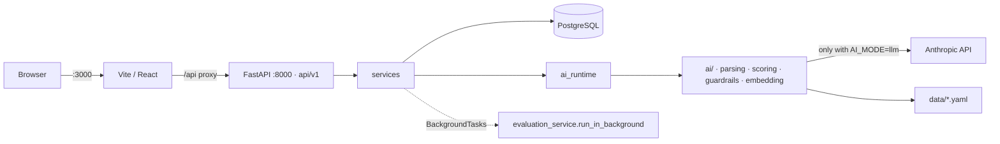
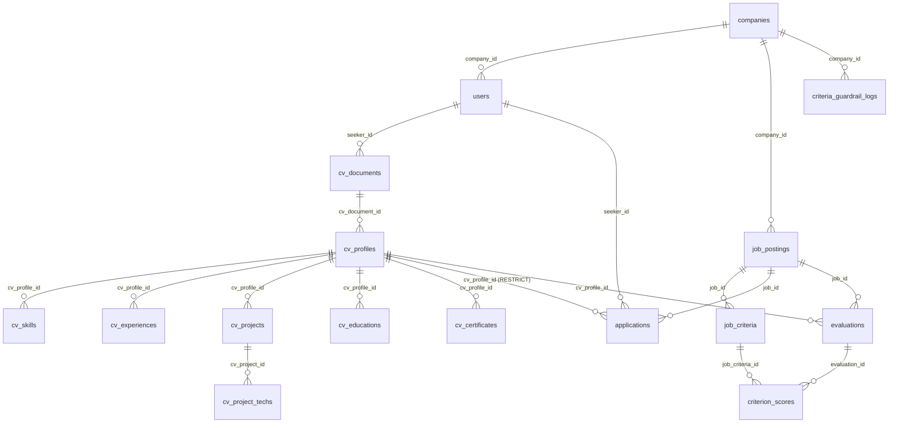
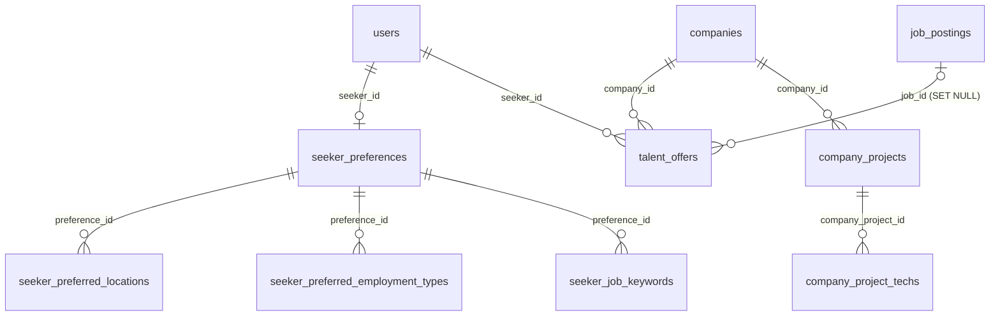

# CareerSync — Project Documentation

> Quyết định và phạm vi: xem docs/DECISIONS.md. Nếu mâu thuẫn thì DECISIONS.md đúng.
>
> Rules for AI coding assistants: [`CLAUDE.md`](CLAUDE.md).
> Written against `main` at commit `56371c6` (2026-10-08). Doc là chuẩn: nếu code lệch doc thì sửa code theo doc. Nghi doc sai hoặc lỗi thời thì hỏi Long.
> [Planned] items come from the design document 「AI 소프트웨어 기본설계서 및 상세설계서」 v1.1 (2026-10-12), which is not a source of decisions.
>
> Labels: **[Current]** in the code and working · **[DB only]** tables exist, no API/logic yet · **[Planned]** hướng dự kiến, chưa phải quyết định, no code · **[Recommended]** a suggestion, not agreed · `TBD` not decided.

## Contents
1. [Overview](#1-overview)
2. [Architecture](#2-architecture)
3. [Database](#3-database)
4. [API](#4-api)
5. [Frontend](#5-frontend)
6. [AI / ML](#6-ai--ml)
7. [Coding conventions](#7-coding-conventions)
8. [Files and folders](#8-files-and-folders)
9. [Environment and configuration](#9-environment-and-configuration)
10. [Development rules](#10-development-rules)
11. [Known issues and risks](#11-known-issues-and-risks)
12. [Open questions](#12-open-questions)
13. [Glossary](#13-glossary)

---

## 1. Overview

**CareerSync** — 기업 맞춤형 AI 채용 매칭 플랫폼 (criteria-based hiring and job matching).

**Idea.** Each company defines **evaluation criteria + weights** per job. The same criteria are used to (1) score applicants and (2) recommend the company's jobs to people who have not applied. AI provides scores and evidence only; **the recruiter makes every decision**.

**Users.** `company` (recruiter; 1 account = 1 company) and `seeker` (job seeker).

| Feature | Status | Note |
|---|---|---|
| Register / log in with privacy + AI-analysis consent | [Current] | |
| Company profile (name, intro, 인재상) | [Current] | |
| Company running projects | [DB only] | Use in scoring `TBD` (Q3) |
| Jobs: draft → published → closed | [Current] | |
| AI suggests criteria from the JD (`/analyze`) | [Current] | Backend only; the frontend does not call it |
| Criteria + weights with a legal guardrail | [Current] | |
| CV PDF upload → PII masking → structuring → seeker edits and confirms | [Current] | |
| Apply → background scoring → applicants ranked by Fit with evidence | [Current] | |
| Recruiter changes application status | [Current] | |
| Job list / detail without login | [Planned] | Today both need a token ([§4.2](#42-planned-endpoints--do-not-exist)) |
| Seeker preferences (input for Pref) | [DB only] | API path planned |
| Job recommendation (Fit + Pref) | [Planned] | Tables ready (`evaluations`, `seeker_preferences`); rules planned ([§6.1](#61-recommendation-planned)); the page shows demo numbers |
| Talent recommendation (opt-in, anonymous, offers) | [Planned] | Tables ready (`profile_public`, `talent_offers`); rules planned; blocked by issues 3, 6 and 26 ([§6.1](#61-recommendation-planned)) |
| Bias audit, AI cache | [Planned] | Stub files |
| Delete CV / account | `TBD` | Q5 |

**End-to-end flow**
```
Company: register → profile → create job (draft) → (optional) AI suggests criteria → save criteria (guardrail) → publish
Seeker:  register → upload CV PDF → AI structures it → edit + confirm → browse jobs → apply
System:  create evaluation (pending) → background task scores each criterion → store scores + evidence
Company: applicants ranked by Fit → per-criterion score + evidence → change status
```

---

## 2. Architecture

| Part | Technology | Location |
|---|---|---|
| Frontend | React 19, TypeScript, Vite, React Router. Korean UI, desktop-first | `frontend/` |
| Backend | Python 3.11+, FastAPI, SQLAlchemy 2, Alembic, Pydantic 2 | `backend/app/` |
| Database | PostgreSQL 16 (tests: in-memory SQLite, or PostgreSQL via `TEST_DATABASE_URL`) | `backend/migrations/` |
| AI | Anthropic Claude via `LLMClient` (optional), sentence-transformers `intfloat/multilingual-e5-base` (fallback `hashing-ngram-v1`), PyMuPDF | `ai/` |
| Auth | JWT HS256 (PyJWT), Argon2id passwords, Bearer token | `backend/app/core/security.py`, `deps.py` |
| Static data | Legal blocklist, skill dictionary (YAML) | `data/` |
| Infra | Docker Compose: `db`, `init` (migrate + seed), `backend`, `frontend` | `docker-compose.yml` |



**Layers.** `api/v1` checks permissions (dependencies `CurrentUser`, `CompanyUser`) and maps schemas → `services` hold business logic and DB access, and call `ai/` through `services/ai_runtime.py` → `models` are the ORM. `ai/` never imports `app.*`.

**Errors.** Services raise `AppError(status, CODE, "Korean message", **extra)` → JSON `{"code", "message", ...}`. Validation errors: 422 `{"detail": [...]}`. Missing/invalid token: 401; non-company on a company route: 403. Another company's job returns 404 `JOB_NOT_FOUND` on purpose.

**Main data flows**
- **CV upload:** PDF (≤ 5 MB, ≤ 5 pages, text only) → `ai.parsing.pdf` → `ai.parsing.pii` masks PII → `cv_documents.masked_text` (the PDF itself is not stored) → `structure_cv` (LLM or rules) → `CvProfile` → `cv_service._fill_relational_profile` writes it into the `cv_*` tables as profile version 1.
- **CV read:** `cv_service.to_profile_data(row)` rebuilds the `CvProfile` model from the `cv_*` tables. The API response and the AI input both use this `CvProfile` shape (`cv_profile.v1`).
- **CV edit:** every save creates a new `cv_profiles` version (new child rows); `confirm=true` sets `confirmed_at`.
- **Apply:** seeker + published, unexpired job + AI consent + newest CV confirmed + not applied → `applications` + `evaluations` (pending, keyed by job × CV version) → background scoring → `criterion_scores`.
- **Ranking:** Fit is computed at read time from stored scores and the **current** weights (`criteria_service.load_for_scoring`), so a weight change re-ranks without any AI call.

---

## 3. Database

PostgreSQL 16, Alembic migrations `0001` → `0008`. List the current tables with:
`python -c "import app.models; from app.db.session import Base; print(sorted(Base.metadata.tables))"` (from `backend/`).
JSON columns are `JSONB` on PostgreSQL and `JSON` on SQLite. All `created_at`/`updated_at` columns are `timestamptz` with `now()` defaults.

### 3.1 Accounts and companies
**`companies`** — `id` PK · `name` varchar(100) · `intro` text (≤1000) · `talent_profile` text (인재상, ≤1000; added to scoring of `other` criteria) · `created_at`, `updated_at`

**`users`** — `id` PK · `email` varchar(255), unique on `lower(email)` · `password_hash` (Argon2id) · `display_name` varchar(50) (shown to recruiters, masked out of CV text) · `role` `seeker`|`company` · `company_id` FK → companies (CASCADE; required when role is company) · `consent_privacy_at`, `consent_ai_at` (AI consent required to apply), `consent_version` · `created_at`

### 3.2 Jobs and criteria
**`job_postings`** — `id` PK · `company_id` FK → companies (CASCADE) · `title` varchar(200) · `description` text (JD, ≤10000, required to publish) · `employment_type` `full_time`|`contract`|`intern` · `min_experience_years` smallint 0–30, NULL = 신입 가능 · `location`, `salary_note` varchar(100) free text · `deadline` date · `status` `draft`|`published`|`closed` · `criteria_updated_at` · `published_at`, `closed_at` · `created_at`, `updated_at`.
After publishing only `deadline`, `location`, `salary_note` change; `closed` is final; only drafts can be deleted.

**`job_criteria`** — `id` PK · `job_id` FK → job_postings (CASCADE) · `name` varchar(50), unique per job on `lower(trim(name))` · `description` text (rubric, ≤500) · `category` `skill`|`experience`|`project`|`certificate`|`education`|`other` · `weight` 1–100 · `position` · `guardrail_version` · `created_at`, `updated_at`.
Service rules: 1–`CRITERIA_MAX_ITEMS` criteria, unique names, weights sum to `CRITERIA_WEIGHT_TOTAL`; an `education` criterion names at least one major or 이공계/STEM (checked on draft save, copy and publish); after publishing only weights and order change.

**`criteria_guardrail_logs`** — one row per blocked input: `company_id` FK (CASCADE), `job_id` FK (SET NULL), `input_name`, `input_description`, `rule_id`, `category`, `law_ref`, `blocklist_version`, `created_at`.

### 3.3 CVs
**`cv_documents`** — `id` PK · `seeker_id` FK → users (CASCADE) · `file_name` · `sha256` (unused so far) · `pages` · `masked_text` (the only text the LLM and evidence checks see) · `masked_kinds` JSON · `created_at`

**`cv_profiles`** — one row per CV version: `id` PK · `cv_document_id` FK (CASCADE) · `seeker_id` FK → users (CASCADE) · `version` (unique per document) · `schema_version` (`cv_profile.v1`) · `method` (`rules`, `llm:<model>`, `seeker`) · `summary` text · `confirmed_at` (only confirmed versions can be used to apply) · `created_at`.

Child tables of `cv_profiles` (all `cv_profile_id` FK → cv_profiles, CASCADE, indexed; read back in `id` order):

| Table | Columns |
|---|---|
| `cv_skills` | `skill_name` varchar(100) |
| `cv_experiences` | `org`, `role` varchar(100) · `start`, `end` varchar(7) `YYYY-MM`, nullable · `description` text · `source` varchar(500) |
| `cv_projects` | `name` varchar(200) · `role` varchar(100) · `description` text · `source` varchar(500) |
| `cv_project_techs` | `cv_project_id` FK → cv_projects (CASCADE) · `tech_name` varchar(100) |
| `cv_educations` | `school`, `major` varchar(100) · `degree` varchar(20) · `source` varchar(500) |
| `cv_certificates` | `name` varchar(100) · `date` varchar(7) nullable · `source` varchar(500) |

`source` = the CV line an item was read from. Seekers can edit it (see [issue 3](#11-known-issues-and-risks)).

### 3.4 Applications and evaluation
**`applications`** — `id` PK · `job_id` FK (CASCADE) · `seeker_id` FK → users (CASCADE) · `cv_profile_id` FK → cv_profiles (**RESTRICT**) · `status` `submitted`|`reviewing`|`interview`|`on_hold`|`passed`|`rejected` (recruiter only) · `status_updated_at` · `created_at`. Unique (`job_id`, `seeker_id`).

**`evaluations`** — `id` PK · `job_id` FK (CASCADE) · `cv_profile_id` FK (CASCADE) · `status` `pending`|`done`|`failed` · `error` · `llm_model`, `embedding_model`, `prompt_version`, `skills_version` · `created_at`, `finished_at` · `queued_at` timestamptz, nullable · `attempts` smallint ≥ 0, default 0. Unique (`job_id`, `cv_profile_id`) — keyed by job × CV version, **not** by application, so recommendation can reuse it.

`queued_at`/`attempts`: migration `0008` (backfill `queued_at = created_at`, `attempts = 1`). **No code sets them yet** (issue 2, issue 25, [§6.1](#61-recommendation-planned)).

**`criterion_scores`** — `evaluation_id` FK (CASCADE) · `job_criteria_id` FK (CASCADE) · `score` 0–100 · `level` · `reason` · `evidence` JSON (quotes) · `method` (`rule:skill`, `llm:<model>`, `retrieval`, …). Unique (`evaluation_id`, `job_criteria_id`). Weights are **not** stored.

### 3.5 Matching groundwork [DB only]
Created in `0007`, no API or logic uses them yet.

| Table | Columns | Purpose |
|---|---|---|
| `seeker_preferences` | `seeker_id` FK → users (CASCADE), unique · `profile_public` bool default false · `profile_public_at` · `created_at`, `updated_at` | One row per seeker. `profile_public` = opt-in to appear anonymously in talent recommendation |
| `seeker_preferred_locations` | `preference_id` FK (CASCADE) · `location` varchar(100); unique per preference | Desired work locations (free text) |
| `seeker_preferred_employment_types` | `preference_id` FK (CASCADE) · `employment_type` `full_time`\|`contract`\|`intern`; unique per preference | Desired employment types |
| `seeker_job_keywords` | `preference_id` FK (CASCADE) · `keyword` varchar(100); unique per preference | Desired role keywords (free text) |
| `talent_offers` | `company_id` FK (CASCADE) · `seeker_id` FK → users (CASCADE) · `job_id` FK (SET NULL, optional) · `status` `pending`\|`accepted`\|`rejected`\|`cancelled` · `created_at`, `responded_at` | Offers from a company to a seeker. Contact details stay in `users` and should be shown only after `accepted` |
| `company_projects` | `company_id` FK (CASCADE) · `name` varchar(200) · `description` text · `created_at`, `updated_at` | Company's running projects |
| `company_project_techs` | `company_project_id` FK (CASCADE) · `tech_name` varchar(100); unique per project | Technologies of a project |

### 3.6 ERD



---

## 4. API

Base URL `http://localhost:8000`. Swagger at `/docs` shows the request/response schemas as currently implemented; this section is the standard — if the implementation differs, fix the code. Except `register`, `login`, `/health`, `GET /api/jobs` and `GET /api/jobs/{job_id}`, every endpoint needs `Authorization: Bearer <token>` (lifetime `JWT_EXPIRE_MINUTES`). On those two job routes the token is optional (`OptionalUser`), but a token that is sent must be valid (401 otherwise). "Company" = `CompanyUser` dependency; "Seeker" = checked in the service (`SEEKER_ONLY`, 403).

### 4.1 Existing endpoints [Current]
| Method | Path | Purpose | Who | Main errors | Service | AI |
|---|---|---|---|---|---|---|
| POST | `/api/auth/register` | Register seeker or company (consents required) | Anyone | 409 `EMAIL_TAKEN` | `auth_service.register` | — |
| POST | `/api/auth/login` | Bearer token | Anyone | 401 `INVALID_CREDENTIALS` | `auth_service.authenticate` | — |
| GET | `/api/users/me` | Current user | Logged in | 401 | — | — |
| GET / PUT | `/api/companies/me` | Own company profile | Company | 422 | route | — |
| GET | `/api/companies/{company_id}` | Public company profile | Logged in | 404 `COMPANY_NOT_FOUND` | route | — |
| POST | `/api/jobs` | Create draft | Company | 422 `DEADLINE_IN_PAST` | `job_service.create` | — |
| GET | `/api/jobs` | Published, unexpired jobs (`q`, `limit`, `offset`) | Anyone (token optional) | — | `job_service.list_public` | — |
| GET | `/api/jobs/mine` | Own jobs, all statuses | Company | — | `job_service.list_mine` | — |
| GET | `/api/jobs/{job_id}` | Job detail. Guest: published, unexpired only. Logged in: also expired published. Owner: also draft/closed | Anyone (token optional) | 404 `JOB_NOT_FOUND` | `job_service.get_visible_job` | — |
| PATCH | `/api/jobs/{job_id}` | Edit (after publish: deadline/location/salary_note) | Company | 409 `JOB_CLOSED`, `JOB_FIELD_LOCKED`; 422 `FIELD_REQUIRED` | `job_service.update` | — |
| DELETE | `/api/jobs/{job_id}` | Delete a draft | Company | 409 `JOB_NOT_DRAFT` | `job_service.delete` | — |
| POST | `/api/jobs/{job_id}/publish` | Publish (needs JD + valid criteria) | Company | 409 `JOB_NOT_DRAFT`; 422 `JOB_INCOMPLETE` + criteria errors | `job_service.publish` | guardrail |
| POST | `/api/jobs/{job_id}/close` | Close (final) | Company | 409 `JOB_NOT_PUBLISHED` | `job_service.close` | — |
| POST | `/api/jobs/{job_id}/analyze` | Suggest criteria from the JD (not saved) | Company | 404 | `ai.parsing.extract.analyze_jd` | **LLM** / rules |
| GET | `/api/jobs/{job_id}/criteria` | Company: full rows. Seeker: name + category + importance, no weights | Logged in | 404 | `criteria_service` | — |
| PUT | `/api/jobs/{job_id}/criteria` | Replace the criteria set | Company | 422 `CRITERIA_COUNT_INVALID`, `CRITERIA_DUPLICATE_NAME`, `WEIGHT_SUM_INVALID`, `CRITERIA_MAJOR_REQUIRED`, `CRITERIA_BLOCKED`; 409 `CRITERIA_LOCKED` | `criteria_service.replace_set` | guardrail |
| POST | `/api/jobs/{job_id}/criteria/copy-from/{source_job_id}` | Copy criteria into a draft | Company | 409 `CRITERIA_LOCKED`; 422 `CRITERIA_MAJOR_REQUIRED`, `CRITERIA_BLOCKED` | `criteria_service.copy_set` | guardrail |
| POST | `/api/criteria/check` | Live guardrail check (saves nothing) | Company | — | `criteria_service.check` | guardrail |
| POST | `/api/cv` | Upload + analyze a PDF (multipart `file`) | Seeker | 422 `CV_TOO_LARGE`, `CV_NOT_PDF`, `CV_UNREADABLE`, `CV_ENCRYPTED`, `CV_TOO_MANY_PAGES`, `CV_NO_TEXT` | `cv_service.upload` | PDF, PII, **LLM** / rules |
| GET | `/api/cv/me` | Newest version of the newest CV | Seeker | 404 `CV_NOT_FOUND` | `cv_service.latest` | — |
| GET / PUT | `/api/cv/{profile_id}` | Read a version / save edits as a new version (`confirm`) | Seeker (own) | 404 | `cv_service.get_own`, `update` | normalize |
| POST | `/api/jobs/{job_id}/applications` | Apply with the newest confirmed CV; scoring runs in background | Seeker | 409 `JOB_EXPIRED`, `AI_CONSENT_REQUIRED`, `CV_NOT_CONFIRMED`, `ALREADY_APPLIED` | `application_service.apply` | **scoring** |
| GET | `/api/applications/mine` | Own applications | Logged in. Filters by `seeker_id = current user`, no role check — a company account gets `200 []` (companies cannot apply) | — | `application_service.list_mine` | — |
| GET | `/api/jobs/{job_id}/applications` | Applicants ranked by Fit | Company | 404 | `application_service.ranked` | Fit |
| GET | `/api/applications/{application_id}/evaluation` | Per-criterion score, reason, evidence | Company | 404 `APPLICATION_NOT_FOUND` | `application_service.evaluation` | — |
| POST | `/api/applications/{application_id}/evaluation/retry` | Re-run an unfinished evaluation | Company | 409 `EVALUATION_DONE` | `application_service.retry` | **scoring** |
| PUT | `/api/applications/{application_id}/status` | Recruiter changes status | Company | 404, 422 | `application_service.set_status` | — |
| GET | `/health` | Health check | Anyone | — | — | — |

Responses with AI results carry `notice` = `AI_NOTICE` ("AI 분석은 참고용입니다. 채용 여부는 기업이 최종 판단합니다."; `schemas/application.py`): applicant list, evaluation, CV (`CvOut`: `POST /api/cv`, `GET /api/cv/me`, `GET`/`PUT /api/cv/{profile_id}`) and `POST /api/jobs/{job_id}/analyze`.

### 4.2 Planned endpoints — do NOT exist
Paths are working names (design doc 상세 §3.1); field-level request/response shapes are `TBD`, added here when designed.

| Purpose | Path (working) | Who | Tables | Blocked by |
|---|---|---|---|---|
| Read/update seeker preferences (+ `profile_public`) | `GET` · `PUT /api/preferences/me` | Seeker | `seeker_preferences` + 3 children | — |
| Job recommendation, Final = 0.5·Fit + 0.5·Pref | `GET /api/recommendations/jobs?limit=20` | Seeker | `evaluations`, `seeker_preferences` | [Q1](#12-open-questions) (synonyms only) |
| Talent recommendation (anonymous list per job) | `GET /api/jobs/{job_id}/talent?limit=20` | Company | `seeker_preferences`, `evaluations` | Issues [3, 6, 26](#11-known-issues-and-risks) |
| Send / cancel an offer | `POST /api/talent-offers` · `POST /api/talent-offers/{id}/cancel` | Company | `talent_offers` | — |
| List received offers / accept / reject | `GET /api/talent-offers/mine` · `POST /api/talent-offers/{id}/accept` · `/reject` | Seeker | `talent_offers` | — |
| Company projects CRUD | `GET` · `POST` · `PUT` · `DELETE /api/companies/me/projects` | Company | `company_projects`, `company_project_techs` | [Q3](#12-open-questions) |
| Delete CV / account | — | — | — | [Q5](#12-open-questions) |

Response sketches (field names not final). `pending_count` = candidates that passed the Pref filter (talent: the candidate filter) but whose evaluation is not `done` yet — queued in this call, still `pending`, `failed` and waiting for re-queue, or left for a later call by the per-call/daily caps. They are not in `items`.
```
GET /api/recommendations/jobs → {"items": [{"job_id", "title", "match_level": "높음|보통|낮음", "matched": [criterion names], "gaps": [criterion names]}], "pending_count": 3, "notice": AI_NOTICE}
GET /api/jobs/{job_id}/talent → {"items": [{"anonymous_id": "C-0042", "fit": 80.0, "skills": [...]}], "pending_count": 5, "notice": AI_NOTICE}
offer detail (company): pending/rejected/cancelled → {"offer_id", "status", "candidate": {anonymous fields}}; accepted → adds "contact": {"display_name", "email"}
```

**`GET /api/jobs/{job_id}/criteria` without login** — planned: make it public together with job detail, returning the **seeker view** (name + category + importance, no weights) for published, unexpired jobs only; the company view (full rows) still needs the owner's token. Reason: the detail page already shows them, and they are what the company evaluates on publicly. If it stays behind login, the frontend must hide the criteria block for guests.

`backend/app/api/v1/recommendations.py` is a one-line stub and is not mounted in `main.py`.

---

## 5. Frontend

Routes from `frontend/src/App.tsx`; API calls from `frontend/src/api/client.ts`. Role is enforced by `Guard`. Token is kept in `localStorage`.

| Route | Page | Role | Calls (`api.*`) | Data |
|---|---|---|---|---|
| `/login` | `Login` | — | `login`, `me` (via `AuthContext`) | Real |
| `/register` | `Register` | — | `register` | Real |
| `/seeker` | `seeker/Recommended` (추천 공고) | seeker | `publicJobs` | Real jobs, **demo match %** (`mock/data.ts` `demoMatch`, "데모" banner) |
| `/seeker/jobs/:id` | `seeker/JobDetail` | seeker | `job`, `seekerCriteria`, `myApplications`, `apply` | Real |
| `/seeker/resume` | `seeker/Resume` (내 이력서) | seeker | `myCv`, `uploadCv`, `updateCv` | Real |
| `/seeker/prep` | `seeker/Prep` (취업 준비) | seeker | — | Coming soon |
| `/seeker/me` | `seeker/MyPage` (마이페이지) | seeker | `myApplications` | Real |
| `/company/jobs` | `company/JobList` | company | `myJobs`, `deleteJob` | Real |
| `/company/jobs/new`, `/company/jobs/:id/edit` | `company/JobEditor` | company | `job`, `myJobs`, `createJob`, `updateJob`, `publishJob`, `closeJob`, `criteria`, `saveCriteria`, `copyCriteria`, `checkCriterion` | Real |
| `/company/applicants` | `company/Applicants` (지원자 관리) | company | `myJobs`, `applicants`, `evaluation`, `retryEvaluation`, `setApplicationStatus` | Real |
| `/company/talent` | `company/Talent` (인재 추천) | company | — | Coming soon |
| `/company/profile` | `company/CompanyProfile` | company | `myCompany`, `updateCompany` | Real |

Backend endpoints with no frontend caller: `POST /api/jobs/{job_id}/analyze`, `GET /api/companies/{company_id}`, `GET /api/cv/{profile_id}`.

---

## 6. AI / ML

Everything is in `ai/`. Pretrained models only; nothing is trained. **Rules for changing AI code and which guarantees hold today: [`CLAUDE.md`](CLAUDE.md#ai-rules--and-whether-the-code-already-guarantees-them).**

| Component | Does | Model / method | Called from |
|---|---|---|---|
| `parsing/pdf.py` | PDF → text; checks size, pages, encryption, text present | PyMuPDF | `cv_service.upload` |
| `parsing/pii.py` | Masks email, URL, 주민번호, phone, birth date, address, and the user's `display_name` | Regex | `cv_service.upload` |
| `parsing/extract.py` `structure_cv` | Masked text → `CvProfile`; skills normalized; experience months computed in code | Claude (`prompts/v1/cv_structure.md`) or rules | `cv_service.upload` |
| `parsing/extract.py` `analyze_jd` | JD → suggested criteria, weights adjusted to 100 | Claude (`jd_analyze.md`) or rules | `POST /jobs/{id}/analyze` |
| `parsing/profile.py` | Pydantic schemas `cv_profile.v1`, `jd_profile.v1` (LLM output = API body) | — | everywhere |
| `guardrails/` | Blocks discriminatory criteria; verifies LLM quotes exist in the CV | Rules + `data/blocklist.yaml` | `criteria_service`, scorers |
| `embedding/skills.py` | Skill/certificate dictionary, aliases → canonical names | `data/skills.yaml` | parsing, scoring |
| `embedding/model.py` | Text vectors | `multilingual-e5-base`; falls back to `hashing-ngram-v1` | scoring |
| `scoring/` | One scorer per category, then Fit | see below | `evaluation_service.evaluate` |
| `llm/client.py` | Only gateway to the LLM; `get_llm_client()` is `None` unless `AI_MODE=llm`, even with a key. `check_llm_config()` runs at startup (`main.py` lifespan) | Anthropic SDK, default `claude-sonnet-5-5`, effort `low` | `ai_runtime.llm()` |
| `bias/audit.py`, `cache/store.py` | — | — | [Planned] stubs |

**Scoring per category**
| Category | Method | LLM? |
|---|---|---|
| `skill` | Skills named in the criterion vs CV skills (dictionary + embedding similarity). No known skill named → scored as free text (retrieval) | No |
| `experience` | Total experience months vs required years: from the criterion text ("3년", "3~5년" → 3, "1년 6개월" → 1.5, "6개월" → 0.5, "신입" → 0; a year such as "2020년" is not a duration), else `min_experience_years` (NULL = 신입, 0 years). Required 0 → 100 for everyone, without CV evidence | No |
| `education` | Major only, against the majors the criterion names (name + description): match 100, other major 30, no major 0. "이공계"/STEM criteria accept STEM majors. Saving or publishing an education criterion without a major fails (`CRITERIA_MAJOR_REQUIRED`); one saved earlier (e.g. "관련 전공") scores a neutral 50 for everyone ("전공 미지정", no evidence). No built-in list of related majors. School names are never scored | No |
| `certificate` | Named certificates found in the CV text; generic "related certificates" counted | No |
| `project`, `other` | 4 most relevant CV passages → rubric (0/25/50/75/100) with ≤3 quotes → quotes verified, one retry. In `rules` mode or on failure: keyword/embedding retrieval. `other` adds the company's 인재상 to the query | **Yes** in `llm` mode |

**Fit** = Σ(weight × score) / Σweight, rounded to 1 decimal (`ai/scoring/fit.py`). Ranking: Fit ↓, then more criteria ≥ `STRONG_SCORE`, then earlier application. LLM criteria run in parallel (up to 4 threads).

**Backend ↔ AI.** Services get AI components only through `services/ai_runtime.py` (`skills()`, `embedder()`, `llm()`), so tests swap them. `ai/` receives plain objects (`Candidate`, `Criterion`, `JobContext`) and never touches the DB. The only criteria read path for scoring is `criteria_service.load_for_scoring()` (drops criteria blocked by a newer blocklist and rescales weights).

**Cost.** Only Claude calls cost money, and only with `AI_MODE=llm`: CV structuring (1 call per upload), JD analysis (1 per click), `project`/`other` criteria (1–2 per criterion per application). Planned recommendation adds the same scoring cost for jobs a seeker has not applied to, and talent recommendation for public seekers per job; limited by the per-call and daily caps and attempt limit in [§6.1](#61-recommendation-planned) (talent limit still open, issue 26). No cache yet.

**Config locations.** Mode: `AI_MODE`. Model: `LLM_MODEL` (default in `ai/llm/client.py`). Embedding: `EMBEDDING_MODEL`. Prompts: `ai/prompts/v1/`, `PROMPT_VERSION` in `ai/parsing/extract.py`. Data: `data/blocklist.yaml` (`grep -c "^  - id:" data/blocklist.yaml` = number of rules), `data/skills.yaml`.

### 6.1 Recommendation [Planned]
Decided parts: docs/DECISIONS.md D1–D3. No code yet. Core rule: the company's `job_criteria` are used **the same way** for applicant scoring and for recommendation, and `evaluations` (keyed by job × CV version) are reused.

**Job recommendation (seeker → jobs)**
- Candidates: published, unexpired jobs. Excluded: jobs already applied to; seekers with no confirmed CV or no AI consent.
- **Pref** (0–100) = desired location, desired employment type, desired role keywords (vs job title + JD), each 1/3. Free text is compared after whitespace/case normalization. Matching method (planned): location and employment type match when equal after normalization (location also matches when one contains the other, e.g. "서울" ⊂ "서울 강남구"); role keywords match when any keyword appears as a substring of the job title or JD. Synonyms stay in Q1. Pref takes only 0 / 33.3 / 66.7 / 100, so "≥ 40" means at least 2 of 3 match.
- **Empty preferences** — planned: a field the seeker left empty counts as a match. Consequence: a seeker with no preferences has Pref = 100 for every job, so ranking is by Fit alone and the evaluation cap below is what limits cost. Planned: show a "희망 조건을 입력하면 추천이 정확해집니다" prompt on the page when all three are empty.
- **Fit**: reuse the evaluation for (job, newest confirmed CV version); create it if missing. Fit is computed only for jobs with Pref ≥ 40, to limit LLM calls.
- **Evaluation cap** (planned): one recommendation call creates at most `RECO_MAX_NEW_EVALUATIONS` (proposed 10) new evaluations, picking candidates with the highest Pref first, then newest `published_at`. Jobs over the cap are left out of this response and get evaluated on later calls.
- **Daily cap per seeker** (planned): at most `RECO_DAILY_NEW_EVALUATIONS` (proposed 30) new evaluations per seeker per day (KST), so reloading the page cannot bypass the per-call cap. Counting rule and re-queues: see the next bullets (uses `queued_at`); evaluations queued by applying do not count. When the cap is reached, the call returns only existing `done` results. Talent recommendation needs its own per-company limit — see [issue 26](#11-known-issues-and-risks). Both endpoints are covered by [issue 22](#11-known-issues-and-risks). Further option if cost is still high: turn recommendation on only when at least one preference is filled.
- **CV versions:** evaluations are keyed by job × CV version, so a newly **confirmed** CV version cannot reuse old evaluations and is re-evaluated (within the cap). This is a deliberate trade-off: scores always match the CV the seeker confirmed. Saving an edit without confirming creates no evaluation, because recommendation uses only the newest confirmed version.
- **Get-or-create rule** (planned; applies to apply, retry and both recommendations): always obtain the evaluation through `evaluation_service.ensure(job_id, cv_profile_id)` (unique on job × CV version), never create one directly. `ensure()` must catch `IntegrityError` on insert (inside a savepoint), roll back that savepoint and re-read the row, so two concurrent requests end up with the same evaluation instead of a 500. Queue scoring **only** when the evaluation is new, `failed`, or `pending` for longer than `EVALUATION_STALE_MINUTES`; a fresh `pending` one is left alone because a task is already running. Current apply does not follow this yet: see [issue 25](#11-known-issues-and-risks).
- **Columns for the rule above:** `evaluations.queued_at` (set on every queue) and `evaluations.attempts` (incremented on every queue). Every queue path (apply, retry, recommendation) must set both; the stale check uses `queued_at`, because a re-queued evaluation keeps its old `created_at`.
- **Re-queues count toward the caps** (planned): every queue — new, `failed` or stale `pending` — uses one slot of `RECO_MAX_NEW_EVALUATIONS` and of `RECO_DAILY_NEW_EVALUATIONS` (daily count = the seeker's evaluations with `queued_at` today that no application references). Recommendation stops re-queuing an evaluation after `EVALUATION_MAX_ATTEMPTS` (proposed 3) attempts; it then stays `failed` and recommendation skips it. `attempts` is reset to 0 when the seeker applies to that job or the company clicks 다시 분석 (both queue it again and are not limited by this count). A newly confirmed CV version is a new evaluation, so it starts at 0. Editing the job does not reset it: after publishing only weights can change, and weights do not need re-scoring.
- **Fencing** (planned): the background task receives the `queued_at` value it was queued with. Before writing scores it updates the row only `WHERE id = :id AND queued_at = :token` (or re-reads it under `SELECT … FOR UPDATE`); if no row matches, a newer queue has replaced it, so the run discards its results and exits without changing `status`. This stops an old, slow run from overwriting the result of a newer one.
- **Sync vs background** (planned): new evaluations run in the **background** (same `evaluation_service.run_in_background` as applying); the call never waits for scoring. The response lists only jobs whose evaluation is `done`, plus `"pending_count"` so the page can show "분석 중 N건". **Retry of `pending`:** nobody clicks 다시 분석 on the seeker side, so the next recommendation call re-queues its own `pending` evaluations older than `EVALUATION_STALE_MINUTES` (10, same rule as issue 2) and `failed` ones, still within the cap. Evaluations shared with an application keep the company's 다시 분석 path too.
- **Final** = 0.5·Fit + 0.5·Pref; recommend only when Fit ≥ 40 **and** Pref ≥ 40.
- Order: ① filter candidates → ② Pref, drop < 40 → ③ load `done` evaluations; queue missing/stale ones up to the cap → ④ Fit with current weights, drop < 40 → ⑤ Final → ⑥ sort by Final ↓, then Fit ↓, then newest `published_at` (planned tie-break), top N with matched/gap criterion names.
- Seekers see **bands only**: 높음 Final ≥ 80 · 보통 60–79 · 낮음 40–59, plus names of matched and missing criteria. No per-criterion numbers and no weights (same as today's importance-only criteria view).

**Talent recommendation (company → seekers)**
- **Prerequisites — do not enable until fixed:** [issue 3](#11-known-issues-and-risks) (seekers could raise their rank by editing `source` lines, and companies would act on it without seeing an application) and [issue 6](#11-known-issues-and-risks) (talent ranking creates many evaluations per job; in-process scoring loses them on restart), and [issue 26](#11-known-issues-and-risks) (no cost limit for talent ranking yet). Also review issue 24 (re-identification).
- **Access rule (all company-side APIs):** a company may read an evaluation, score or profile only for (a) seekers who applied to one of its jobs — today's behaviour, enforced through `get_owned` on the application — or (b) seekers with `profile_public = true` **at the time of the request**, and then only the anonymous fields below. Evaluations created for job recommendation are otherwise never visible to companies. Check `profile_public` on every read, not only when listing, so turning it off takes effect immediately.
- Candidates: `profile_public = true` with a confirmed CV. Excluded: seekers who already applied to that job, seekers with a pending offer from that company, and (once [issue 23](#11-known-issues-and-risks) is decided) seekers blocked by the re-offer rule.
- Ranked by Fit against that job's criteria; Pref is a secondary signal (exact use `TBD`). Tie-break [Recommended]: more criteria ≥ `STRONG_SCORE`, then newest `profile_public_at`.
- **New evaluations** [Recommended, not agreed]: same rules as job recommendation — background only, at most `RECO_MAX_NEW_EVALUATIONS` per call (seekers with the newest confirmed CV first), response lists `done` results plus `pending_count`. Cost grows with jobs × public seekers, so never evaluate the whole pool in one call.
- Anonymous profile — shown: anonymous ID, skills, total experience, experience roles (no org names), project roles and techs, major and degree, certificates, desired location/employment type/role keywords, Fit and per-criterion `score` (and `level`) for that job. Hidden: `display_name`, email, school name, org names, CV text, and the per-criterion `reason` and `evidence` — evidence quotes CV lines and reasons paraphrase them, which leaks text and makes re-identification easier ([issue 24](#11-known-issues-and-risks)). `reason`/`evidence` become visible only through the normal applicant view after the seeker applies.
- Offers: create as `pending` (service blocks a duplicate pending offer from the same company to the same seeker — no DB constraint, see [issue 16](#11-known-issues-and-risks)); seeker accepts/rejects (`responded_at`); company can cancel while pending. Re-offering after `rejected` is not decided (issue 23). Contact (`display_name`, email from `users`) is returned **only after `accepted`**.

**Consent:** the AI-analysis consent text at signup will name "지원 평가 및 맞춤 추천" as purposes, and `CONSENT_VERSION` is bumped; existing users re-consent at next login and get no recommendation until they do, and get no evaluation for jobs they did not apply to; existing applications stay valid (planned). Appearing in talent recommendation additionally requires the separate `profile_public` opt-in (`profile_public_at` records when).

**Evaluation (AI quality) plan [Planned]:** synthetic data only — 20 synthetic CVs + 5 jobs with hand-made answers. Metrics: extraction precision/recall, quote-verification pass rate and evidence review, top-5 agreement of Fit ranking vs hand ranking, processing time (`POST /api/cv` → response; apply → `done`), failed-evaluation and upload-error rates. Each measured for rules-only and LLM mode.

---

## 7. Coding conventions

**Current**:
- Code, comments, commit messages: English. User-facing messages (errors, notices, AI comments): Korean.
- Python: `snake_case` files/functions/variables, `_private` helpers, `PascalCase` classes, `UPPER_SNAKE` constants. Pydantic models suffixed `In`/`Out`/`Create`/`Update`. Type hints everywhere (`X | None`, `Annotated`, `Mapped[...]`).
- Services: `services/<domain>_service.py`; routes: `api/v1/<domain>.py`.
- Endpoints that call synchronous code (DB, PDF, LLM) use `def`, not `async def`.
- Status values: string constants class (`JobStatus.DRAFT`) + DB `CHECK` constraint, no DB enum types.
- API: `/api` prefix, plural nouns, `me` for the current user's resource, verb sub-paths for actions (`/publish`, `/close`, `/analyze`, `/retry`).
- DB: plural `snake_case` tables; constraints `ck_<table>_<col>`, `uq_<table>_<cols>`, indexes `ix_<table>_<col>`.
- Errors: `AppError(status, CODE_UPPER_SNAKE, "Korean message", **extra)`.
- Logging: `logging.getLogger(__name__)`; warnings/exceptions on AI failures. No central config.
- Imports: stdlib → third-party → `ai.*` → `app.*`.
- Prompts: versioned Markdown under `ai/prompts/vN/`.
- Frontend: `PascalCase.tsx` components, pages under `pages/seeker/*` and `pages/company/*`, all HTTP through `src/api/client.ts`.
- Commits: imperative, capitalized English sentence.
- Tests: pytest from the repo root; no DB, network or key needed (in-memory SQLite, hashing embedder, `FakeLLM`).

**[Recommended]**, not agreed: run `pytest` (and `npm run build` for frontend changes) before committing; add a linter/formatter (e.g. `ruff`).

---

## 8. Files and folders

```
CareerSync/
├── CLAUDE.md, PROJECT_DOCUMENTATION.md, README.md
├── .env.example            # copy to .env in the repo root (never commit .env)
├── conftest.py, pyproject.toml   # test setup; run pytest from the root
├── docker-compose.yml, docs/docker-compose.md
├── backend/
│   ├── alembic.ini, migrations/versions/   # run alembic from backend/
│   ├── requirements.txt, Dockerfile
│   ├── app/main.py         # app, routers, AppError handler, /health
│   ├── app/core/           # config, security (JWT, Argon2), deps, errors
│   ├── app/db/session.py   # engine, SessionLocal, Base
│   ├── app/models/         # user, job, criteria, cv, application, matching
│   ├── app/schemas/        # Pydantic request/response
│   ├── app/services/       # auth, job, criteria, cv, application, evaluation, ai_runtime
│   ├── app/api/v1/         # routers (recommendations.py is a stub)
│   └── tests/
├── ai/                     # llm, prompts/v1, parsing, embedding, scoring, guardrails, bias*, cache* (*stub), tests
├── data/                   # blocklist.yaml, skills.yaml
├── scripts/                # seed.py (demo data), docker_init.py (migrate + seed)
└── frontend/src/           # App.tsx, api/, auth/, components/, mock/, pages/
```

**Dependencies:** `api` → `services` → `models` + `ai`; `api/v1/jobs.py` calls `ai.parsing.extract.analyze_jd` directly; `criteria_service` → `ai/guardrails` + `data/blocklist.yaml`; `frontend` → backend only over `/api`.

**Key files:** `services/criteria_service.py` (`load_for_scoring`), `services/evaluation_service.py`, `services/cv_service.py` (`to_profile_data`, `_fill_relational_profile`), `ai/scoring/scorers.py`, `ai/scoring/fit.py`, `ai/llm/client.py`, `ai/parsing/pii.py`, `data/blocklist.yaml`, `core/deps.py`.

---

## 9. Environment and configuration

Read from `.env` in the repo root; shell variables win. Defaults below are the code defaults.

| Variable | Default | Notes |
|---|---|---|
| `DATABASE_URL` | — | Replaces the five `DB_*` variables |
| `DB_HOST` / `DB_PORT` / `DB_USER` / `DB_PASSWORD` / `DB_NAME` | `localhost` / `5432` / `postgres` / `postgres` / `careersync_db` | Manual Docker setup uses port 5433 (`.env.example`) |
| `JWT_SECRET_KEY` | dev default, only when the variable is **missing** | Empty string breaks login ([issue 4](#11-known-issues-and-risks)) |
| `JWT_EXPIRE_MINUTES` | `120` | |
| `AI_MODE` | `rules` | `rules` or `llm`, case-insensitive; empty = `rules`. Only `llm` makes Claude calls (paid). Another value, or `llm` without `LLM_API_KEY`, stops startup (`LLMConfigError`) |
| `LLM_API_KEY` | — | Required when `AI_MODE=llm`; ignored in `rules`. `ANTHROPIC_API_KEY` is not read |
| `LLM_MODEL` / `LLM_EFFORT` | `claude-sonnet-5-5` / `low` | |
| `EMBEDDING_MODEL` | `intfloat/multilingual-e5-base` | `hashing-ngram-v1` skips the ~1 GB download; Compose defaults to it when unset |
| `BLOCKLIST_PATH`, `SKILLS_PATH` | `data/blocklist.yaml`, `data/skills.yaml` | |
| `CAREERSYNC_DOTENV` | `1` | `0` skips `.env` (tests) |
| `TEST_DATABASE_URL` | `sqlite://` | Point at a separate PostgreSQL DB to run tests on PostgreSQL |
| `VITE_API_TARGET` | `http://127.0.0.1:8000` | Vite proxy target |
| `COMPOSE_DB_PORT` / `COMPOSE_BACKEND_PORT` / `COMPOSE_FRONTEND_PORT` | `5434` / `8000` / `3000` | |

**Constants** in `backend/app/core/config.py`: `CONSENT_VERSION`, `CRITERIA_MAX_ITEMS`, `CRITERIA_WEIGHT_TOTAL`, `IMPORTANCE_HIGH`, `IMPORTANCE_MID`, `JWT_ALGORITHM`. Recommendation constants — **not** in the config yet; add to `config.py` when implementing [§6.1](#61-recommendation-planned):

| Constant | Value | Status |
|---|---|---|
| `RECO_FIT_WEIGHT` / `RECO_PREF_WEIGHT` | `0.5` / `0.5` | Planned |
| `RECO_MIN_FIT` / `RECO_MIN_PREF` | `40` / `40` | Planned |
| `RECO_BAND_HIGH` / `RECO_BAND_MID` | `80` / `60` (below 60 = 낮음) | Planned |
| `RECO_EMPTY_PREF_MATCHES` | `True` (empty field counts as match) | Planned |
| `RECO_MAX_NEW_EVALUATIONS` | `10` per call | Planned |
| `RECO_DAILY_NEW_EVALUATIONS` | `30` per seeker per day (KST), new + re-queued | Planned |
| `EVALUATION_MAX_ATTEMPTS` | `3` automatic attempts from recommendation | Planned |
| `EVALUATION_STALE_MINUTES` | `10` (retry allowed for `pending` older than this; shared with issue 2) | Planned (retry and recommendation) |

**Databases.** Manual: `postgres:16` container on host port 5433. Compose: service `db` on host port 5434 with its own volume (separate data). Migrate: `cd backend && alembic upgrade head`. Demo data: `python scripts/seed.py` (accounts and password in the README).

**Runtime.** Python 3.11+ (Docker image 3.12, CPU torch); Node 20.19+ or 22.12+; dependencies in `backend/requirements.txt` and `frontend/package.json`. Secrets: `.env` is git-ignored; no real secret is committed.

---

## 10. Development rules

1. `pytest` must pass before and after every change.
2. Do not change the architecture, the DB schema, auth, or an existing API contract unless the task asks for it; schema changes always go through a new migration, never edit an applied one.
3. Stay inside the task; small, revertible changes, one purpose each.
4. Before changing a function/endpoint, find its callers (backend and `frontend/src/api/client.ts`).
5. Never commit `.env`, API keys or real CVs; use synthetic data.
6. Every feature must work in `AI_MODE=rules`.
7. Run `alembic` and `uvicorn` from `backend/`, `pytest` from the root.
8. Korean for user-facing text, English for code; AI results include `AI_NOTICE`.

### Keeping this document current
- **Doc first.** When a task adds or changes a table, endpoint, page, env variable or constant, update the affected section of this document as part of that task; decisions go to docs/DECISIONS.md.
- If the code differs from this document, fix the code. If this document looks wrong or outdated, ask Long instead of editing it.
- Re-check the header commit and the [Known issues](#11-known-issues-and-risks) / [Open questions](#12-open-questions) lists at each milestone.
- Counts: `pytest --collect-only -q | tail -1`, `/docs`, and the table-list command in §3.

---

## 11. Known issues and risks

Recorded only; fix when a task covers it. Status: **Open** not decided or not started · **Planned** fix chosen, not a decision unless in docs/DECISIONS.md, no code yet · **Fixed** done in code (keep the row until the next milestone review, then remove).

| # | Type | Issue | Where | Status |
|---|---|---|---|---|
| 1 | Cost / security | `ANTHROPIC_API_KEY` is read as well as `LLM_API_KEY`; a machine with it set makes paid calls silently (Compose passes only `LLM_API_KEY`). **Fixed:** only `LLM_API_KEY` is read, and only when `AI_MODE=llm` | `ai/llm/client.py` | Fixed |
| 2 | Concurrency | `retry` rejects only `done`; re-running a `pending` evaluation can start two scoring threads. **Planned fix:** allow retry only for `failed`, or `pending` older than 10 minutes; otherwise 409. Uses `evaluations.queued_at`. Related: issue 25 | `application_service.retry` | Planned |
| 3 | Trust | `experience`, generic certificates and skill "uses" take evidence from seeker-editable `source` fields, not from the masked CV text. **Must be fixed before enabling talent recommendation** ([§6.1](#61-recommendation-planned)) | `ai/scoring/scorers.py` | Open |
| 4 | Config | `JWT_SECRET_KEY=` (empty) → login 500 (`HMAC key must not be empty`) | `core/config.py` | Open |
| 5 | Tests | SQLite tests do not enable `PRAGMA foreign_keys`; FK errors (e.g. RESTRICT) go unnoticed unless tests run on PostgreSQL | `backend/tests/conftest.py` | Open |
| 6 | Architecture | Scoring runs in-process (`BackgroundTasks`); a restart leaves evaluations `pending` until 다시 분석. **Must be fixed before enabling talent recommendation** — recommendation multiplies the number of background evaluations | `api/v1/applications.py` | Open |
| 7 | AI / UX | JD-suggested criteria skip the guardrail (it only blocks on save) | `analyze_jd`, `/analyze` | Open |
| 8 | Performance | Retrieval re-embeds all CV passages for every criterion | `ai/scoring/retrieval.py` | Open |
| 9 | Cost | No LLM cache; `cv_documents.sha256` unused | `ai/cache/store.py` (stub) | Open |
| 10 | Observability | Token usage is not logged | `ai/llm/client.py` | Open |
| 11 | Privacy | No API to delete a CV or account; `applications.cv_profile_id` is RESTRICT | — | Open |
| 12 | Security | Token in `localStorage` (XSS exposure) | `frontend/src/api/client.ts` | Open |
| 13 | Data quality | A whitespace-only company name passes validation and becomes empty | `api/v1/companies.py` | Open |
| 14 | Staleness | Editing 인재상 after scoring does not re-score `other` criteria | — | Open |
| 15 | Design | Newest CV must be confirmed to apply, even if an older version was confirmed | `cv_service.latest_confirmed` | Open |
| 16 | Data | `talent_offers` allows duplicate `pending` offers from the same company to the same seeker; planned: check in the service, no DB constraint | `models/matching.py` | Planned |
| 17 | Data | Desired role is free-text keywords (`seeker_job_keywords`) and job titles are free text — Pref matching must handle this — see [Q1](#12-open-questions) | `models/matching.py` | Open |
| 18 | Tests | Tests build tables with `create_all`, not migrations; model/migration drift is not tested | `backend/tests/conftest.py` | Open |
| 19 | Frontend | 추천 공고 shows demo %; 인재 추천 and 취업 준비 are placeholders | `frontend/src/pages/` | Open |
| 20 | Breaking-change risk | Changing `cv_profile.v1`, `to_profile_data`, the Fit formula or `load_for_scoring` affects stored scores and applicant screens | see [`CLAUDE.md`](CLAUDE.md) | Open |
| 21 | Legal | Blocklist `law_ref` values are an unverified reading of the law; re-check their legal validity before the demo | `data/blocklist.yaml` | Open |
| 22 | Cost / abuse | No rate limit on endpoints that can call the LLM: `POST /api/cv`, `/analyze`, apply, `/evaluation/retry`, and the planned `GET /api/recommendations/jobs` and `GET /api/jobs/{job_id}/talent`. A user can loop requests and spend API credit. The per-call and daily evaluation caps in [§6.1](#61-recommendation-planned) limit recommendation only; a general rate limit is still needed | `api/v1/` | Open |
| 23 | Data / UX | After a seeker rejects an offer, nothing stops the same company from sending a new offer right away (issue 16 only covers duplicate `pending`). Needs a rule, e.g. no re-offer for the same job, or a cool-down. When decided, also update the talent candidate filter in [§6.1](#61-recommendation-planned) | `talent_offers`, planned offer service | Open |
| 24 | Privacy | Anonymous profiles can still identify a person when combined: rare skills/certificates, exact experience months, project descriptions, a small applicant pool. Consider rounding experience to years, hiding free-text project descriptions, and a minimum pool size before showing results | planned talent API ([§6.1](#61-recommendation-planned)) | Open |
| 25 | Concurrency | Apply calls `evaluation_service.ensure()` (reuse is correct) but queues scoring whenever the evaluation is not `done`. If it is a fresh `pending` (e.g. queued by recommendation, or by another request), the same evaluation is scored twice; `evaluate()` clears and rewrites scores, so the two runs can collide. Also, two concurrent `ensure()` calls for the same job × CV version hit `uq_evaluations_job_profile` and one request fails with 500. Fix: `ensure()` catches `IntegrityError` and re-reads; apply follows the get-or-create rule in [§6.1](#61-recommendation-planned); every queue sets `queued_at`/`attempts`. Related: issue 2 | `application_service.apply`, `api/v1/applications.py`, `evaluation_service.ensure` | Planned |
| 26 | Cost | Talent recommendation has no cost limit yet. It evaluates one job against every public seeker, and a per-company daily limit cannot be counted because `evaluations` does not store who triggered it. Options: a `triggered_by` / company column, a separate counter table, or using only existing evaluations for talent. **Must be resolved before enabling talent recommendation**, together with issues 3 and 6 | planned talent API ([§6.1](#61-recommendation-planned)) | Open |
| 27 | Schema | Migration `0008` for `evaluations.queued_at` (timestamptz) + `evaluations.attempts` (smallint, default 0) — see [§3.4](#34-applications-and-evaluation). **Blocks** issue 2, issue 25 and [§6.1](#61-recommendation-planned) (stale check, fencing, caps, attempt limit) | `backend/migrations/`, `models/application.py` | Fixed |
| 28 | Consistency | `AI_NOTICE` is only in applicant/evaluation responses; `POST /api/cv` (AI-structured CV) and `POST /api/jobs/{job_id}/analyze` return AI output without it, although rule 8 in §10 and `CLAUDE.md` require it. **Fixed:** `CvOut` and `JdAnalysisOut` have `notice` | `schemas/cv.py`, `api/v1/jobs.py` | Fixed |

---

## 12. Open questions

| # | Question | Blocks |
|---|---|---|
| Q1 | Pref beyond whitespace/case normalization: synonyms for locations and role keywords (e.g. "서울" vs "서울 강남구", "백엔드" vs "Backend")? Should a role mismatch alone exclude a job? Confirm the basic matching method proposed in §6.1 (equality / containment / substring). (Formula itself is decided — docs/DECISIONS.md D2) | Recommendation quality |
| Q3 | How do company projects affect evaluation: only context for suggesting criteria, or also part of the scoring prompt? One job ↔ one or many projects? (The 과제계획서 promises they are "reflected in the criteria".) | Projects API, scoring |
| Q5 | Deleting a CV attached to an application: block (409), withdraw the application, or keep the application without CV text? Deleting a company account? | Delete APIs, FK `RESTRICT` |
| Q6 | Issue 15: allow applying with an older confirmed CV version? | Apply, recommendation |
| Q7 | Blocklist legal references: re-check their legal validity before the demo | Demo |
| Q8 | The design doc's Figma mockups show features with no backend design: saved jobs (공고 저장), job search filters (location, employment type, experience, tech stack, work mode), AI CV feedback (strengths / improvements), 취업 준비 roadmap, headcount (모집 인원) on the job form, 기업 탐색 page. Build, defer, or remove from the mockups? The job form mockup also lacks the criteria + weights input. | Frontend scope, DB, API |
| Q10 | A seeker turns `profile_public` off while offers are `pending`: auto-cancel them, keep them answerable, or hide them from the company? What happens to `accepted` offers (contact already shown)? | Offer API, preferences API |

---

## 13. Glossary

| Korean | English | Meaning here |
|---|---|---|
| 과제계획서 | Project proposal | Capstone project proposal (version 2026-10-08) |
| 인재상 | Talent profile | Company's description of the people it wants (`companies.talent_profile`) |
| 신입 (가능) | Entry level (OK) | `min_experience_years = NULL` |
| 희망 직무 | Desired role | `seeker_job_keywords` |
| 근무 조건 / 희망 근무지 / 고용형태 | Working conditions / desired location / employment type | `seeker_preferred_locations`, `seeker_preferred_employment_types` |
| 추천 공고 | Recommended jobs | Seeker page `/seeker` |
| 인재 추천 | Talent recommendation | Company page `/company/talent` |
| 기업 제안 | Company offer | `talent_offers` |
| 지원자 관리 | Applicant management | Company page `/company/applicants` |
| 내 이력서 | My CV | Seeker page `/seeker/resume` |
| 마이페이지 | My page | Seeker page `/seeker/me` |
| 취업 준비 | Job preparation | Placeholder page `/seeker/prep` |
| 다시 분석 | Re-analyze | Button that calls `/evaluation/retry` |
| 검토 전 / 서류 검토 / 면접 예정 / 보류 / 합격 / 불합격 | submitted / reviewing / interview / on_hold / passed / rejected | `applications.status` |
| 중요도 높음 / 보통 / 낮음 | Importance high / medium / low | What seekers see instead of weights (`IMPORTANCE_HIGH`, `IMPORTANCE_MID`) |
| 적합도 구간 높음 / 보통 / 낮음 | Match band high / medium / low | What seekers see in job recommendation instead of scores: Final ≥ 80 / 60–79 / 40–59 [Planned] |
| 인재풀 공개 | Talent-pool opt-in | `seeker_preferences.profile_public` |
| 기본설계서 / 상세설계서 | Basic / detailed design document | Course design doc, v1.1 dated 2026-10-12 |
| 채용절차법 제4조의3 | Fair Hiring Procedure Act, Art. 4-3 | Basis of the criteria blocklist |
| 개인정보 보호법 | Personal Information Protection Act | Consent, deletion rights |
