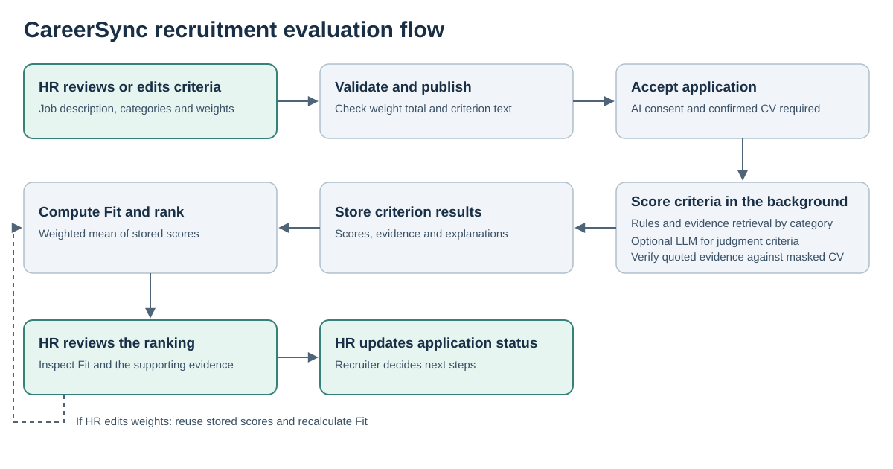

# 시스템 설계

CareerSync의 채용 지원 에이전트는 공고별 평가 기준과 지원자가 확인한 이력서를 입력으로 받아, 채용 담당자가 지원서를 일관되게 검토할 수 있도록 돕는다. 백엔드 개발자 공고를 예로 들면, 채용 담당자는 직무 설명을 입력하고 기술, 경력, 프로젝트 등 평가 항목과 가중치를 검토하거나 수정한다. 저장 시 서버는 가중치 합계와 차별 가능성이 있는 표현을 검사한다. 채용 담당자가 공고를 게시한 뒤 지원자가 AI 분석에 동의하고 확인된 이력서로 지원하면, 서버는 지원 기록을 저장하고 필요한 평가를 백그라운드에서 실행한다.

평가는 개인정보를 가린 이력서 원문과 구조화된 프로필을 사용한다. 기술, 경력, 학력, 자격증은 항목별 규칙으로 채점한다. 프로젝트와 기타 판단형 항목은 언어 모델이 활성화되어 있을 때 평가 루브릭에 따라 모델을 호출하고, 응답의 인용문이 원문에 있는지 확인한다. 모델을 사용하지 않는 기본 모드에서는 항목에 따라 규칙이나 근거 검색으로 처리한다. 서버는 항목별 점수, 근거 문장, 설명을 저장하고, 현재 적용되는 가중치의 가중평균으로 직무 적합도인 Fit을 계산한다. 게시 후 가중치만 수정하면 저장된 점수를 재사용하여 순위를 다시 계산한다. 담당자는 순위와 항목별 근거를 검토한 뒤 지원 상태를 직접 변경한다. 면접 진행과 합격 여부는 채용 담당자가 결정한다.

**그림.** 채용 담당자가 기준과 가중치를 확인하는 게시 전 단계부터 지원서 평가, 적합도 계산, 지원 상태 결정까지의 흐름. 가중치만 수정하면 저장된 항목별 점수로 적합도를 다시 계산한다.

## 구현 근거

- [기준 조회 및 저장 API](../../backend/app/api/v1/criteria.py)
- [지원 접수, 순위 산출, 상태 변경](../../backend/app/services/application_service.py)
- [평가 실행 및 결과 저장](../../backend/app/services/evaluation_service.py)
- [항목별 채점](../../ai/scoring/scorers.py)과 [가중평균](../../ai/scoring/fit.py)
- [평가 흐름과 채점 방식](../explanation/how-it-works.md)
